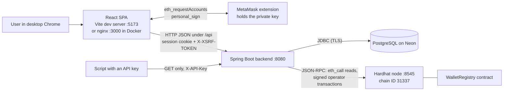
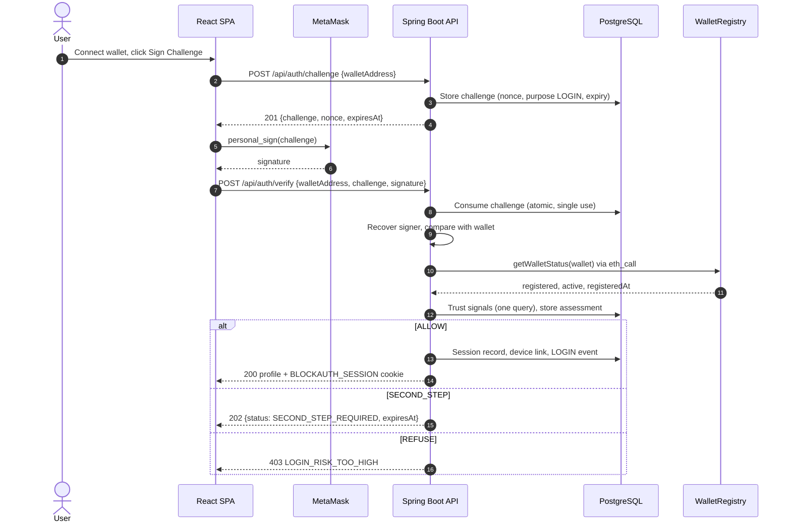

# BlockAuth — Blockchain-Based Authentication System

## Complete project details

This document explains the BlockAuth project from beginning to end. It is written for a new developer or a
college student who has not seen the code before. Every statement about the implementation was checked
against the source files in this repository. File paths are relative to the repository root.

---

## Table of contents

1. [Project title and team members](#1-project-title-and-team-members)
2. [Project summary](#2-project-summary)
3. [Introduction](#3-introduction)
4. [Technical stack](#4-technical-stack)
5. [Complete project architecture](#5-complete-project-architecture)
6. [Feature-by-feature documentation](#6-feature-by-feature-documentation)
7. [Authentication workflow](#7-authentication-workflow)
8. [Blockchain and smart contract details](#8-blockchain-and-smart-contract-details)
9. [Database and data management](#9-database-and-data-management)
10. [APIs, modules and important functions](#10-apis-modules-and-important-functions)
11. [Project setup and execution](#11-project-setup-and-execution)
12. [Security mechanisms](#12-security-mechanisms)
13. [Challenges faced during development](#13-challenges-faced-during-development)
14. [Project limitations](#14-project-limitations)
15. [Testing and verification](#15-testing-and-verification)
16. [Known issues and missing information](#16-known-issues-and-missing-information)
17. [Advantages and trade-offs](#17-advantages-and-trade-offs)
18. [Glossary of technical terms](#18-glossary-of-technical-terms)
19. [Conclusion](#19-conclusion)

---

## 1. Project title and team members

**Project title:** BlockAuth — Blockchain-Based Authentication System

**Official name in the code:** The project calls itself **BlockAuth** everywhere: the README title, the
Maven project name (`<name>BlockAuth</name>` in `backend/pom.xml`), the Java package `com.blockauth`, the
contract project `blockauth-contracts` and the page titles in the browser. The descriptive title above is a
longer form of that name.

**Repository name:** The GitHub repository is called `ai-augmented-decentralized-authentication-system`.
That name is older than the current code. The current code contains no artificial-intelligence or
machine-learning component (the "trust score" in section 6 is a fixed set of rules), and it is only
partly decentralized (see section 3.6). The repository name should not be read as a description of what
the code does.

**Project creators:**

- Karthik R Nair
- Sunny Singh
- Abhinand Biju Smitha

This document does not assign roles or contributions to individual team members. The repository does not
record them in a way that can be verified (see section 13.1 about the commit history).

---

## 2. Project summary

### 2.1 What is BlockAuth?

BlockAuth is a web application that lets people sign in **without a password**. Instead of typing a
password, a user proves that they control a blockchain wallet (an Ethereum account held in the MetaMask
browser extension). The proof is a **digital signature** over a one-time message. A small **smart
contract** on a blockchain keeps the official list of which wallets are registered and whether each one is
active or revoked. The server lets a user in only when the signature is correct **and** the contract says
the wallet is registered and active.

### 2.2 The problem

Most websites use passwords. Passwords have well-known weaknesses:

- People choose weak passwords or reuse the same password on many sites.
- Attackers guess passwords (brute force) or try leaked passwords from other sites (credential stuffing).
- The website must store password data. If that data leaks, many accounts are exposed.
- In a normal application, whether an account is "active" or "blocked" is just a value in the
  application's database. Anyone with write access to that database can change it without a trace
  outside that database.

### 2.3 Why the problem matters

An account is only as safe as its sign-in method. Stolen or guessed passwords are a common cause of account
takeover. Silent changes to account status are hard to detect and hard to prove afterwards.

### 2.4 How BlockAuth tries to solve it

1. **No password exists.** There is no password field, column or endpoint (`README.md`, and confirmed by
   the database schema in `backend/src/main/resources/db/migration/`).
2. **Proof of key ownership.** The server sends a random, single-use message. The user's wallet signs it.
   The server checks that the signature was made by the claimed wallet. The private key never leaves the
   wallet.
3. **An on-chain registry.** The `WalletRegistry` smart contract (`contracts/contracts/WalletRegistry.sol`)
   stores, for each wallet, whether it is registered and whether it is active or revoked. Only one
   administrator account (the server's "operator" key) can change it. Every change is a blockchain
   transaction with an event.
4. **A hardened web backend.** Around the core idea the project adds server-side sessions, role-based
   access, rate limiting, audit logs, an optional second step with authenticator codes, a rule-based trust
   score, fresh signatures for dangerous actions, an emergency stop, delayed administrator actions and
   read-only API keys.

### 2.5 Who can use the system?

- **Users** with the MetaMask extension in a desktop browser. They register a wallet once and then sign in
  with it.
- **Administrators** (wallets listed in the `BLOCKAUTH_ADMIN_WALLETS` setting at the time they register).
  They can revoke and reactivate wallets, see statistics and logs, and use the security controls.
- **Scripts and monitoring tools**, through read-only API keys created by an administrator.

### 2.6 Expected result

When everything works, a registered and active wallet signs a message, and the user lands on their
dashboard with a server-side session. A wallet that is unknown or revoked on the blockchain is refused. An
administrator who revokes a wallet ends its sessions; its next request is refused and it cannot sign in
again until it is reactivated.

### 2.7 Intended purpose versus what is implemented

| Intended purpose | What the code actually does |
|---|---|
| Passwordless sign-in | Implemented: challenge-response with EIP-191 signatures. |
| Blockchain as the source of truth for account status | Implemented for **registered / active / revoked** status only. Roles, sessions and all other data live in PostgreSQL. |
| Decentralization | Limited. The blockchain is a **local Hardhat development chain** (chain ID 31337). One server-held operator key controls the contract. No public network is configured. |
| Security against common attacks | Many protections are implemented and tested (section 12). Some limits remain (section 14). |
| Production use | Not configured. There is no hosted deployment; the repository supports local runs and a Docker Compose stack. |

---

## 3. Introduction

### 3.1 Background and motivation

Authentication means answering the question "who are you?". For decades the usual answer has been a
username and a password. Blockchain wallets offer another option: each wallet has a **private key** that
only its owner holds, and a **public address** that anyone can see. If someone can produce a valid
signature for an address, they hold that address's private key. BlockAuth uses this fact to replace
passwords.

### 3.2 The authentication problem being addressed

BlockAuth addresses two questions:

1. **Is this really the owner of the wallet?** Answered by a signature over a fresh, random message.
2. **Is this wallet allowed in right now?** Answered by the `WalletRegistry` contract, which an
   administrator can change (revoke or reactivate).

### 3.3 The basic idea

```text
Server: "Please sign this one-time message."  ->  Wallet signs it with its private key
Server: checks the signature                    ->  recovers the signer's address
Server: asks the smart contract                 ->  is this address registered and active?
Server: both answers are yes                    ->  start a session
```

### 3.4 How traditional authentication usually works

1. The user creates a password at registration.
2. The server stores a hash of the password in its database.
3. At login the user types the password; the server hashes it and compares.
4. On success, the server creates a session (or issues a token).
5. Whether the account is active is a column in the same database.

### 3.5 How BlockAuth differs

| Topic | Traditional password login | BlockAuth |
|---|---|---|
| What the user proves | Knowledge of a password | Control of a private key (signature) |
| What the server stores to check it | A password hash | Nothing secret: only the public address |
| Replay of a captured login | A stolen password works again | Each challenge works once and expires (default 120 seconds) |
| Where "active / blocked" lives | Application database | Smart contract on a blockchain (mirrored in the database) |
| Who can change the status | Anyone with database write access | Only the contract's admin account (the server's operator key) |
| Recovery if the secret is lost | Password reset by e-mail | **None for the wallet key.** BlockAuth has no account-recovery flow for a lost wallet. |
| What the user needs | A browser | A desktop browser with the MetaMask extension |

### 3.6 Why a blockchain is used, and what it does and does not give

What the code confirms:

- The contract keeps, per wallet, a status (`None`, `Active`, `Revoked`) and a registration time.
- Only the contract's `admin` (set once, when the contract is deployed) can call `registerWallet`,
  `revokeWallet` and `activateWallet`.
- Each change emits an event (`WalletRegistered`, `WalletRevoked`, `WalletActivated`) that is part of the
  chain's history.
- A wallet can never go back to "not registered" (contract test "a wallet can never return to the
  unregistered state").

What this means in practice:

- A change to a wallet's status cannot be made by editing the database. The backend reads the chain at
  every sign-in and corrects its database copy (`UserService.walletState`).
- The status history is visible as events on the chain.

What it does **not** mean:

- It is **not** fully decentralized. The backend holds the only key that can change the registry. Whoever
  holds that key can change any wallet's status.
- It is **not** permanent or independent in this repository's setup. The configured chain is a local
  Hardhat node. Restarting it (or `docker compose down`) erases the whole chain, as the README warns.
- The blockchain does not make the whole system secure by itself. Sessions, roles, second step data and
  logs are in an ordinary PostgreSQL database and are protected by ordinary server-side measures.

### 3.7 Benefits and trade-offs (short version)

Benefits: no password to steal or reuse; one-time challenges stop replay; status changes need the
operator key and leave events on-chain; the user never pays gas or sends a transaction.

Trade-offs: MetaMask is required; there is no recovery for a lost wallet key; the chain adds another
service that must be running; the operator key is a single powerful secret. Section 17 discusses these in
more detail.

---

## 4. Technical stack

Versions come from `frontend/package-lock.json`, `contracts/package-lock.json`, `backend/pom.xml` and the
Dockerfiles. "Locked" means the exact version installed by the lock file.

### 4.1 Summary table

| Category | Technology | Version (source) |
|---|---|---|
| Frontend library | React, React DOM | 19.3.0 (locked) |
| Frontend routing | React Router (`react-router-dom`) | 7.18.4 (locked) |
| Frontend build tool | Vite with `@vitejs/plugin-react` | 8.3.3 / 6.1.2 (locked) |
| Frontend language and styling | JavaScript (no TypeScript), plain CSS | — |
| Wallet | MetaMask browser extension (EIP-1193 provider) | not pinned (user installs it) |
| Backend language | Java | 21 (`pom.xml`, Dockerfile `eclipse-temurin:21`) |
| Backend framework | Spring Boot (Web MVC, Security, Data JPA, Validation, Actuator, Flyway starters) | 4.1.1 (parent POM) |
| Blockchain client library | Web3j `core` | 5.0.0 (`pom.xml`) |
| Cryptography provider | Bouncy Castle `bcprov-jdk18on` | 1.86 (`pom.xml`) |
| Database | PostgreSQL (hosted on Neon, per README and `.env.example`) | server version not pinned in the repo |
| Database driver and migrations | PostgreSQL JDBC driver, Flyway (`flyway-database-postgresql`) | managed by Spring Boot |
| Smart contract language | Solidity | 0.8.24 (`hardhat.config.js`, `pragma ^0.8.24`) |
| Smart contract framework | Hardhat, `@nomicfoundation/hardhat-toolbox` | 2.29.1 / 6.1.2 (locked) |
| Contract test libraries (via toolbox) | Mocha, Chai, ethers.js | 11.8.0 / 4.5.0 / 6.17.0 (locked) |
| Backend tests | JUnit 5, Spring Boot Test, Spring Security Test, Mockito (`@MockitoBean`) | managed by Spring Boot |
| API tests | Postman collection | `postman/BlockAuth.postman_collection.json` (84 requests) |
| Security scanning | OWASP ZAP (run in Docker) | `ghcr.io/zaproxy/zaproxy:stable` per `security-tests/zap/README.md` |
| Builds | Maven Wrapper (`backend/mvnw`, `mvnw.cmd`), npm | — |
| Containers (optional) | Docker Compose, `eclipse-temurin:21` images, `node:22-alpine`, `nginx:alpine` | Dockerfiles |

### 4.2 Each technology in this project

**React and React Router (frontend).**
Purpose: the single-page application (SPA) the user sees. Location: `frontend/src/`. Pages are in
`frontend/src/pages/`, shared components in `frontend/src/components/`, routes in `frontend/src/App.jsx`.
Interaction: calls the backend through `frontend/src/api/client.js` and the wallet through
`frontend/src/wallet/metamask.js`. Role: every screen, form and table.

**Vite (frontend build and dev server).**
Purpose: starts the development server on port 5173 and builds the production files into `frontend/dist`.
Location: `frontend/vite.config.js`. Interaction: in development it proxies `/api` to
`http://localhost:8080`, so the app and the API share one origin and no CORS setup is needed.

**Plain CSS.**
Purpose: all styling, in one file, `frontend/src/styles/global.css`, built on CSS custom properties
(design tokens). The project specification forbids CSS frameworks and component libraries, and none are
installed.

**MetaMask (wallet).**
Purpose: holds the user's private key and signs messages. Location: only
`frontend/src/wallet/metamask.js` talks to it, through `window.ethereum.request` with the methods
`eth_requestAccounts` and `personal_sign`. Users never send blockchain transactions from MetaMask.

**Java 21 and Spring Boot 4.1.1 (backend).**
Purpose: the REST API. Location: `backend/src/main/java/com/blockauth/`. Spring Web MVC handles HTTP,
Spring Security handles sessions, CSRF and authorization, Spring Data JPA (Hibernate) maps tables to
classes, Jakarta Bean Validation checks request bodies, Actuator exposes only `/actuator/health`, and
Spring scheduling runs background jobs (`@EnableScheduling` in `BlockAuthApplication.java`).

**Web3j 5.0.0 (blockchain client).**
Purpose: talks to the blockchain over JSON-RPC, signs the operator's transactions and recovers signers
from signatures. Location: `blockchain/WalletRegistryClient.java` (contract calls and transactions),
`auth/SignatureVerifier.java` (signature recovery), `common/WalletAddresses.java` (EIP-55 checksums),
`config/Web3jConfig.java` (HTTP client with 5-second timeouts).

**Bouncy Castle.**
Purpose: cryptographic provider used by Web3j. `pom.xml` replaces Web3j's older `bcprov-jdk15on` with the
maintained `bcprov-jdk18on` 1.86.

**PostgreSQL, Flyway and Hibernate (database).**
Purpose: stores users, challenges, sessions, devices, second-step data, flags, assessments, delayed
actions, API keys and audit events. Location: schema in
`backend/src/main/resources/db/migration/V1__init_schema.sql` and `V2__security_features.sql`. Flyway
applies the migrations at startup. Hibernate runs with `ddl-auto: validate`, so it checks the Java
entities against the schema but never changes the schema itself. Connection pool: HikariCP with at most 5
connections (`application.yml`).

**Neon (database hosting).**
Documented in the README and `.env.example` as the PostgreSQL host, with a separate `test` branch for
integration tests. The code itself only needs a PostgreSQL JDBC URL; Neon-specific features are not used
in the code. The connection details live only in the local `.env.local` file.

**Solidity 0.8.24 and Hardhat 2 (smart contract).**
Purpose: `contracts/contracts/WalletRegistry.sol` is the on-chain registry. Hardhat compiles it, runs its
tests (`contracts/test/WalletRegistry.test.js`), runs a local node (`npx hardhat node`, chain ID 31337) and
deploys it (`contracts/scripts/deploy.js`).

**Cryptographic algorithms actually used (all in the backend):**

| Algorithm | Where | What for |
|---|---|---|
| secp256k1 ECDSA signature recovery, EIP-191 `personal_sign` prefix | `auth/SignatureVerifier.java` via Web3j `Sign.signedPrefixedMessageToKey` | Proving wallet ownership |
| Keccak-256 (inside Web3j) | address derivation and EIP-55 checksums | Wallet addresses |
| SHA-256 | `common/Tokens.sha256Hex` | Stored form of device tokens and API key secrets |
| HMAC-SHA256 | `common/Tokens.hmacSha256Hex` | Stored form of backup codes; derivation of the backup-code key |
| HMAC-SHA1 (RFC 6238 TOTP) | `secondstep/Totp.java` | Authenticator-app codes |
| AES-256-GCM | `secondstep/SecretBox.java` | Encrypting authenticator secrets at rest |
| `SecureRandom` | `ChallengeMessageFactory`, `Tokens`, `SecondStepService` | Nonces, tokens, secrets, backup codes |

**APIs and protocols:** JSON over HTTP(S) between the browser and the backend (all endpoints under `/api`);
JSON-RPC over HTTP between the backend and the blockchain node; JDBC over TLS (`sslmode=require` in the
README example) between the backend and PostgreSQL; EIP-1193 between the page and MetaMask.

**Deployment infrastructure:** `docker-compose.yml` defines three services (Hardhat node, backend,
frontend served by nginx). `frontend/nginx.conf` serves the built SPA, forwards `/api/` to the backend and
adds security headers. No cloud deployment, CI pipeline or infrastructure-as-code exists in the repository.

**Not used (checked):** no TypeScript, no Tailwind or UI component library, no ethers.js or web3.js in the
frontend, no JWT, no Redis, no CORS configuration, no e-mail service, no AI or machine-learning library.

---

## 5. Complete project architecture

### 5.1 Main components

| Component | Folder | Responsibility |
|---|---|---|
| Web app (SPA) | `frontend/` | Pages, wallet connection, asking MetaMask for signatures, showing results. Keeps the signed-in user only in memory (no web storage). |
| MetaMask | user's browser | Holds the private key; signs messages when the user approves. |
| Backend API | `backend/` | Challenges, signature checks, contract reads and writes, sessions, roles, validation, rate limits, trust score, audit logs, admin features, background jobs. |
| Smart contract | `contracts/` | Authoritative registered / active / revoked status per wallet. |
| Blockchain node | Hardhat (`npx hardhat node` or the `hardhat` Docker service) | Runs the local chain the contract lives on. |
| Database | PostgreSQL (Neon) | All off-chain data (section 9). |

### 5.2 Architecture diagram



### 5.3 How the parts talk to each other

**Frontend to backend.** All calls go through `frontend/src/api/client.js`:

- Same-origin requests with cookies (`credentials: 'same-origin'`).
- For every `POST`, it makes sure an `XSRF-TOKEN` cookie exists (fetching `GET /api/auth/csrf` if not) and
  sends its value in the `X-XSRF-TOKEN` header.
- If the server answers `CSRF_INVALID`, it fetches a new token and retries once.
- Errors become an `ApiError` object with `status`, `code`, `retryAfter`, `errorId` and `fieldErrors`.
- A `401` from a protected endpoint tells `AuthContext` that the session ended; it then shows a notice and
  goes to the login page.

**Backend to database.** Spring Data JPA repositories (for example `user/UserRepository.java`,
`session/UserSessionRepository.java`) plus one hand-written SQL query in `risk/TrustService.java` run
through `NamedParameterJdbcTemplate`.

**Backend to blockchain.** Only `blockchain/WalletRegistryClient.java` talks to the chain:

- Reads (`getWalletStatus`, `admin`) are `eth_call` requests and cost nothing.
- Writes (`registerWallet`, `revokeWallet`, `activateWallet`) are transactions signed with the operator
  private key and sent with `eth_sendRawTransaction`. The client then waits for the receipt.

**Frontend to MetaMask.** Only `frontend/src/wallet/metamask.js`. `connectWallet()` asks for the account;
`signMessage()` sends the exact challenge text, hex-encoded, to `personal_sign`.

### 5.4 Authentication and authorization boundaries

- **Public:** `GET /api/auth/csrf`, `GET /actuator/health`, and the `POST` endpoints for challenges,
  registration, verification, second step and logout.
- **Signed-in user (role `USER` or `ADMIN`):** everything under `/api/users/**` and `POST /api/auth/step-up`.
- **Administrator (`ADMIN`):** everything under `/api/admin/**` and `/api/blockchain/**`.
- **API key with a scope:** only five admin read endpoints plus the two `/api/blockchain` reads, each tied to
  one scope.
- **Everything else:** denied (`anyRequest().denyAll()` in `config/SecurityConfig.java`).

The frontend's route guards (`components/RequireAuth.jsx`, `components/RequireAdmin.jsx`) only decide what
to show. The server checks every request itself.

### 5.5 Security-sensitive operations

- Signing operator transactions (holds the operator private key in memory).
- Verifying wallet signatures.
- Creating and ending sessions.
- Encrypting and decrypting authenticator secrets (`SECOND_STEP_ENCRYPTION_KEY`).
- Creating API keys (the secret is shown once and only its hash is stored).
- Revoking wallets, the emergency stop and delayed actions.

### 5.6 External dependencies at run time

- A blockchain JSON-RPC endpoint with the contract deployed (`BLOCKCHAIN_RPC_URL`, `CONTRACT_ADDRESS`).
- A PostgreSQL database (`DB_URL` and credentials).
- MetaMask in the user's browser.

### 5.7 Directory and file structure

```text
.
├── README.md                         Project overview, setup, API list, troubleshooting
├── CompleteDetails.md                This document
├── .env.example                      Template of all settings (placeholders only)
├── .gitignore, .gitattributes        Git settings (.env.* files are ignored)
├── docker-compose.yml                Optional local stack: hardhat, backend, frontend
├── backend/                          Spring Boot API (Maven)
│   ├── pom.xml                       Dependencies and build; "blockchain-it" test profile
│   ├── mvnw, mvnw.cmd, .mvn/         Maven Wrapper
│   ├── Dockerfile                    Two-stage build, runs as a non-root user
│   └── src/
│       ├── main/java/com/blockauth/
│       │   ├── BlockAuthApplication.java   Entry point; enables scheduling; system UTC clock
│       │   ├── auth/         Challenges, signature check, registration, login, second step at sign-in,
│       │   │                 sessions (SessionService), step-up (fresh signatures), challenge cleanup
│       │   ├── user/         User entity, own profile, history, own wallet status
│       │   ├── admin/        Wallet revoke/reactivate, statistics, emergency stop, delayed actions
│       │   ├── blockchain/   WalletRegistryClient, startup checks, on-chain lookup endpoints
│       │   ├── session/      Session records, devices, device cookie, sign-in alerts, session endpoints
│       │   ├── secondstep/   TOTP, AES-GCM secret box, backup codes, second-step endpoints
│       │   ├── risk/         Trust score (TrustPolicy, TrustService), wallet flags, assessments
│       │   ├── apikey/       Read-only API keys and the X-API-Key filter
│       │   ├── audit/        Authentication and security events
│       │   ├── security/     Filters (rate limit, origin, active session, size limit), 401/403 handlers
│       │   ├── common/       Error catalog, exception handler, tokens, address validation, paging
│       │   └── config/       Spring Security setup, typed settings, Web3j client, JSON-only responses
│       ├── main/resources/
│       │   ├── application.yml, application-dev.yml, application-prod.yml, application-test.yml
│       │   └── db/migration/V1__init_schema.sql, V2__security_features.sql
│       └── test/java/com/blockauth/   Unit tests (*Test) and integration tests (*IT)
├── frontend/                         React SPA (Vite)
│   ├── index.html, vite.config.js, package.json, package-lock.json
│   ├── nginx.conf, Dockerfile        Production serving in Docker, with security headers
│   ├── public/favicon.svg
│   └── src/
│       ├── main.jsx, App.jsx         Bootstrapping and routes
│       ├── api/                      client.js (fetch wrapper), auth.js, stepUp.js, useApi.js
│       ├── context/AuthContext.jsx   Signed-in user, wallet address, login/logout
│       ├── wallet/metamask.js        The only MetaMask code
│       ├── components/               Layout, NavBar, tables, dialogs, alerts, form fields, guards
│       ├── pages/                    11 pages (see section 6)
│       ├── utils/                    format.js, messages.js, events.js
│       └── styles/global.css         All styles and design tokens
├── contracts/                        Hardhat project
│   ├── contracts/WalletRegistry.sol  The smart contract
│   ├── scripts/deploy.js             Deployment script
│   ├── test/WalletRegistry.test.js   15 contract tests
│   ├── hardhat.config.js             Solidity 0.8.24, "localhost" network (chain 31337)
│   └── Dockerfile                    Image for the Hardhat node
├── postman/BlockAuth.postman_collection.json   84 API requests in 6 folders
└── security-tests/zap/               OWASP ZAP instructions, results table, API description
```

---

## 6. Feature-by-feature documentation

Each feature below uses the same headings. "Status" uses these labels:
**Fully implemented**, **Partially implemented**, **Documented only**, **Missing**, **Not verifiable**.
The four sign-in flows (registration, login, second step at sign-in, logout) are described step by step in
section 7; their entries here point there to avoid repeating the same steps.

### 6.1 Connecting a wallet

- **Purpose / problem:** The app needs to know which wallet address the user wants to use before it can ask
  for a challenge.
- **Trigger:** The user clicks **Connect Wallet** (Home, Register or Login page).
- **Workflow:**
  1. `WalletConnectButton.jsx` checks `isMetaMaskAvailable()` (is `window.ethereum` present?).
  2. It calls `connect()` in `AuthContext.jsx`, which calls `connectWallet()` in `wallet/metamask.js`.
  3. MetaMask asks the user which account to share and returns the address (`eth_requestAccounts`).
  4. The address is kept in React state (`walletAddress`). Nothing is sent to the server yet.
  5. `onAccountsChanged` listens for account switches. If the user switches to another account while signed
     in, the app logs out with the notice "Wallet changed — you have been signed out."
- **Frontend:** `components/WalletConnectButton.jsx`, `context/AuthContext.jsx`, `wallet/metamask.js`.
- **Backend / database / blockchain:** none.
- **Security:** only the public address is shared. Connecting proves nothing; ownership is proven later by
  signing.
- **Errors:** without MetaMask the button is disabled and a notice links to metamask.io. A rejected request
  (MetaMask code 4001) or an already open request (-32002) is shown in plain words
  (`utils/messages.js`).
- **Status:** Fully implemented. Checked in this repository with a simulated wallet; a run with the real
  MetaMask extension is outside what an automated check can do (section 15).

### 6.2 Wallet registration

- **Purpose / problem:** Adds a wallet to the on-chain registry after proving the user owns it.
- **Trigger:** **Sign & Register** on the Register page.
- **Workflow:** see section 7.2.
- **Frontend:** `pages/Register.jsx`, `components/SignChallengeFlow.jsx`, `api/auth.js` (`signAndSubmit('register', …)`).
- **Backend:** `auth/AuthController.java` (`POST /api/auth/register/challenge`, `POST /api/auth/register`),
  `auth/ChallengeService.java`, `auth/SignatureVerifier.java`, `auth/RegistrationService.java`,
  `user/UserService.java`.
- **Database:** `authentication_challenges` (challenge row, consumed once), `users` (new row with role and
  status), `authentication_events` (`REGISTRATION` event), `security_events` on suspicious failures.
- **Blockchain:** `getWalletStatus` read, then `registerWallet(wallet)` transaction from the operator
  account, then a second read.
- **Security:** single-use, expiring, wallet-bound challenge; signature recovered from the stored text, not
  from the client's copy; blocked during an emergency stop.
- **Output:** `201` with `walletAddress` (checksummed), `role`, `status`, `registeredAt`,
  `transactionHash`. No session is created; the user logs in next.
- **Errors:** `WALLET_ALREADY_REGISTERED` (409), `WALLET_REVOKED` (403), `STATE_CONFLICT` (409, see
  7.2), `BLOCKCHAIN_TX_FAILED` (502), `BLOCKCHAIN_UNAVAILABLE` (503), `BLOCKCHAIN_TIMEOUT` (504),
  `EMERGENCY_STOP_ACTIVE` (503), plus all challenge and signature errors.
- **Dependencies:** Web3j, PostgreSQL, a running chain.
- **Status:** Fully implemented. Evidence: `RegistrationFlowIT`, `RegistrationServiceTest`,
  `WalletRegistryClientIT` (real chain).

### 6.3 Login (challenge-response sign-in)

- **Purpose / problem:** Signs a user in without a password.
- **Trigger:** **Sign Challenge** on the Login page.
- **Workflow:** see section 7.3.
- **Frontend:** `pages/Login.jsx`, `components/SignChallengeFlow.jsx` (shows the exact message and a
  countdown to its expiry), `context/AuthContext.jsx` (`login`).
- **Backend:** `AuthController` (`POST /api/auth/challenge`, `POST /api/auth/verify`),
  `auth/LoginService.java`, `risk/TrustService.java`, `session/SessionRegistry.java`,
  `auth/SessionService.java`, `admin/EmergencyStopService.checkSignIn`.
- **Database:** `authentication_challenges`, `users`, `login_assessments`, `devices`, `user_devices`,
  `user_sessions`, `sign_in_alerts`, `authentication_events`, `security_events`.
- **Blockchain:** one `getWalletStatus` read per login. No transaction.
- **Security:** challenge rules as above; fail-closed checks; session fixation defence; CSRF token rotated.
- **Output:** `200` with the profile and a new `BLOCKAUTH_SESSION` cookie, or `202`
  `SECOND_STEP_REQUIRED` with an expiry time.
- **Errors:** `WALLET_NOT_REGISTERED`, `WALLET_REVOKED`, `REGISTRATION_INCOMPLETE`,
  `LOGIN_RISK_TOO_HIGH`, `RISK_CHECK_UNAVAILABLE`, `EMERGENCY_STOP_ACTIVE`, challenge and signature errors,
  `IP_TEMPORARILY_BLOCKED`, `RATE_LIMITED`.
- **Status:** Fully implemented. Evidence: `LoginFlowIT`, `LoginServiceTest`, `TrustScoreIT`.

### 6.4 Second step at sign-in (authenticator or backup code)

- **Purpose / problem:** A signature alone may not be enough when a sign-in looks unusual (new device, new
  network, flagged wallet). A second factor is then asked for.
- **Trigger:** `POST /api/auth/verify` answers `202`; the Login page shows a code form.
- **Workflow:** see section 7.4.
- **Frontend:** `SecondStepForm` inside `pages/Login.jsx`; `completeSecondStep` in `AuthContext.jsx`.
- **Backend:** `LoginService.completeSecondStep`, `auth/PendingSecondStep.java`,
  `secondstep/SecondStepService.verifyCode`.
- **Database:** `second_factors.last_used_step` (a code is accepted once), `backup_codes.used_at`,
  `user_sessions.second_step = true`, `user_devices.trusted_until`.
- **Security:** the pending attempt lives only in the server session of the browser that signed; at most 5
  tries and 5 minutes.
- **Output:** `200` with the profile and a session; the device becomes trusted for `TRUSTED_DEVICE_DAYS`
  (default 30).
- **Errors:** `SECOND_STEP_INVALID` (401), `SECOND_STEP_EXPIRED` (401; the wallet must sign again),
  `WALLET_REVOKED`, `EMERGENCY_STOP_ACTIVE`.
- **Status:** Fully implemented. Evidence: `SecondStepIT`, `TotpTest`, `SecretBoxTest`.

### 6.5 Sessions and logout

- **Purpose / problem:** After a successful sign-in the browser needs to stay signed in safely, and the
  server must be able to end a session at any time.
- **Trigger:** Successful login; every later API call; **Logout** button.
- **Workflow (per request):** `security/ActiveUserFilter.java` runs on every authenticated request:
  1. Reads the session record and its user in one query (`UserSessionRepository.findWithUser`).
  2. If the record is missing or ended, or the user's status is `REVOKED`, it invalidates the session,
     records `SESSION_TERMINATED` where relevant, and answers `401 SESSION_REVOKED`.
  3. Otherwise it reloads the role from the database (so a changed role takes effect at once) and, at most
     once a minute, updates `last_seen_at`.
  4. If the database cannot answer, it fails closed with `503 DATABASE_UNAVAILABLE`.
- **Logout workflow:** see section 7.5.
- **Frontend:** `NavBar.jsx` and `Dashboard.jsx` (Logout), `AuthContext.logout`, `api/client.js` (`401`
  handling).
- **Backend:** `auth/SessionService.java`, `security/ActiveUserFilter.java`, `session/SessionLifecycle.java`
  (closes a record when a session times out and closes all open records at startup with reason `RESTART`).
- **Database:** `user_sessions` (end reasons `LOGOUT`, `REMOTE_LOGOUT`, `EXPIRED`, `WALLET_REVOKED`,
  `RESTART`, `EMERGENCY_STOP`, `DEVICE_REMOVED`, `RELOGIN`).
- **Security:** `HttpOnly`, `SameSite=Strict` cookie, `Secure` by default, 30-minute idle timeout
  (`SESSION_TIMEOUT`), new session ID at login.
- **Status:** Fully implemented. Evidence: `LogoutIT`, `RevocationFlowIT`, `SessionManagementIT`.

### 6.6 Roles and administrator bootstrap

- **Purpose / problem:** Separates normal users from administrators.
- **Trigger:** Registration.
- **Workflow:** `UserService.create` gives the new user `ADMIN` if the wallet is listed in
  `BLOCKAUTH_ADMIN_WALLETS`, otherwise `USER`. The list is validated at startup
  (`config/BlockAuthProperties.java`); an entry that looks like a private key stops the startup with a
  warning that does not print the value.
- **Database:** `users.role`, marked `updatable = false` in `user/User.java`: the application never changes
  a role after creation.
- **Security:** roles come only from the database and are re-read on every request; the client cannot set
  them.
- **Limitation:** there is no endpoint or screen to promote or demote a user. Changing a role needs a manual
  database change (README troubleshooting says to list the address and register again).
- **Status:** Fully implemented as designed. Evidence: `ConfiguredAdminWalletsIT`,
  `AdminWalletsBindingTest`, `AuthorizationMatrixIT`.

### 6.7 User dashboard and profile

- **Purpose:** Shows the signed-in wallet, session state, account status, role and registration date.
- **Trigger:** Opening `/dashboard`.
- **Frontend:** `pages/Dashboard.jsx` (uses the user object already loaded by `AuthContext` from
  `GET /api/users/me`).
- **Backend:** `user/UserController.me`.
- **Status:** Fully implemented.

### 6.8 Authentication history

- **Purpose:** Lets users see every attempt made with their wallet, including refused ones.
- **Trigger:** Opening `/history`; changing the event filter or page.
- **Frontend:** `pages/History.jsx` with `DataTable`, `Pagination`, `SelectFilter`.
- **Backend:** `GET /api/users/authentication-history?page&size&eventType` → `AuditService.historyOf`.
  Always scoped to the caller's user ID; no parameter can select another user.
- **Database:** `authentication_events` filtered by `user_id`.
- **Status:** Fully implemented. Evidence: `HistoryScopeIT`.

### 6.9 Own wallet status from the blockchain

- **Purpose:** Shows what the contract says about the user's own wallet.
- **Trigger:** Opening `/wallet-status` or pressing **Refresh from blockchain**.
- **Backend:** `GET /api/users/wallet-status` → `UserService.chainStatus` → `WalletRegistryClient.getWalletStatus`.
  Reading the chain also corrects the database mirror if it has drifted.
- **Output:** `walletAddress`, `registered`, `active`, `status` (`ACTIVE`, `REVOKED`, `NOT_REGISTERED`),
  `registeredAt`, `source: "BLOCKCHAIN"`.
- **Errors:** `503 BLOCKCHAIN_UNAVAILABLE` when the node does not answer.
- **Status:** Fully implemented.

### 6.10 Managing signed-in sessions

- **Purpose / problem:** A user who suspects misuse can see where the wallet is signed in and end those
  sessions.
- **Trigger:** **Account security** page.
- **Frontend:** `Sessions` section of `pages/AccountSecurity.jsx`.
- **Backend:** `session/SessionController.java` and `session/SessionManagement.java`:
  `GET /api/users/sessions`, `POST /api/users/sessions/{id}/end`, `POST /api/users/sessions/end-others`.
- **Workflow:** ending a session sets `ended_at` and `end_reason = REMOTE_LOGOUT`; that session's next
  request is refused by `ActiveUserFilter`. The current session cannot be ended here (`CURRENT_DEVICE`, use
  Logout). An ID that belongs to someone else answers `404 RESOURCE_NOT_FOUND`.
- **Database:** `user_sessions`; `authentication_events` (`REMOTE_LOGOUT`).
- **Status:** Fully implemented. Evidence: `SessionManagementIT`.

### 6.11 Device recognition and device list

- **Purpose / problem:** The trust score and the alerts need to know whether a browser has been used
  before.
- **Trigger:** First successful sign-in on a browser; **Forget** on the Account security page.
- **Workflow:**
  1. At the first sign-in on a browser, `SessionRegistry.start` creates a random 32-byte token, stores only
     its SHA-256 hash in `devices.token_hash`, and sends the token in the `BLOCKAUTH_DEVICE` cookie
     (`HttpOnly`, `SameSite=Strict`, 400 days, `session/DeviceCookie.java`).
  2. Later sign-ins send the cookie; `SessionRegistry.recognise` looks up the hash.
  3. A readable label such as "Chrome on Windows" is derived from the User-Agent header for display only
     (`session/DeviceLabels.java`).
  4. **Forget** (`POST /api/users/devices/{id}/remove`) marks the link removed, ends all of the user's
     sessions on that device and makes its next sign-in count as new.
- **Database:** `devices`, `user_devices` (first/last seen, `trusted_until`, `removed_at`).
- **Security:** the cookie is only a recognition hint; it proves nothing on its own.
- **Status:** Fully implemented. Evidence: `SessionManagementIT`, `SignInAlertIT`.

### 6.12 New sign-in alerts

- **Purpose / problem:** Warns the wallet owner when the wallet signs in on a new device.
- **Trigger:** A sign-in on a device that is new for this user while the user already has another device.
- **Workflow:** `SessionRegistry.start` stores a `sign_in_alerts` row. Other sessions of the same user see
  a banner on every page (`SignInAlertBanner` in `components/Layout.jsx`) and the alert on the Account
  security page with two buttons:
  - **This was me** → `POST /api/users/alerts/{id}/confirm` (resolution `CONFIRMED`).
  - **This was not me** → `POST /api/users/alerts/{id}/sign-out`: ends that session, forgets its device
    and records `REMOTE_LOGOUT` (resolution `SIGNED_OUT`).
- **Limitation:** alerts appear inside the app only. No e-mail, SMS or push notification exists.
- **Status:** Fully implemented (in-app only). Evidence: `SignInAlertIT`.

### 6.13 Managing the second step (authenticator app and backup codes)

- **Purpose:** Lets a user turn the second step on or off and renew backup codes.
- **Trigger:** **Second step** section of `pages/AccountSecurity.jsx`.
- **Workflow (turn on):**
  1. `POST /api/users/second-step/setup` creates a 20-byte secret, encrypts it with AES-256-GCM and stores
     it (not yet enabled). It returns the Base32 secret and an `otpauth://` link once.
  2. The user adds it to an authenticator app and types the current 6-digit code.
  3. The page asks for a fresh signature (feature 6.15) and sends `POST /api/users/second-step/enable` with
     `{ code, proof }`.
  4. The server checks the code, then the signature, then enables the factor, creates 10 backup codes
     (shown once, stored as HMAC-SHA256) and marks the current device trusted.
- **Turn off / renew:** `POST /api/users/second-step/disable` and `POST /api/users/second-step/backup-codes`,
  both with a valid current code (or backup code) and a fresh signature.
- **Rate limit:** 5 code attempts per user per 5 minutes on these management actions.
- **Database:** `second_factors`, `backup_codes`, `authentication_events` (`SECOND_STEP_ENABLED`,
  `SECOND_STEP_DISABLED`, `BACKUP_CODES_RENEWED`).
- **Errors:** `VERIFICATION_CODE_INVALID`, `SECOND_STEP_ALREADY_ENABLED`, `SECOND_STEP_NOT_ENABLED`,
  `SECOND_STEP_SETUP_MISSING`, `STEP_UP_FAILED`, `RATE_LIMITED`.
- **Note:** the setup returns a text key and a link, not a QR code image. The frontend shows both as text.
- **Status:** Fully implemented. Evidence: `SecondStepIT`.

### 6.14 Trust score for each sign-in

- **Purpose / problem:** Decides whether a valid signature is enough, or whether the second step is also
  needed.
- **Trigger:** Every login whose signature and chain status checked out.
- **Workflow:** `TrustService.assess` reads six signals in **one SQL query** and passes them to the pure
  function `TrustPolicy.score`. The score starts at 100 and loses a penalty for each rule:

  | Rule | Default penalty | When it applies |
  |---|---:|---|
  | `NEW_DEVICE` | 30 | The wallet has signed in before and this device is unknown (or, when the second step is on, not currently trusted) |
  | `NEW_NETWORK` | 20 | The wallet has signed in before but never from this IP address |
  | `FLAGGED_WALLET` | 35 | An administrator flagged this wallet |
  | `REPEATED_FAILURES` | 25 | 3 or more failed or blocked attempts from this IP in the last hour |
  | `LINKED_TO_FLAGGED` | 35 | The wallet shares a device with a flagged wallet, up to 3 device hops away |

  `TrustPolicy.decide` then picks:
  - score **90 or more** → `ALLOW` (signature is enough);
  - below 90 and the wallet **has** a second step → `SECOND_STEP`;
  - below 90, no second step, score **50 or more** → `ALLOW`;
  - below 50 and no second step → `REFUSE` (`403 LOGIN_RISK_TOO_HIGH`, recorded as `LOW_TRUST_LOGIN`).

  If the query fails, the decision is `SECOND_STEP` for wallets that have one and `REFUSE` (`503
  RISK_CHECK_UNAVAILABLE`) for the others. A sign-in is never let through because the check failed.
- **Database:** every result is stored in `login_assessments` (score, rules, decision).
- **Frontend:** results are listed under Admin → Security → **Sign-in risk**.
- **Settings:** all thresholds and penalties are under `blockauth.security.trust.*` in `SecuritySettings`
  (startup fails if `second-step-at` is not below `allow-at`). They are not listed in `.env.example`.
- **Important:** the score is a fixed rule set. It is not machine learning. The code calls it "a risk
  indicator, never proof of identity". The default numbers are starting values, not tuned figures
  (README, Known limitations).
- **Status:** Fully implemented. Evidence: `TrustPolicyTest`, `TrustServiceTest`, `TrustScoreIT`.

### 6.15 Fresh signature for dangerous actions ("step-up")

- **Purpose / problem:** A stolen session cookie should not be enough to do something dangerous. The wallet
  must sign again for each such action.
- **Trigger:** Any of 11 actions in `auth/StepUpAction.java`: `REVOKE_WALLET`, `ACTIVATE_WALLET`,
  `RESET_SECOND_STEP`, `FLAG_WALLET`, `UNFLAG_WALLET`, `START_EMERGENCY_STOP`, `LIFT_EMERGENCY_STOP`,
  `CREATE_API_KEY` (administrator only), and `ENABLE_SECOND_STEP`, `DISABLE_SECOND_STEP`,
  `RENEW_BACKUP_CODES` (any signed-in user).
- **Workflow:**
  1. The page calls `withProof(wallet, action, parameters)` in `frontend/src/api/stepUp.js`.
  2. That sends `POST /api/auth/step-up` with the action and its parameters.
  3. The server builds a one-time message naming the action and its exact parameters, for example the
     wallet address, and binds it to the current session (`ChallengeService.issueForAction`). A
     non-administrator asking for an administrator action gets `403` and a `PRIVILEGE_ESCALATION_ATTEMPT`
     security event.
  4. MetaMask shows the message and the user signs it.
  5. The page sends the real action with `proof: { challenge, signature }`.
  6. `StepUpService.verify` consumes the challenge only if it matches this wallet, this session, this action
     and these exact parameters, then checks the signature. Any failure becomes `403 STEP_UP_FAILED`, a
     `STEP_UP_FAILED` security event and a count toward the IP block.
- **Database:** `authentication_challenges` with `purpose = 'ACTION'`, `action`, `action_details`,
  `session_id`.
- **Rate limit:** 10 step-up challenges per wallet per minute.
- **Status:** Fully implemented. Evidence: `StepUpIT`.

### 6.16 Administrator statistics dashboard

- **Purpose:** Totals for users, wallets, login attempts, failure reasons and security events.
- **Trigger:** Opening `/admin`; **Refresh**.
- **Backend:** `GET /api/admin/statistics` → `admin/StatisticsService.java` (three grouped queries in one
  read-only transaction). "Attempts" counts `LOGIN` events only.
- **Frontend:** `pages/AdminDashboard.jsx`, including a bar list of security events by type drawn with
  native `<progress>` elements.
- **Access:** `ADMIN`, or an API key with `audit:read`.
- **Status:** Fully implemented. Evidence: `StatisticsIT`.

### 6.17 User list and on-chain lookup

- **Purpose:** Lets administrators see registered users and check any wallet on the chain.
- **Frontend:** `pages/WalletManagement.jsx` (status and role filters, paging, **Check on-chain**).
- **Backend:** `GET /api/admin/users?status&role&walletAddress&page&size`,
  `GET /api/blockchain/wallet/{address}`, `GET /api/blockchain/verify/{address}`
  (`blockchain/BlockchainController.java`).
- **Notes:** the user list supports a `walletAddress` filter that the page does not offer. The
  `/api/blockchain/verify/{address}` endpoint is not used by the frontend; it is available to
  administrators and to API keys with `wallet-status:read`.
- **Status:** Fully implemented (API); partially exposed in the UI.

### 6.18 Revoking a wallet

- **Purpose / problem:** Stops a compromised or unwanted wallet at once.
- **Trigger:** **Revoke** on Admin → Wallets, confirmed in a dialog.
- **Workflow:**
  1. `ConfirmDialog` asks for confirmation.
  2. The page obtains a fresh signature for `REVOKE_WALLET` naming the target wallet (6.15).
  3. `POST /api/admin/wallet/{address}/revoke` with `{ proof }`.
  4. `AdminWalletService.revoke` refuses the administrator's own wallet (`CANNOT_MODIFY_OWN_WALLET`), reads
     the chain (`WALLET_NOT_FOUND`, `WALLET_ALREADY_REVOKED`), verifies the signature, then sends the
     `revokeWallet` transaction.
  5. After the receipt confirms, it sets `users.status = REVOKED`, ends all the user's sessions
     (`WALLET_REVOKED`) and records a `WALLET_REVOKED` event.
- **Output:** `200` with `walletAddress`, `status: REVOKED`, `transactionHash`.
- **Effect:** the revoked user's next request is refused (`ActiveUserFilter` reads the database mirror) and
  the next login is refused by the chain check.
- **Errors:** a transaction that is sent but not confirmed within 30 seconds returns `504
  BLOCKCHAIN_TIMEOUT` and is logged as a failed `WALLET_REVOKED` event, because it may still be mined
  later.
- **Status:** Fully implemented. Evidence: `RevocationFlowIT`, `AdminWalletServiceTest`.

### 6.19 Reactivating a wallet (delayed)

- **Purpose / problem:** Restoring access is risky, so it waits and can be cancelled.
- **Trigger:** **Activate** on Admin → Wallets for a revoked wallet.
- **Workflow:** fresh signature for `ACTIVATE_WALLET` → `POST /api/admin/wallet/{address}/activate` →
  `202` with a scheduled action (6.20). When the waiting period ends, the background job sends
  `activateWallet` on-chain, sets the mirror to `ACTIVE` and records `WALLET_ACTIVATED`.
- **Errors:** `WALLET_ALREADY_ACTIVE`, `WALLET_NOT_FOUND`, `CANNOT_MODIFY_OWN_WALLET`,
  `ADMIN_ACTION_ALREADY_PENDING`, `EMERGENCY_STOP_ACTIVE`.
- **Status:** Fully implemented. Evidence: `AdminActionIT`.

### 6.20 Delayed administrator actions

- **Purpose / problem:** A stolen administrator session or wallet should not be able to grant access in one
  step. Actions that grant or restore access wait, and any administrator can cancel them meanwhile.
- **Actions:** `ACTIVATE_WALLET`, `RESET_SECOND_STEP`, `LIFT_EMERGENCY_STOP`.
- **Workflow:**
  1. The request is stored in `admin_actions` with `execute_after = now + ADMIN_ACTION_DELAY` (default 10
     minutes, allowed 1 second to 7 days). A unique index allows at most one open request per action and
     target.
  2. `AdminActionService.runDue` runs every 15 seconds (`@Scheduled`, cron `*/15 * * * * *`, configurable
     as `blockauth.admin-actions.schedule`).
  3. For each due action it skips non-lift actions while the emergency stop is on, claims the row
     (`EXECUTING`), checks that the requester is still an active administrator, carries the action out
     and marks it `EXECUTED` or `FAILED`.
  4. Temporary failures (chain or database unavailable, timeout) are retried after 1 minute.
  5. At startup, actions left in `EXECUTING` by a restart are put back in the queue.
- **Frontend:** **Waiting actions** table on `pages/AdminControls.jsx` (status filter, Cancel).
- **Backend:** `admin/AdminActionService.java`, `admin/ControlsController.java`
  (`GET /api/admin/actions`, `POST /api/admin/actions/{id}/cancel`).
- **Status:** Fully implemented. Evidence: `AdminActionIT`.

### 6.21 Resetting a user's second step (administrator)

- **Purpose:** Helps a user who lost both the authenticator and all backup codes.
- **Workflow:** fresh signature for `RESET_SECOND_STEP` → `POST /api/admin/wallet/{address}/second-step/reset`
  → `202`, delayed action (6.20). When due, `SecondStepService.remove` deletes the user's factor and backup
  codes and a `SECOND_STEP_RESET` event is recorded.
- **Note:** the page tells the administrator to confirm the user's identity "outside BlockAuth first". The
  application has no identity-proofing step of its own.
- **Status:** Fully implemented.

### 6.22 Flagging suspicious wallets

- **Purpose:** Lowers the trust score of a wallet (and of wallets that share a device with it) without
  revoking it.
- **Backend:** `risk/WalletFlagService.java`, `risk/RiskController.java`:
  `GET /api/admin/wallet-flags`, `POST /api/admin/wallet-flags` (`walletAddress`, `reason` of 3–200
  characters, `proof`), `POST /api/admin/wallet-flags/{address}/remove` (`proof`; refused during an
  emergency stop).
- **Database:** `wallet_flags`; events `WALLET_FLAGGED` and `WALLET_UNFLAGGED`.
- **Frontend:** **Suspicious wallets** section of `pages/AdminControls.jsx`.
- **Status:** Fully implemented.

### 6.23 Emergency stop

- **Purpose / problem:** Lets an administrator pause risky changes while a security problem is handled.
- **While it is on, the server refuses:** registrations, reactivation requests, second-step reset requests,
  flag removal, API key creation and, if chosen, new sign-ins by users. Administrators can always sign in,
  and revoking a wallet still works.
- **Workflow (switch on):** reason (3–200 characters), two options (`blockLogins`, `endUserSessions`), a
  fresh signature that names both options, then `POST /api/admin/emergency-stop/activate`. The change runs
  under a row lock, so two concurrent requests cannot both switch it on. With `endUserSessions`, every open
  `USER` session ends (`EMERGENCY_STOP`).
- **Lifting:** `POST /api/admin/emergency-stop/lift` creates a delayed `LIFT_EMERGENCY_STOP` action.
- **Database:** single-row table `emergency_stop` (`CHECK (id = 1)`).
- **Limitation:** it controls this application only. Whoever holds the operator key can still call the
  contract directly (stated in the code and the README).
- **Status:** Fully implemented. Evidence: `EmergencyStopIT`.

### 6.24 Read-only API keys

- **Purpose / problem:** Scripts and reports need read access without a browser session.
- **Workflow:**
  1. An administrator chooses a name (1–60 characters), one or more scopes and a lifetime (1 to 90 days by
     default) and signs a fresh message that names all three.
  2. `POST /api/admin/api-keys` returns a token of the form `bak.<key id>.<43-character secret>` **once**.
     Only the SHA-256 hash of the secret is stored.
  3. A script sends it as the `X-API-Key` header. `apikey/ApiKeyFilter.java` checks the format, compares
     the hash in constant time, checks expiry and revocation, and checks that the owner is still an active
     administrator.
  4. The key's scopes become the request's only permissions. Keys never hold a role and no scope allows a
     change.
- **Scopes:** `users:read` (user list), `audit:read` (event logs, statistics, sign-in risk),
  `wallet-status:read` (`/api/blockchain/wallet/*` and `/api/blockchain/verify/*`).
- **Revoking:** `POST /api/admin/api-keys/{id}/revoke`; the page asks for confirmation first.
- **Errors:** invalid, expired or revoked keys get `401 INVALID_API_KEY` (recorded at most once a minute
  per IP address).
- **Status:** Fully implemented. Evidence: `ApiKeyIT`.

### 6.25 Audit logging and security monitoring

- **Purpose / problem:** Every important outcome must be traceable afterwards.
- **What is recorded:**
  - `authentication_events`: 21 event types (registration, login, logout, revocations, second-step changes,
    remote logouts, flags, emergency stop, delayed actions, API keys), each with status `SUCCESS`,
    `FAILURE` or `BLOCKED`, failure reason, IP address and user agent (cut to 512 characters).
  - `security_events`: 15 attack types (for example `REPLAY_ATTEMPT`, `SIGNATURE_MISMATCH`,
    `CSRF_REJECTED`, `RATE_LIMIT_EXCEEDED`, `STEP_UP_FAILED`, `LOW_TRUST_LOGIN`). Descriptions are fixed
    server text, never request data.
- **How:** `audit/AuditService.java` writes each event in its own transaction. A failed audit write is
  logged and ignored, so auditing never breaks the operation it records.
- **Frontend:** `pages/SecurityMonitoring.jsx` (three tabs: Security events, Authentication events,
  Sign-in risk, each with filters and paging) and the user's own `pages/History.jsx`.
- **Notes:** the admin event endpoints accept `from` and `to` time filters that the page does not offer.
  There is no retention or deletion rule for events.
- **Status:** Fully implemented.

### 6.26 Background challenge cleanup

- **Purpose:** Keeps the challenge table from growing without limit.
- **Workflow:** `auth/ChallengeCleanupJob.java` runs every hour (cron `0 0 * * * *`) and deletes challenges
  that expired more than 24 hours ago.
- **Status:** Fully implemented. Evidence: `ChallengeCleanupIT`.

### 6.27 Startup blockchain check and health endpoint

- **Purpose / problem:** A backend pointed at the wrong chain or contract must not serve requests.
- **Workflow:** `blockchain/BlockchainStartupVerifier.java` runs before the web server opens its port. It
  stops startup if the chain ID differs from `BLOCKCHAIN_CHAIN_ID`, if there is no code at
  `CONTRACT_ADDRESS`, or if the contract's `admin` is not the operator key's address. If the node is simply
  unreachable, startup continues and chain-dependent requests answer `503`.
- **Health:** `GET /actuator/health` answers `{"status":"UP"}` with no details.
- **Status:** Fully implemented. (The verifier is disabled in the `test` profile, where the chain client is
  mocked.)

### 6.28 Platform protections

Rate limiting, the IP block, CSRF and Origin checks, the 16 KB body limit, strict input validation and the
standard error format apply to every feature above. They are described in section 12.

### 6.29 Feature status overview

| # | Feature | Status |
|---|---|---|
| 6.1 | Connect wallet | Fully implemented |
| 6.2 | Registration | Fully implemented |
| 6.3 | Login | Fully implemented |
| 6.4 | Second step at sign-in | Fully implemented |
| 6.5 | Sessions and logout | Fully implemented |
| 6.6 | Roles and admin bootstrap | Fully implemented (no role-change feature) |
| 6.7 | Dashboard and profile | Fully implemented |
| 6.8 | Authentication history | Fully implemented |
| 6.9 | Own wallet status | Fully implemented |
| 6.10 | Session management | Fully implemented |
| 6.11 | Devices | Fully implemented |
| 6.12 | Sign-in alerts | Fully implemented, in-app only |
| 6.13 | Second-step management | Fully implemented |
| 6.14 | Trust score | Fully implemented (fixed rules, untuned defaults) |
| 6.15 | Fresh signatures | Fully implemented |
| 6.16 | Statistics | Fully implemented |
| 6.17 | User list and on-chain lookup | API complete; some filters not in the UI |
| 6.18 | Revoke wallet | Fully implemented |
| 6.19 | Reactivate wallet | Fully implemented |
| 6.20 | Delayed admin actions | Fully implemented |
| 6.21 | Second-step reset | Fully implemented |
| 6.22 | Wallet flags | Fully implemented |
| 6.23 | Emergency stop | Fully implemented (application-level only) |
| 6.24 | API keys | Fully implemented |
| 6.25 | Audit and monitoring | Fully implemented (no retention policy) |
| 6.26 | Challenge cleanup | Fully implemented |
| 6.27 | Startup check and health | Fully implemented |
| — | Wallet key recovery | Missing (no such flow exists) |
| — | E-mail or push notifications | Missing |
| — | Public blockchain deployment | Missing (local chain only) |
| — | Hosted deployment | Missing (local and Docker only) |
| — | AI or machine-learning features | Missing (despite the repository name) |

---

## 7. Authentication workflow

### 7.1 Which mechanisms exist

| Mechanism | Exists? | Where |
|---|---|---|
| Wallet signature challenge-response (EIP-191, EIP-4361 message layout) | Yes | `auth/` |
| Server-side session in an HttpOnly cookie | Yes | `auth/SessionService.java`, Spring Security |
| Second factor: TOTP authenticator codes and backup codes | Yes, optional and risk-based | `secondstep/`, `auth/LoginService.java` |
| Fresh signature for dangerous actions | Yes | `auth/StepUp*.java` |
| Read-only API keys for scripts | Yes | `apikey/` |
| Passwords | **No** | — |
| JSON Web Tokens (JWT) | **No** | — |
| OAuth / social login | **No** | — |
| Recovery of a lost wallet key | **No** | — |

### 7.2 Registration

1. **What the user does:** connects MetaMask and clicks **Sign & Register**.
2. **What the server receives:**
   - Step A: `POST /api/auth/register/challenge` with `{ "walletAddress": "0x…" }`.
   - Step B: `POST /api/auth/register` with `{ walletAddress, challenge, signature }`.
3. **Validation:**
   - The address must be `0x` plus 40 hex characters; a mixed-case address must have a valid EIP-55
     checksum; the zero address is refused (`common/WalletAddresses.java`).
   - Rate limits: 10 challenge requests per minute per IP address, and 5 per minute for the same wallet
     from the same IP address.
   - The signature must be `0x` plus 130 hex characters.
   - The emergency stop must be off.
4. **Who does what:**
   1. `ChallengeMessageFactory.create` builds the message (see the example below) with a 128-bit random
      nonce and stores it in `authentication_challenges` (purpose `REGISTRATION`, expiry = now + 120 s by
      default).
   2. The browser shows the message and MetaMask signs it (`personal_sign`).
   3. `ChallengeService.consume` marks the challenge used in its own committed transaction. This is an
      atomic `UPDATE … WHERE used = false AND expires_at > now`, so the same challenge can never be used
      twice, even by two requests at once.
   4. `SignatureVerifier.verify` recovers the signer from the **stored** message and compares it with the
      wallet. It rejects malformed signatures and "high-s" duplicates (EIP-2).
   5. `UserService.walletState` reads the chain and the user row.
   6. If the chain does not know the wallet, `WalletRegistryClient.registerWallet` sends the transaction
      and waits for the receipt.
   7. The user row is created (role from `BLOCKAUTH_ADMIN_WALLETS`) and a `REGISTRATION` event is
      recorded.
5. **Blockchain involvement:** one read, one transaction from the **operator** account, one read again. The
   user pays nothing and sends no transaction.
6. **Stored data:** on-chain: status `Active` and the registration time. Off-chain: the user row,
   challenge row and audit event.
7. **Success and failure rules:**
   - Chain says registered and active, but a user row is missing → the row is created (this repairs an
     earlier half-finished registration).
   - Chain says registered and active, and the row exists → `409 WALLET_ALREADY_REGISTERED`.
   - Chain says revoked → `403 WALLET_REVOKED`.
   - Chain says not registered but the database says revoked → `409 STATE_CONFLICT`, so that a chain reset
     cannot silently re-activate a wallet an administrator revoked.
   - If the transaction reverts because another request registered the wallet first, the server re-reads
     and decides again.
8. **What the user sees:** "Registration complete. Log in with this wallet", with the transaction hash
   under **Registration details**. No session is started.

Example of a challenge message (the layout follows EIP-4361, "Sign-In with Ethereum"; values here are
placeholders):

```text
localhost:5173 wants you to sign in with your Ethereum account:
0x<checksummed wallet address>

Sign in to BlockAuth. This request sends no transaction and costs no gas.

URI: http://localhost:5173
Version: 1
Chain ID: 31337
Nonce: <32 hexadecimal characters>
Issued At: <UTC time>
Expiration Time: <UTC time + 120 s>
```

For registration the statement reads "Register this wallet with BlockAuth." For actions it reads
"Confirm in BlockAuth: <action> <parameters>."

### 7.3 Login

1. **What the user does:** connects MetaMask and clicks **Sign Challenge**.
2. **What the server receives:** `POST /api/auth/challenge` with the address, then `POST /api/auth/verify`
   with `{ walletAddress, challenge, signature }`.
3. **Validation and processing order** (`auth/LoginService.login`):
   1. Consume the `LOGIN` challenge (single use, not expired, same wallet).
   2. Verify the signature against the stored text.
   3. Read the chain: not registered → `403 WALLET_NOT_REGISTERED`; revoked → `403 WALLET_REVOKED`.
   4. The user row must exist, otherwise `409 REGISTRATION_INCOMPLETE`.
   5. Emergency stop with "block sign-ins" refuses non-administrators (`503 EMERGENCY_STOP_ACTIVE`).
   6. Recognise the device from the `BLOCKAUTH_DEVICE` cookie.
   7. Compute the trust score (6.14) → `ALLOW`, `SECOND_STEP` or `REFUSE`.
4. **On `ALLOW`, `SessionService.establish`:**
   - closes any earlier session record (reason `RELOGIN`) and invalidates the old servlet session;
   - creates a new session (new ID: session-fixation defence);
   - opens a `user_sessions` record, links the device, issues a device cookie if needed and creates a
     sign-in alert if the device is new for a user with other devices;
   - stores the principal (user ID, wallet, session record ID) in the server-side session;
   - rotates the CSRF token;
   - records a `LOGIN` `SUCCESS` event.
5. **Blockchain involvement:** one read (`getWalletStatus`). No transaction.
6. **Stored data:** off-chain only (session record, device link, assessment, events).
7. **Failure handling:** every failure is recorded as a `LOGIN` `FAILURE` event (plus a security event for
   attack-like failures). Failures that mean "credentials refused" (HTTP 401 or 403) count toward the IP
   block: **10 failures in 15 minutes block that IP address from the sign-in endpoints for 15 minutes**.
   The IP is blocked, never the wallet, so nobody can lock an owner out on purpose.
8. **What the user sees:** the admin dashboard (administrators) or the user dashboard. On `202`, the code
   form (7.4). On refusal, a plain-language message from `utils/messages.js` and a "Technical details"
   section with the error code, HTTP status and, for unexpected errors, a reference ID.



### 7.4 Completing the second step at sign-in

1. **What the user does:** types a 6-digit authenticator code or a backup code (for example `ABCD-EFGH`).
2. **What the server receives:** `POST /api/auth/second-step` with `{ "code": "…" }` (6–20 characters).
3. **Validation:**
   - A pending attempt must exist in **this browser's** server session (`PendingSecondStep`). It was
     created by the `202` answer and lasts 5 minutes or 5 tries. Otherwise `401 SECOND_STEP_EXPIRED`
     and the wallet must sign again.
   - A TOTP code is checked for the current 30-second step and one step either side; a step at or before the
     last used one is refused, so a code works once.
   - A backup code is normalised (dashes and spaces removed, upper case), hashed with HMAC-SHA256 and
     marked used in one atomic update.
   - The user must still be active and the emergency stop must still allow the sign-in.
4. **Result:** a session is created as in 7.3, with `second_step = true`; the device becomes trusted for
   `TRUSTED_DEVICE_DAYS`. A `SECOND_STEP` `SUCCESS` event and a `LOGIN` `SUCCESS` event are recorded.
5. **Blockchain involvement:** none (the chain was read during the signature step).

### 7.5 Logout

1. The user clicks **Logout**.
2. `POST /api/auth/logout` (CSRF header required; the endpoint is public, so it also works without a
   session).
3. `SessionService.logout` closes the session record (`LOGOUT`), invalidates the server session, rotates the
   CSRF token and expires the session cookie. A `LOGOUT` event is recorded when a user was signed in.
4. The page clears its in-memory user and returns to the home page. If the server cannot be reached, the
   page still clears its state; the server session then expires on its own.

### 7.6 Access to protected resources

- Every request with a session cookie passes `ActiveUserFilter` (6.5).
- Authorization rules in `config/SecurityConfig.java` decide by role or API-key scope. Unauthenticated
  requests get `401 UNAUTHENTICATED`; requests without the needed role get `403 ACCESS_DENIED` and a
  `PRIVILEGE_ESCALATION_ATTEMPT` security event.
- User endpoints never accept a user ID; they always use the session's own user.

### 7.7 Session end without logout

- **Idle timeout:** 30 minutes by default. `SessionLifecycle.sessionDestroyed` closes the record with
  `EXPIRED`.
- **Server restart:** servlet sessions live in memory, so all users are signed out. Open records are closed
  at startup with `RESTART`.
- **Revocation, remote logout, device removal, emergency stop:** the record is ended in the database and
  the next request is refused.
- **Wallet change in MetaMask:** the frontend logs out by itself.

### 7.8 Account recovery

There is **no** recovery flow for a lost or stolen wallet key. The only recovery-related features are:

- backup codes for the optional second step;
- an administrator's delayed second-step reset;
- an administrator's revocation of a compromised wallet.

A user who loses the wallet key cannot sign in with that wallet again. Registering a new wallet creates a
new, separate account; no feature moves data from one wallet to another.

---

## 8. Blockchain and smart contract details

### 8.1 Network

- **Platform:** an Ethereum-compatible chain run by **Hardhat Network** on `http://127.0.0.1:8545`, chain ID
  **31337** (`contracts/hardhat.config.js`, `.env.example`).
- **No public network** (mainnet or testnet) is configured anywhere in the repository.
- The local chain is temporary. Stopping the node erases all state, and the contract must be deployed again.

### 8.2 The contract: `WalletRegistry.sol`

| Element | Description |
|---|---|
| `enum Status { None, Active, Revoked }` | The three possible states of a wallet. |
| `struct WalletRecord { Status status; uint64 registeredAt; }` | One record per wallet (fits in one storage slot). |
| `address public immutable admin` | Set to the deployer in the constructor; can never change. |
| `mapping(address => WalletRecord) private records` | The registry itself. |
| `registerWallet(address)` | Admin only. Fails for the zero address and for any wallet that was ever registered (`AlreadyRegistered`). Sets `Active` and the time. Emits `WalletRegistered`. |
| `revokeWallet(address)` | Admin only. Requires `Active`. Sets `Revoked`. Emits `WalletRevoked`. |
| `activateWallet(address)` | Admin only. Requires `Revoked`. Sets `Active`. Emits `WalletActivated`. |
| `isRegistered`, `isActive`, `getWalletStatus` | Free read functions (`view`). `getWalletStatus` returns `(registered, active, registeredAt)`. |
| Custom errors | `NotAdmin`, `ZeroAddress`, `AlreadyRegistered`, `NotRegistered`, `AlreadyRevoked`, `AlreadyActive`. |

The contract has no `payable` functions, no `receive` or `fallback` function and makes no calls to other
contracts. Its test "holds no funds: plain transfers and unknown calls are rejected" confirms that sending
ETH to it fails.

### 8.3 Deployment

`contracts/scripts/deploy.js` deploys the contract with the first Hardhat account (Account #0), which
becomes the contract's `admin`. It prints the address and writes
`contracts/deployments/<network>.json` (git-ignored). The README tells the developer to copy Account #0's
private key into `BLOCKCHAIN_OPERATOR_PRIVATE_KEY` and the printed address into `CONTRACT_ADDRESS`.
Hardhat's printed keys are public test keys; they must only be used on the local chain.

### 8.4 How the backend calls the contract

All calls are in `backend/src/main/java/com/blockauth/blockchain/WalletRegistryClient.java`.

**Reads** (`getWalletStatus`, `admin`): ABI-encoded with Web3j's `FunctionEncoder` and sent as `eth_call`
from the operator address. An RPC error, or an empty answer (no contract at the address), becomes `503
BLOCKCHAIN_UNAVAILABLE`.

**Writes** (`registerWallet`, `revokeWallet`, `activateWallet`), in this order:

1. `eth_estimateGas`. An error here means the contract would revert (for example, the wallet is already in
   the target state) → `502 BLOCKCHAIN_TX_FAILED`, and nothing is sent.
2. Gas limit = estimate × 1.2, capped at 200,000. Gas price = the node's `eth_gasPrice`.
3. The transaction is signed with the operator key (`RawTransactionManager`, with the configured chain ID)
   and sent.
4. The receipt is polled every 250 ms for up to 30 seconds. No receipt in time → `504 BLOCKCHAIN_TIMEOUT`.
   A receipt with a failed status → `502 BLOCKCHAIN_TX_FAILED`.
5. The method is `synchronized`, so the operator account never sends two transactions at once and its
   transaction nonces cannot collide.

RPC calls time out after 5 seconds (`config/Web3jConfig.java`).

### 8.5 Data on-chain and off-chain

| On-chain (contract) | Off-chain (PostgreSQL) |
|---|---|
| Wallet status (`None`/`Active`/`Revoked`) | User ID, role, a mirror of the status, timestamps |
| Registration time (`uint64` seconds) | Challenges, sessions, devices, alerts |
| Events for each change | Second-step secrets (encrypted) and backup codes (hashed) |
| | Trust assessments, flags, delayed actions, emergency stop state, API keys (hashed) |
| | Authentication and security events, including IP addresses and user agents |

No personal data, IP address or secret is written to the chain.

### 8.6 How the chain connects to authentication

- **Registration:** writes `registerWallet`.
- **Login:** reads `getWalletStatus`; only `registered && active` can continue.
- **Session checks:** the chain is **not** read on every request. The database mirror (`users.status`) is
  read instead, and it is updated by revocation and corrected on every chain read.
- **Admin:** revocation writes at once; reactivation writes after the delay.

### 8.7 Signatures, hashes and addresses

- **EIP-191 `personal_sign`:** the wallet signs `"\x19Ethereum Signed Message:\n" + length + message`.
  `SignatureVerifier` rebuilds this with Web3j and recovers the public key, then the address (the last 20
  bytes of the Keccak-256 hash of the public key).
- **EIP-55:** mixed-case addresses must have a valid checksum. The server stores addresses in lower case and
  returns them checksummed.
- **EIP-2 (low `s`):** signatures with a high `s` value are rejected, so a signature cannot be changed into a
  second valid form.

### 8.8 Gas, cost and delays

- Users never pay gas; only the operator account sends transactions.
- On the local Hardhat chain the test ETH is free and blocks are mined at once, so registration and
  revocation usually finish within seconds. On a public network these steps would cost real fees and could
  take much longer. That has not been tested, because no public network is configured.
- A contract test checks that each state change costs a constant, small amount of gas (one storage slot per
  wallet).

### 8.9 Limitations and risks of the design

- **One key controls everything.** The operator private key is the contract's permanent admin. If it
  leaks, an attacker can register, revoke or reactivate any wallet. There is no multi-signature, no key
  rotation (the `admin` is `immutable`) and no on-chain delay.
- **Application-level safeguards only.** The emergency stop and the waiting period are enforced by the
  backend, not by the contract.
- **The chain is not durable here.** The local node loses its state on restart, and the database then
  disagrees with the chain (README Troubleshooting explains the manual reset).
- **The mirror can lag.** If the chain is changed outside the application, the database mirror is only
  corrected on the next chain read for that wallet. Until then, an open session keeps working.

---

## 9. Database and data management

### 9.1 Storage overview

PostgreSQL (hosted on Neon per the README). The schema is owned by Flyway: `V1__init_schema.sql` creates 4
tables and `V2__security_features.sql` adds 11 tables and new columns. Hibernate only validates the schema.
Times are `TIMESTAMPTZ` stored in UTC (the application clock is `Clock.systemUTC()`). Wallet addresses are
stored in lower case and checked by `CHECK (… ~ '^0x[0-9a-f]{40}$')`. Allowed values of status-like columns
are enforced by `CHECK` constraints.

### 9.2 Tables

| Table | Purpose | Important fields and constraints |
|---|---|---|
| `users` | One row per registered wallet | `id` UUID; `wallet_address` unique; `role` `USER`/`ADMIN`; `status` `ACTIVE`/`REVOKED` (mirror of the chain); `created_at`, `updated_at` |
| `authentication_challenges` | One-time messages | `nonce` unique 32 hex; `challenge` unique, at most 1000 characters; `purpose` `REGISTRATION`/`LOGIN`/`ACTION`; `expires_at > created_at`; `used`, `used_at`; for actions: `action`, `action_details`, `session_id` |
| `authentication_events` | Audit of outcomes | `event_type` (21 values), `event_status` `SUCCESS`/`FAILURE`/`BLOCKED`, `failure_reason`, `user_id`, `actor_user_id` (the administrator who acted), `ip_address`, `user_agent` |
| `security_events` | Detected attacks | `attack_type` (15 values), `description` (server text), `result` `BLOCKED`/`DETECTED`, `ip_address` |
| `devices` | Browsers that completed a sign-in | `token_hash` unique SHA-256 hex; `label` |
| `user_devices` | Which user used which device | unique (`user_id`, `device_id`); `first_seen_at`, `last_seen_at`, `trusted_until`, `removed_at` |
| `user_sessions` | Server-side record of each session | `user_id`, `device_id`, `ip_address`, `second_step`, `last_seen_at`, `ended_at` + `end_reason` (both set or both null; 8 reasons) |
| `sign_in_alerts` | New-device alerts | one per session; `resolution` `CONFIRMED`/`SIGNED_OUT` |
| `second_factors` | Authenticator secret per user | `secret_ciphertext` (AES-256-GCM, Base64), `enabled_at`, `last_used_step` |
| `backup_codes` | One-time backup codes | `code_hash` (HMAC-SHA256 hex), `used_at`; unique per user and hash |
| `wallet_flags` | Suspicious wallets | primary key `wallet_address`; `reason`; `flagged_by` |
| `login_assessments` | Trust score results | `score` 0–100; `rules`; `decision` `ALLOW`/`SECOND_STEP`/`REFUSE` |
| `emergency_stop` | The single stop switch | `CHECK (id = 1)`; `active`, `block_logins`, `reason`, `changed_by`, `changed_at`; one row inserted by V2 |
| `admin_actions` | Delayed actions | `action` (3 types), `target_wallet` (null only for lifting the stop), `status` `PENDING`/`EXECUTING`/`EXECUTED`/`CANCELLED`/`FAILED`; unique open request per action and target; `execute_after >= requested_at` |
| `api_keys` | Read-only keys | `secret_hash` unique SHA-256 hex; `scopes`; `expires_at > created_at`; `revoked_at`, `revoked_by`, `last_used_at` |

Foreign keys connect most tables to `users(id)`; sessions reference `devices`; alerts reference
`user_sessions`; challenges of purpose `ACTION` reference `user_sessions`.

### 9.3 Important data operations

- **Atomic single use:** `AuthenticationChallengeRepository.consume` (update only if unused and unexpired),
  `BackupCodeRepository.use`, `SecondFactorRepository.useStep`, `AdminActionRepository.claim` and
  `cancel`, `ApiKeyRepository.revoke`. Each is a conditional `UPDATE` that returns how many rows it
  changed, so concurrent requests cannot both succeed.
- **Session end:** every "end" update applies only to open records, so the first end reason stays.
- **Trust signals:** one SQL statement with a recursive CTE for the device graph (`TrustService.SIGNALS`).
- **Row lock:** `EmergencyStopRepository.lockCurrent` locks the stop row while switching it.

### 9.4 Create, read, update, delete

| Data | Created | Updated | Deleted |
|---|---|---|---|
| Users | At registration | `status` only (mirror) | Never by the application |
| Challenges | At each challenge request | Marked used once | Hourly cleanup, 24 h after expiry |
| Sessions | At sign-in | `last_seen_at` (at most once a minute), end fields | Never |
| Devices and links | At first sign-in | Last seen, trust, removal | Never (removal is a flag) |
| Second step | At setup | Enabled, last used step | On disable or administrator reset |
| Backup codes | On enable or renewal | `used_at` | Replaced on renewal; deleted on disable or reset |
| Events, assessments | Continuously | Never | **Never** (no retention rule) |
| API keys | By an administrator | Revoked, last used | Never |

There is **no** feature to delete a user or their data. The README's troubleshooting section gives a
manual `TRUNCATE` command for resetting development data after a chain reset.

### 9.5 Sensitive data

- No passwords are stored, because none exist.
- **Secrets are never stored in plain form:** device tokens and API key secrets as SHA-256, backup codes as
  keyed HMAC-SHA256, authenticator secrets encrypted with AES-256-GCM.
- **The key for the second-step data** (`SECOND_STEP_ENCRYPTION_KEY`) lives only in the environment.
  Changing it makes every enrolled second step and backup code unusable (README).
- **Personal data:** IP addresses and user agents are stored in events, sessions and assessments. They are
  visible to administrators, and users see the IP addresses of their own events.
- **Errors never return** SQL, URLs or stack traces (`GlobalExceptionHandler`); database errors are logged
  by exception type only.

### 9.6 Migrations and initialization

Flyway runs `V1` and `V2` when the backend starts against an empty or older database. The README advises a
database snapshot before applying new migrations to an existing database. Integration tests run against a
separate Neon `test` branch and empty its tables before every test (`IntegrationTest` uses `TRUNCATE`).

### 9.7 Backup and recovery

The repository contains **no** backup, restore or export feature. Any backup would depend on the database
host (Neon), which is outside the code.

---

## 10. APIs, modules and important functions

### 10.1 Common rules

- Base path `/api`, same origin as the web app. JSON only: the backend ignores the `Accept` header
  (`config/WebConfig.java`) and rejects unknown JSON fields (`fail-on-unknown-properties: true`).
- Every `POST` needs the `X-XSRF-TOKEN` header (value from the `XSRF-TOKEN` cookie). A `POST` whose
  `Origin` header names another site is refused.
- Bodies over 16 KB → `413 PAYLOAD_TOO_LARGE`.
- Paged lists accept `page` (0 or more) and `size` (1 to 100, default 20) and return
  `{ items, page, size, totalElements, totalPages }`, newest first.
- Error body (`common/ApiError.java`):

  ```json
  { "status": 401, "code": "SIGNATURE_MISMATCH", "message": "Signature does not belong to the specified wallet.",
    "timestamp": "…", "path": "/api/auth/verify", "errorId": null, "fieldErrors": [] }
  ```

  `errorId` is set only for unexpected `500` errors; `Retry-After` is sent with `429`. The full catalog of
  49 error codes is in `common/ErrorCode.java`.
- A "proof" is `{ "challenge": "…", "signature": "0x…" }` obtained through `POST /api/auth/step-up`.

There are **45 routes under `/api`** plus `GET /actuator/health`. They are listed below.

### 10.2 Authentication (`auth/AuthController.java`, `auth/StepUpController.java`)

| Method and route | Access | Input | Success | Important errors |
|---|---|---|---|---|
| `GET /api/auth/csrf` | Public | — | `200 { headerName, token }` and the `XSRF-TOKEN` cookie | — |
| `POST /api/auth/register/challenge` | Public | `{ walletAddress }` | `201 { challenge, nonce, expiresAt }` | 400, 429 |
| `POST /api/auth/register` | Public | `{ walletAddress, challenge, signature }` | `201 { walletAddress, role, status, registeredAt, transactionHash }` | 401 (challenge/signature), 403, 409, 502, 503, 504 |
| `POST /api/auth/challenge` | Public | `{ walletAddress }` | `201 { challenge, nonce, expiresAt }` | 400, 429 |
| `POST /api/auth/verify` | Public | `{ walletAddress, challenge, signature }` | `200` profile `{ id, walletAddress, role, status, createdAt }` + session cookie, or `202 { status: "SECOND_STEP_REQUIRED", expiresAt }` | 401, 403, 409, 429, 503 |
| `POST /api/auth/second-step` | Public (needs the pending browser session) | `{ code }` | `200` profile + session cookie | 401 `SECOND_STEP_INVALID` / `SECOND_STEP_EXPIRED`, 403, 503 |
| `POST /api/auth/step-up` | `USER` or `ADMIN` | `{ action, walletAddress?, blockLogins?, endUserSessions?, name?, scopes?, days? }` | `201 { challenge, expiresAt }` | 400, 403, 429 |
| `POST /api/auth/logout` | Public | — | `204`, cookie cleared | — |

### 10.3 Signed-in user (`user/UserController.java`, `session/SessionController.java`, `secondstep/SecondStepController.java`)

All require `USER` or `ADMIN` and act on the caller's own data only.

| Method and route | Input | Success | Important errors |
|---|---|---|---|
| `GET /api/users/me` | — | profile | 401 |
| `GET /api/users/authentication-history` | `page`, `size`, `eventType` | page of `{ … event fields … }` | 400 |
| `GET /api/users/wallet-status` | — | `{ walletAddress, registered, active, status, registeredAt, source }` | 503 |
| `GET /api/users/sessions` | — | list of `{ id, device, ipAddress, createdAt, lastSeenAt, secondStep, current }` | — |
| `POST /api/users/sessions/{id}/end` | — | `204` | 404, 409 `CURRENT_DEVICE` |
| `POST /api/users/sessions/end-others` | — | `200 { ended }` | — |
| `GET /api/users/devices` | — | list of `{ id, label, firstSeenAt, lastSeenAt, trustedUntil, current }` | — |
| `POST /api/users/devices/{id}/remove` | — | `204` | 404, 409 |
| `GET /api/users/alerts` | — | list of `{ id, createdAt, device, ipAddress, sessionOpen }` | — |
| `POST /api/users/alerts/{id}/confirm` | — | `204` | 404 |
| `POST /api/users/alerts/{id}/sign-out` | — | `204` | 404, 409 |
| `GET /api/users/second-step` | — | `{ enabled, backupCodesLeft }` | — |
| `POST /api/users/second-step/setup` | — | `{ secret, otpauthUri }` (shown once) | 409 |
| `POST /api/users/second-step/enable` | `{ code, proof }` | `{ backupCodes: [10 codes] }` | 403, 409, 429 |
| `POST /api/users/second-step/disable` | `{ code, proof }` | `204` | 403, 409, 429 |
| `POST /api/users/second-step/backup-codes` | `{ code, proof }` | `{ backupCodes }` | 403, 409, 429 |

### 10.4 Administration (`admin/AdminController.java`, `admin/ControlsController.java`, `risk/RiskController.java`, `apikey/ApiKeyController.java`, `blockchain/BlockchainController.java`)

"Key scope" means the endpoint also accepts an API key with that scope.

| Method and route | Access | Input | Success |
|---|---|---|---|
| `GET /api/admin/users` | `ADMIN` or `users:read` | `status`, `role`, `walletAddress`, `page`, `size` | page of users |
| `GET /api/admin/authentication-events` | `ADMIN` or `audit:read` | `eventType`, `eventStatus`, `walletAddress`, `from`, `to`, paging | page of events |
| `GET /api/admin/security-events` | `ADMIN` or `audit:read` | `attackType`, `walletAddress`, `from`, `to`, paging | page of events |
| `GET /api/admin/statistics` | `ADMIN` or `audit:read` | — | totals and counts by attack type |
| `GET /api/admin/login-assessments` | `ADMIN` or `audit:read` | `walletAddress`, `decision`, paging | page of assessments |
| `GET /api/blockchain/wallet/{address}` | `ADMIN` or `wallet-status:read` | — | on-chain status |
| `GET /api/blockchain/verify/{address}` | `ADMIN` or `wallet-status:read` | — | `{ walletAddress, valid, reason }` |
| `POST /api/admin/wallet/{address}/revoke` | `ADMIN` | `{ proof }` | `200 { walletAddress, status, transactionHash }` |
| `POST /api/admin/wallet/{address}/activate` | `ADMIN` | `{ proof }` | `202` delayed action |
| `POST /api/admin/wallet/{address}/second-step/reset` | `ADMIN` | `{ proof }` | `202` delayed action |
| `GET /api/admin/wallet-flags` | `ADMIN` | paging | page of flags |
| `POST /api/admin/wallet-flags` | `ADMIN` | `{ walletAddress, reason, proof }` | `201` flag |
| `POST /api/admin/wallet-flags/{address}/remove` | `ADMIN` | `{ proof }` | `204` |
| `GET /api/admin/emergency-stop` | `ADMIN` | — | `{ active, blockLogins, reason, changedBy, changedAt }` |
| `POST /api/admin/emergency-stop/activate` | `ADMIN` | `{ reason, blockLogins, endUserSessions, proof }` | `200` new state |
| `POST /api/admin/emergency-stop/lift` | `ADMIN` | `{ proof }` | `202` delayed action |
| `GET /api/admin/actions` | `ADMIN` | `status`, paging | page of actions |
| `POST /api/admin/actions/{id}/cancel` | `ADMIN` | — | `200` cancelled action |
| `GET /api/admin/api-keys` | `ADMIN` | paging | page of keys (no secrets) |
| `POST /api/admin/api-keys` | `ADMIN` | `{ name, scopes, days, proof }` | `201 { key, token }` (token shown once) |
| `POST /api/admin/api-keys/{id}/revoke` | `ADMIN` | — | `200` key |

### 10.5 Important backend modules and functions

| Function | Inputs → output | Role |
|---|---|---|
| `ChallengeMessageFactory.create` / `createForAction` | wallet, purpose or action → challenge entity | Builds the EIP-4361-style text with a 128-bit nonce |
| `ChallengeService.issue` / `consume` / `consumeAction` | wallet, purpose, text → challenge | Rate-limited issue; atomic single-use consumption in its own transaction |
| `SignatureVerifier.verify` | message, signature, wallet → nothing or error | Recovers and compares the signer |
| `RegistrationService.register` | signed challenge → registration result | Chain-first registration that can safely be repeated |
| `LoginService.login` / `completeSecondStep` | signed challenge or code → user or "second step owed" | The whole sign-in decision |
| `SessionService.establish` / `logout` | user, device → session | Session creation and destruction |
| `UserService.walletState` | wallet → chain status + user row | Reads the chain and repairs the mirror |
| `WalletRegistryClient.getWalletStatus` / `registerWallet` / `revokeWallet` / `activateWallet` | wallet → status or transaction hash | The only blockchain access |
| `TrustPolicy.score` / `decide` | signals → score and decision | Pure, testable trust rules |
| `StepUpService.issue` / `verify` | action, parameters, proof → nothing or error | Fresh signatures |
| `SecondStepService.verifyCode` | user, code → true or false | TOTP or backup code, each usable once |
| `AdminActionService.runDue` | — | Scheduled execution of delayed actions |
| `InMemoryRateLimiter.acquire` / `recordAuthFailure` | bucket, key, limit → decision | Fixed-window counters and the IP block |
| `AuditService.recordAuthEvent` / `recordSecurityEvent` / `recordFailure` | event data | Audit writes that never break the caller |

### 10.6 Important frontend modules

| Module | Role |
|---|---|
| `api/client.js` | `fetch` wrapper: cookies, CSRF header and retry, error normalisation, 401/403 hooks |
| `api/auth.js` (`signAndSubmit`) | Challenge → MetaMask signature → submit, shared by registration and login |
| `api/stepUp.js` (`withProof`) | Step-up challenge → signature → `{ proof }` |
| `api/useApi.js` | `GET` hook with loading, error, data and reload; `query()` builds query strings |
| `context/AuthContext.jsx` | Current user (from `/api/users/me`), wallet address, login, second step, logout, notices |
| `wallet/metamask.js` | `connectWallet`, `signMessage`, `onAccountsChanged` |
| `utils/messages.js` | Plain-language message and hint for each error code |
| `components/DataTable.jsx`, `Pagination.jsx`, `SelectFilter.jsx` | Tables with loading, empty and error states |
| `components/ConfirmDialog.jsx` | Native `<dialog>` confirmation (revoke or reactivate a wallet, revoke an API key) |
| `components/Layout.jsx` | Page titles, focus handling after navigation, the sign-in alert banner |

---

## 11. Project setup and execution

These steps come from `README.md` and were checked against the scripts and configuration files. Replace
every `<…>` placeholder with your own local value. Never commit `.env.local`.

### 11.1 Prerequisites

| Tool | Version stated in the repository |
|---|---|
| Git | any recent |
| JDK | 21 |
| Node.js and npm | 22 LTS (the Dockerfiles use `node:22-alpine`) |
| MetaMask | latest, in desktop Chrome |
| PostgreSQL | a Neon account (free tier) per the README; any reachable PostgreSQL should work, but only Neon is documented |
| Docker Desktop | optional |

Maven does not need to be installed: use `backend/mvnw` (or `mvnw.cmd` on Windows).

### 11.2 Configure

```powershell
Copy-Item .env.example .env.local
```

Fill in `.env.local` (all names and their purpose are in the README's "Environment variables" table):

- `DB_URL`, `DB_USERNAME`, `DB_PASSWORD`: the application database (for example
  `jdbc:postgresql://<host>/<database>?sslmode=require`).
- `TEST_DB_URL`, `TEST_DB_USERNAME`, `TEST_DB_PASSWORD`: a **separate** database or branch for integration
  tests. The tests empty its tables.
- `BLOCKCHAIN_RPC_URL` (`http://127.0.0.1:8545`), `BLOCKCHAIN_CHAIN_ID` (`31337`).
- `CONTRACT_ADDRESS`, `BLOCKCHAIN_OPERATOR_PRIVATE_KEY`: from the deployment step below.
- `BLOCKAUTH_ADMIN_WALLETS`: the public address(es) that should become administrators.
- `APP_ORIGIN`: `http://localhost:5173`.
- `SECOND_STEP_ENCRYPTION_KEY`: 32 random bytes in Base64 (for example `openssl rand -base64 32`).
- Optional: `CHALLENGE_TTL_SECONDS` (60–600), `SESSION_TIMEOUT`, `SESSION_COOKIE_SECURE` (`false` on plain
  `http://localhost`), `TRUSTED_DEVICE_DAYS`, `ADMIN_ACTION_DELAY`, `SPRING_PROFILES_ACTIVE`.

The backend reads `.env.local` from the repository root or the `backend` folder
(`spring.config.import` in `application.yml`). Real environment variables override it.

### 11.3 Smart contract

```powershell
cd contracts
npm install
npx hardhat test
npx hardhat node
```

In a second terminal in `contracts/`:

```powershell
npx hardhat run scripts/deploy.js --network localhost
```

`npm run deploy` runs the same command (`contracts/package.json`). Copy the printed address into
`CONTRACT_ADDRESS` and Account #0's private key (printed by `hardhat node`) into
`BLOCKCHAIN_OPERATOR_PRIVATE_KEY`.

### 11.4 Backend

```powershell
cd backend
.\mvnw.cmd spring-boot:run
```

On macOS or Linux use `./mvnw spring-boot:run`. Flyway creates the tables. The startup check refuses a
wrong chain ID, a missing contract or a wrong operator key. The API listens on port 8080; check it with
`GET http://localhost:8080/actuator/health`.

### 11.5 Frontend

```powershell
cd frontend
npm install
npm run dev
```

Open `http://localhost:5173`. The dev server proxies `/api` to port 8080. Production build:
`npm run build` (output in `frontend/dist`).

### 11.6 Docker Compose (optional)

From the README:

```powershell
docker compose up -d --build hardhat
docker compose logs hardhat
docker compose exec hardhat npx hardhat run scripts/deploy.js --network localhost
docker compose up -d --build backend frontend
```

After the second command, copy Account #0's key from the log into `.env.local`; after the third, set
`CONTRACT_ADDRESS`. Then open `http://localhost:3000`. All ports are published on `127.0.0.1` only. The
database stays external, so `.env.local` must contain `DB_*`. `docker compose down` erases the chain.

### 11.7 Tests and builds

| What | Command | Needs |
|---|---|---|
| Contract tests | `cd contracts; npx hardhat test` | nothing running |
| Backend unit tests | `cd backend; .\mvnw.cmd test` | nothing running |
| Backend unit + integration tests | `cd backend; .\mvnw.cmd verify` | `TEST_DB_*` in `.env.local` |
| Plus tests against the real chain | `cd backend; .\mvnw.cmd verify -Pblockchain-it` | Hardhat node with the contract deployed |
| Frontend build | `cd frontend; npm run build` | nothing running |

The frontend has no test, lint or type-check script (`frontend/package.json` defines only `dev`, `build`
and `preview`).

### 11.8 Deployment

No hosted deployment is configured. The `prod` Spring profile (`application-prod.yml`) is meant for running
behind an HTTPS reverse proxy: it trusts `X-Forwarded-*` headers and forces `Secure` cookies. No such proxy
setup, domain or cloud configuration is in the repository.

---

## 12. Security mechanisms

Each mechanism lists what it protects, how it works here, and its limits.

### 12.1 No passwords

- **Protects against:** password guessing, reuse and database password leaks.
- **How:** the only sign-in proof is a wallet signature.
- **Limits:** the security of an account now equals the security of the user's wallet. A stolen seed phrase
  or a malicious browser extension gives full access.

### 12.2 Digital signatures and challenge rules

- **Protects against:** impersonation and replay.
- **How:**
  - a 128-bit random nonce;
  - the message names the site, URI, chain ID, wallet, purpose and expiry (EIP-4361 layout);
  - default lifetime 120 seconds;
  - single use, enforced by an atomic update;
  - signature checked against the server's stored text;
  - low-`s` rule and strict format checks.
- **Limits:** depends on the user reading what MetaMask shows. The README notes that wallets warn when the
  site differs from the message's first line.

### 12.3 Sessions

- **Protects against:** session theft, fixation and stale sessions.
- **How:**
  - the session lives on the server; the cookie is `HttpOnly`, `SameSite=Strict` and `Secure` by default;
  - a new session ID is issued at login;
  - 30-minute idle timeout;
  - the session record is checked on every request, so ended sessions stop at once;
  - the role is re-read from the database.
- **Limits:** sessions are stored in the backend's memory, so a restart signs everyone out and only one
  backend instance can run.

### 12.4 CSRF and Origin checks

- **Protects against:** another site making the browser send requests.
- **How:**
  - a cookie-to-header token (`XSRF-TOKEN` → `X-XSRF-TOKEN`), read from the header only and never from a
    form field;
  - a `POST` with a foreign `Origin` header is refused and recorded as `CSRF_REJECTED`;
  - `SameSite=Strict` cookies.
- **Limits:** the `XSRF-TOKEN` cookie is readable by page scripts by design. This is accepted in the ZAP
  notes.

### 12.5 Authorization

- **Protects against:** privilege escalation and reading other users' data.
- **How:**
  - deny by default;
  - path rules in `SecurityConfig`;
  - roles only from the database;
  - user endpoints never take a user ID;
  - administrators cannot revoke or reactivate their own wallet;
  - refused attempts are recorded as `PRIVILEGE_ESCALATION_ATTEMPT`.
- **Limits:** no finer permissions exist beyond `USER`, `ADMIN` and the three API key scopes.

### 12.6 Fresh signatures, delays and the emergency stop

- **Protects against:** a stolen session doing damage, and a stolen admin account granting access silently.
- **How:**
  - fresh signatures bound to the action, its parameters and the session (6.15);
  - delayed, cancellable access-granting actions (6.20);
  - the emergency stop (6.23).
- **Limits:** all three are enforced by the backend only; the operator key can bypass them on-chain.

### 12.7 Second step and trust score

- **Protects against:** sign-ins from unusual devices or networks, or by flagged wallets.
- **How:** sections 6.13 and 6.14.
- **Limits:**
  - the second step is optional;
  - a wallet without it can still sign in with a medium score (50–89);
  - the rules and numbers are untuned defaults;
  - "new network" is based only on the exact IP address.

### 12.8 Rate limiting and the IP block

- **Protects against:** brute force, floods and abuse.
- **How** (`security/RateLimitFilter.java`, `security/InMemoryRateLimiter.java`, per client IP address):

  | Limit | Value |
  |---|---|
  | Challenge endpoints | 10 per minute per IP |
  | Registration, verification, second step | 10 per minute per IP |
  | All other `/api` requests | 120 per minute per IP |
  | Challenges for the same wallet from the same IP | 5 per minute |
  | Step-up challenges | 10 per minute per wallet |
  | Second-step management codes | 5 per 5 minutes per user |
  | Failed sign-ins (401/403) | 10 in 15 minutes → IP blocked from sign-in endpoints for 15 minutes |

  `429` answers carry a `Retry-After` header. The filter matches the decoded, normalised path, so encoded
  tricks such as `%76erify` cannot avoid the limit.
- **Limits:**
  - counters are in memory: lost on restart and not shared between instances;
  - the client IP is the connection address. Only the `prod` profile trusts the proxy's `X-Forwarded-*`
    headers. The Docker Compose stack puts the backend behind nginx and sets
    `SESSION_COOKIE_SECURE: "false"` for plain `http://localhost:3000`, which suggests it runs without
    `prod` (the `prod` profile forces `Secure` cookies). Without `prod`, the backend sees nginx's address
    for every user, and they all share one set of limits (see 14).

### 12.9 Input validation and size limits

- **Protects against:** malformed or oversized input and injection.
- **How:**
  - Bean Validation on request records;
  - strict address, signature, enum and paging checks;
  - fixed text patterns for reasons and API key names;
  - unknown JSON fields rejected;
  - a 16 KB body limit, including chunked bodies;
  - multipart uploads disabled;
  - URLs rejected by Spring's firewall (for example with `;` or encoded slashes) answered as `400`;
  - JPA parameters and named SQL parameters only (no string-built SQL).
- **Limits:** none known; this is backed by `ErrorFormatIT`, the Postman "Validation & injection" folder
  and the ZAP scans.

### 12.10 Secret management

- **Protects against:** leaking keys and database credentials.
- **How:**
  - all secrets come from `.env.local` or environment variables, and `.env.*` is git-ignored;
  - configuration classes validate the operator key, admin wallet list and encryption key without ever
    printing their values;
  - `toString()` of the settings hides secrets;
  - database errors are logged by type only;
  - Spring Boot's default generated user and password are disabled.
- **Limits:** the operator private key and the encryption key sit in plain text in the environment file and
  in process memory. No vault or hardware key store is used.

### 12.11 Stored secrets and cryptography

SHA-256 for random tokens, HMAC-SHA256 for low-entropy backup codes, AES-256-GCM for authenticator secrets,
constant-time comparisons (section 9.5).

### 12.12 Fail-closed behaviour

- If the chain cannot be read, sign-in and registration fail (`503`).
- If the database cannot confirm a session, the request fails (`503`).
- If the trust check fails, the sign-in is never allowed on the signature alone.

Tested in `FailClosedFiltersTest` and the trust tests.

### 12.13 HTTP security headers

- **API** (Spring Security): `Content-Security-Policy: default-src 'none'; frame-ancestors 'none'`,
  `X-Frame-Options: DENY`, `X-Content-Type-Options: nosniff`, `Referrer-Policy: no-referrer`. HSTS is
  added only on HTTPS requests.
- **nginx frontend:** a strict CSP (`script-src 'self'; style-src 'self'; …; frame-ancestors 'none'`) and the
  same `nosniff`, `DENY` and `no-referrer` headers. `server_tokens off`.
- **Limits:** a `Permissions-Policy` header is not set (accepted as Low in the ZAP notes).

### 12.14 Smart contract safety

- **How:** admin-only mutators, zero-address checks, no Ether handling, no external calls, explicit state
  rules, custom errors.
- **Limits:** a single immutable admin (8.9).

### 12.15 Audit trail

Every outcome and detected attack is stored (6.25). Audit writes never block the operation. There is no
tamper protection for the audit tables themselves, and no retention policy.

### 12.16 What is missing or not verified

- No multi-instance support (sessions and limits in memory).
- No key management service and no rotation for the operator key or the encryption key.
- No account recovery for a lost wallet.
- No independent security audit of the code or the contract appears in the repository. The ZAP scans
  listed in `security-tests/zap/README.md` were run against a local stack.
- Behaviour on a public blockchain has not been tested.

---

## 13. Challenges faced during development

### 13.1 What can and cannot be established

The current code entered the repository in **one commit** (`1569187`, "Replace the project with
BlockAuth", 19 October 2026). It replaced an earlier project whose 58 commits are still in the history. As a
result, the step-by-step history of how the current code was built is **not** in Git. The challenges below
are taken from evidence that is in the repository: code comments, tests, the README's troubleshooting
section and the ZAP notes. Each is marked **confirmed** (the repository documents the problem and its
solution) or **design challenge** (the code clearly handles a hard problem, but the repository does not
say how the team ran into it).

### 13.2 Keeping the database consistent with the blockchain — design challenge, resolved

- **What:** the chain is the authority on wallet status, but the database keeps a copy, and the two can
  disagree after partial failures or chain resets.
- **Why hard:** a blockchain transaction and a database insert cannot be in one transaction.
- **Where:** `RegistrationService.register` writes the chain first, so running registration again after a
  failure finishes the job ("Registration is incomplete" in README Troubleshooting).
  `UserService.walletState` repairs the mirror on every chain read. `STATE_CONFLICT` stops a chain reset
  from re-activating a revoked wallet.
- **Status:** resolved for the cases above. Changes made on-chain outside the app are only picked up on the
  next chain read (8.9).

### 13.3 Concurrent blockchain transactions — design challenge, resolved

- **What:** two transactions from the same operator account at the same time can collide on the account's
  transaction nonce, or one can revert because the other already changed the state.
- **Where:** `WalletRegistryClient.send` is `synchronized`. `RegistrationService` and `AdminWalletService`
  re-read the chain after a revert before deciding on an error. `WalletRegistryClientIT` tests this against
  a real Hardhat node.
- **Status:** resolved for a single backend instance.

### 13.4 Slow or missing transaction confirmations — design challenge, partially resolved

- **What:** a transaction can be sent but not confirmed in time.
- **Where:** a 30-second receipt timeout gives `504 BLOCKCHAIN_TIMEOUT`. The code comments that the
  transaction "can still be mined later" and records a `FAILURE` event naming the administrator. Delayed
  actions retry temporary failures after 1 minute.
- **Status:** partially resolved. A revocation that is mined after the timeout leaves the database mirror
  unchanged until the next chain read for that wallet.

### 13.5 One-time challenges under concurrency — design challenge, resolved

- **Where:** atomic `UPDATE`, consumption in its own committed transaction (`ChallengeService.consume`).
  `ChallengeConcurrencyIT` tests concurrent submissions.
- **Status:** resolved.

### 13.6 Local chain resets — confirmed, worked around

- **What:** restarting the Hardhat node erases the contract and all registrations, while the database still
  has users.
- **Evidence:** README Troubleshooting ("Login says the wallet is not registered although it was", "Backend
  stops at startup with a blockchain error") and `BlockchainStartupVerifier`.
- **How addressed:** the startup check refuses a wrong chain or contract. A manual redeploy and a manual
  `TRUNCATE` of development data are documented.
- **Status:** worked around manually; not automated.

### 13.7 A server error found by the security scan — confirmed, resolved

- **What:** an OWASP ZAP API scan on 2026-10-19 found that a query parameter without a name (`?=&page=0`)
  made paged endpoints answer `500` instead of `400`.
- **Evidence:** `security-tests/zap/README.md`.
- **How addressed:** `GlobalExceptionHandler` maps `InvalidParameterException` to `VALIDATION_FAILED`,
  with a regression test in `ErrorFormatIT`.
- **Status:** resolved.

### 13.8 Running security scans without overloading the machine — confirmed, worked around

- **What:** the ZAP notes record that an uncapped full scan "made Docker Desktop stop responding on
  2026-10-18", and that unthrottled scans hit the 120-requests-per-minute limit.
- **How addressed:** the documented commands add `--memory 4g` and `scanner.delayInMs=550`.
- **Status:** worked around.

### 13.9 Keeping secrets out of logs — design challenge, resolved

- **Where:** comments in `BlockAuthProperties` and `SecuritySettings` explain that constraint annotations are
  avoided for secrets "because a constraint violation report prints the rejected value". Also: settings
  `toString()` overrides, database errors logged by type only, and `BlockAuthApplication` excluding the
  default Spring user, which would print a generated password.
- **Status:** resolved in the code; no automated secret scanning is set up in the repository.

### 13.10 Slow first request after inactivity — confirmed, accepted

- **Evidence:** README Troubleshooting: "Neon suspends idle databases; the first connection wakes it."
- **Status:** accepted; no workaround in code (apart from a 30-second socket timeout in `application.yml`).

### 13.11 Testing with real signatures but without a chain — design challenge, resolved

- **What:** integration tests must sign real messages but should not need a running blockchain.
- **How addressed:** `IntegrationTest` mocks `WalletRegistryClient` with `@MockitoBean` and signs with real
  test keys (`TestWallet`). Chain-specific tests are tagged `blockchain` and run only with
  `-Pblockchain-it`.
- **Status:** resolved.

### 13.12 Potential challenges that are not documented

Connecting the frontend to the backend (solved with a same-origin proxy), handling MetaMask errors (mapped
in `utils/messages.js`) and asynchronous transaction handling are clearly addressed in the code. The
repository holds no record of specific difficulties with them, so they are listed here as potential
technical challenges only.

---

## 14. Project limitations

| # | Limitation | Why it matters | Practical impact | Workaround in the code? |
|---|---|---|---|---|
| 1 | Single backend instance: sessions, rate-limit counters and pending second steps are in memory | Cannot scale out or survive restarts | A restart signs everyone out and clears limits; two instances would not share state | No (documented in the README) |
| 2 | Local Hardhat chain only (chain ID 31337) | No real decentralization or durability | Restarting the node loses all on-chain data | Manual redeploy and data reset (README) |
| 3 | One operator key is the contract's permanent admin | Single point of compromise | A leaked key lets an attacker change any wallet's status, bypassing all app-level safeguards | No (stated in the README) |
| 4 | No recovery for a lost wallet key | Users can lose access for good | A new wallet means a new, separate account | No |
| 5 | MetaMask in desktop Chrome required | Excludes mobile and other wallets | Mobile is not supported (README) | No |
| 6 | Sign-in alerts in the app only | A user who is not signed in sees nothing | Alerts may be noticed late | No |
| 7 | Trust score uses fixed, untuned rules | Too strict or too lenient in real use | Medium-risk sign-ins without a second step are allowed | Second step is optional; thresholds are configurable |
| 8 | Rate limits per IP address; in the Docker stack (without the `prod` profile) the backend sees nginx's address | Users behind one address share limits | In Docker, one user's failures can block sign-ins for everyone; behind NAT, many users share a limit | `prod` profile with a trusted HTTPS proxy (not set up in Compose) |
| 9 | Database mirror is not re-read from the chain on every request | Off-app chain changes are seen late | An open session survives a revocation made directly on-chain until the next chain read | Every chain read repairs the mirror |
| 10 | No data deletion or retention | Privacy and growth | IP addresses and user agents stay forever; no "delete my account" | Only challenges are cleaned up |
| 11 | No role management | Promoting a user needs a database edit | Admins are fixed at registration | Manual (README) |
| 12 | Frontend has no automated tests or lint | UI regressions are found by hand | Only the production build checks the frontend | No |
| 13 | No CI pipeline in the repository | Tests run only when someone runs them | Regressions can be pushed | No |
| 14 | No hosted deployment or HTTPS setup | Not ready for public use | Local and Docker only | `prod` profile prepared |
| 15 | Real MetaMask and public-network behaviour not covered by automated tests | Gaps between tests and real use | Wallet UI quirks or network fees are untested | Manual checks only |
| 16 | `SECOND_STEP_ENCRYPTION_KEY` has no rotation | Changing it breaks all enrolled second steps | Rotation would lock users out of the second step | Administrator reset per user |

Confirmed limitations are those visible in code or configuration (all rows). Rows 3, 8 and 9 describe
risks that follow from the design. Whether they were exploited or observed in practice is not recorded.

---

## 15. Testing and verification

### 15.1 What the repository contains

| Kind | Location | What it covers |
|---|---|---|
| Contract tests (Mocha/Chai via Hardhat) | `contracts/test/WalletRegistry.test.js` | 15 tests: admin rights, register/revoke/activate rules, zero address, events, independent records, no funds, exact interface, no return to unregistered, constant gas |
| Backend unit tests (`*Test`, Surefire) | `backend/src/test/java/…` | Signature verification, EIP-4361 format, challenge service, address validation, tokens, TOTP, AES-GCM, trust policy and service, rate limiter, fail-closed filters, settings validation, exception mapping, user and admin services |
| Backend integration tests (`*IT`, Failsafe) | same folder | The real application over HTTP with real wallet signatures against a separate PostgreSQL database (Neon `test` branch), chain client mocked: registration, login, logout, step-up, second step, sessions, alerts, revocation, delayed actions, emergency stop, statistics, API keys, trust score, CSRF, rate limits, authorization matrix, error format, schema, challenge cleanup and concurrency, history scoping |
| Chain integration test | `blockchain/WalletRegistryClientIT.java` (tag `blockchain`) | `WalletRegistryClient` against a real Hardhat node; runs only with `-Pblockchain-it` |
| API regression | `postman/BlockAuth.postman_collection.json` | 84 requests: unsigned auth checks, authorization, validation and injection, CSRF, rate limiting, admin endpoints (Postman cannot sign, so signed actions are checked for refusal) |
| Security scans | `security-tests/zap/` | OWASP ZAP baseline, full and API scans; results table with no High or Medium alerts |
| Frontend | `npm run build` only | Compilation of the production bundle |

### 15.2 Checks run while writing this document (19 October 2026)

| Check | Command | Result |
|---|---|---|
| Contract tests | `cd contracts; npx hardhat test` | **15 passing** |
| Backend unit tests | `cd backend; .\mvnw.cmd test` | **184 run, 0 failures, 0 errors, 0 skipped** |
| Backend unit + integration tests | `cd backend; .\mvnw.cmd verify` (Neon `test` branch; chain tests excluded) | **Succeeded:** 184 unit tests and **172 integration tests run, 0 failures, 0 errors, 0 skipped** |
| Frontend production build | `cd frontend; npm run build` | **Succeeded** (JavaScript 326.90 kB, 99.72 kB gzip; CSS 12.94 kB) |

Not run for this document:

- the `-Pblockchain-it` chain tests (they need a running Hardhat node with the contract deployed);
- the Postman collection (it needs a running stack and session cookies);
- the ZAP scans (they need the Docker stack).

### 15.3 What lacks tests

- The frontend has no unit, component or end-to-end tests.
- No automated test uses the real MetaMask extension.
- Scheduled jobs are tested by calling them directly; the 15-second schedule itself is switched off in
  tests.
- No load or performance tests are in the repository.
- No test runs against a public blockchain.

### 15.4 What the tests do not prove

- Passing tests show that the tested cases behave as written. They do not prove there are no other bugs.
- The integration tests mock the chain client, so they do not prove chain behaviour; only
  `WalletRegistryClientIT` does, and only on a local node.
- The ZAP results show no High or Medium alerts for the scanned endpoints and dates; they are not a full
  security audit.

---

## 16. Known issues and missing information

### 16.1 Confirmed inconsistencies

| # | Issue | Location | Impact | Status |
|---|---|---|---|---|
| 1 | The repository name says "ai-augmented" and "decentralized", but the code has no AI component, and the contract is controlled by one server key on a local chain | GitHub repository name | Readers may expect features that do not exist | Open (naming only) |
| 2 | The contract and the contracts package declare the MIT licence (`SPDX-License-Identifier: MIT`, `"license": "MIT"`), but there is no LICENSE file and the README has no licence section | `contracts/contracts/WalletRegistry.sol`, `contracts/package.json` | The project's licence is unclear | Open |
| 3 | The ZAP notes say "An ADMIN session has not been scanned", but the results table lists an API scan with an ADMIN session on 2026-10-19 | `security-tests/zap/README.md` | Outdated sentence | Open |
| 4 | The ZAP notes point to a "Docker" section of the main README; the heading is "Running with Docker" | `security-tests/zap/README.md` | Minor | Open |
| 5 | The API key form limits the lifetime to 90 days in the browser, while the server's maximum is configurable (`blockauth.security.api-key-max-days`, 1–365) | `frontend/src/pages/AdminControls.jsx` | If the server limit is changed, the form does not follow | Open (the server still enforces its own limit) |

### 16.2 README compared with the code

The README's main claims were checked and match the code: passwordless flow, EIP-191 signatures, EIP-4361
layout, 128-bit nonce, single use, chain check at login, roles, revocation ending sessions, every listed
endpoint, the 15 tables, hashing and encryption choices, headers, rate limits, fail-closed behaviour,
the startup check and the known limitations.

Details the README leaves out (omissions, not errors):

- The challenge lifetime of 120 seconds is a default; `CHALLENGE_TTL_SECONDS` allows 60–600.
- Extra limits exist beyond the README's list: 5 challenges per minute for the same wallet and IP address,
  10 step-up challenges per minute per wallet, and 5 second-step management codes per 5 minutes per user.
- The trust-score thresholds and penalties can be configured under `blockauth.security.trust.*`, and the API
  key maximum under `blockauth.security.api-key-max-days`. Neither is listed in `.env.example`.
- When the wallet has **no** second step, a medium trust score (50–89) is allowed on the signature alone.
  The README's wording ("Low scores require the second step, or are refused") is correct but does not
  mention this middle band.
- `GET /api/blockchain/verify/{address}` and the `from`/`to` and `walletAddress` filters exist in the API but
  are not used by the web pages.

### 16.3 Suspected issues and untested behaviour (not confirmed bugs)

- Behaviour on a public Ethereum network (fees, slow confirmations, reorganisations) is untested.
- In the Docker Compose stack, per-IP rate limits apply to nginx's address for all users (12.8). This
  follows from the configuration but no test in the repository covers it.
- A revocation transaction mined after the 30-second timeout leaves the database mirror stale until the
  next chain read (13.4).

### 16.4 Missing information

- **Team roles and contributions** are not recorded in the repository.
- **Development history** of the current code is not in Git (13.1).
- Tests and comments refer to a project specification (for example contract tests named `CT-01` to
  `CT-10`, "exposes exactly the specified interface"). That specification document is **not** in the
  repository.
- No architecture decision records, design documents or meeting notes are in the repository.

---

## 17. Advantages and trade-offs

| Factor | BlockAuth | Traditional password login | Assessment |
|---|---|---|---|
| Secret handling | No password; the server stores no sign-in secret | Server stores password hashes | Advantage: nothing reusable leaks from the server |
| Replay and phishing of the login itself | One-time, expiring, site-bound messages | A phished password works again | Advantage |
| Control over account status | Status on-chain, changeable only with the operator key, events kept | A database column | Advantage in traceability, but only as strong as the operator key |
| Reliance on central services | Still needs the backend, PostgreSQL, the chain node and the operator key | Needs the backend and the database | Trade-off: more moving parts, not fewer |
| Usability | Needs MetaMask in desktop Chrome; signing prompts | Works in any browser | Disadvantage for many users |
| Recovery | None for a lost wallet key | E-mail reset is common | Disadvantage |
| Privacy | No personal profile data; IP addresses and user agents are logged | Usually e-mail and personal data | Mixed: less identity data, but logs keep network data with no retention limit |
| Transaction costs | Free on the local chain; the operator would pay on a public chain | None | Trade-off for any real deployment |
| Scalability | Single instance; in-memory sessions and limits | Commonly scaled out | Disadvantage as built |
| Operational complexity | Chain node, contract deployment, key management, database | Database only | Disadvantage |
| Extra defences | Second step, trust score, fresh signatures, delayed actions, emergency stop, API keys, audit | Vary by product | Advantage of this implementation, not of blockchain itself |

BlockAuth is not better than traditional authentication in every situation. It removes passwords and
records status changes on a chain. In return, it needs a wallet extension, has no key recovery, and adds
infrastructure and a powerful operator key that must be protected.

---

## 18. Glossary of technical terms

- **ABI encoding:** The standard way to turn a contract function call and its arguments into bytes that the
  blockchain understands.
- **API (Application Programming Interface):** A set of URLs that programs call to read or change data.
  Here, everything under `/api`.
- **API key:** A long random secret that a script sends instead of signing in. In BlockAuth it can only read.
- **Audit log:** A permanent list of what happened, when and from where.
- **Authentication:** Checking who someone is.
- **Authorization:** Checking what an authenticated person may do.
- **Backup code:** A one-time code that replaces an authenticator code when the phone is unavailable.
- **Blockchain:** A shared, append-only ledger of transactions grouped into blocks. Here, a local Hardhat
  development chain.
- **Chain ID:** A number that identifies a blockchain network (31337 for Hardhat's local network), so a
  signature or transaction for one network is not valid on another.
- **Challenge (nonce):** A random, one-time value the server asks the wallet to sign, so an old signature
  cannot be reused.
- **Checksum address (EIP-55):** An Ethereum address written in mixed case so that typing mistakes can be
  detected.
- **CSRF (cross-site request forgery):** An attack in which another website makes your browser send a
  request to a site where you are signed in.
- **Database migration:** A versioned script that creates or changes database tables (Flyway files `V1`,
  `V2`).
- **Digital signature:** Data made with a private key that anyone can check with the matching public key or
  address, proving who signed a message.
- **EIP-191 / `personal_sign`:** The Ethereum standard for signing plain messages. It adds a fixed prefix so
  a message signature can never be a transaction.
- **EIP-4361 (Sign-In with Ethereum):** A standard text layout for sign-in messages. It names the site, the
  address, the chain, a nonce and an expiry.
- **Emergency stop:** A switch that pauses risky operations in the application.
- **Event (smart contract):** A log entry a contract writes during a transaction, kept in the chain's
  history.
- **Gas:** The fee unit for running a transaction on Ethereum-like chains.
- **Hash (cryptographic):** A fixed-length fingerprint of data. It is easy to compute and practically
  impossible to reverse. SHA-256 and Keccak-256 are examples.
- **HMAC:** A hash computed with a secret key. Without the key, nobody can recompute or check it.
- **HttpOnly cookie:** A cookie that page scripts cannot read, which protects it from script injection.
- **JSON-RPC:** The request format used to talk to a blockchain node.
- **MetaMask:** A browser extension wallet that stores private keys and signs on the user's behalf.
- **Operator key:** The private key the backend uses to send registry transactions. It is the contract's
  admin.
- **Private key / public address:** A secret number that signs, and the public identifier derived from it.
- **Rate limiting:** Refusing requests above a set number per time window.
- **Session:** The server's memory that a browser has signed in, linked to a cookie.
- **Smart contract:** A program stored on a blockchain whose code and state anyone can read and whose rules
  the chain enforces.
- **SPA (single-page application):** A web app that loads once and updates the page without full reloads.
- **Step-up (fresh signature):** Asking the user to sign again before a dangerous action, even though they
  are already signed in.
- **TOTP:** Time-based one-time password: a 6-digit code from an authenticator app that changes every 30
  seconds.
- **Transaction:** A signed instruction that changes blockchain state and is recorded in a block.
- **Trust score:** In BlockAuth, a rule-based number from 0 to 100 that decides whether a sign-in also needs
  the second step.
- **Wallet:** Software that holds private keys and signs messages and transactions.

---

## 19. Conclusion

**Objective.** BlockAuth signs people in without passwords. A user proves control of an Ethereum wallet
with a signature, and an on-chain registry decides whether that wallet is allowed in.

**Problem addressed.** Passwords can be guessed, reused and leaked, and account status stored only in an
application database can be changed silently.

**Technical approach.**

- A React single-page app asks MetaMask to sign one-time, expiring messages in the Sign-In with Ethereum
  layout.
- A Spring Boot backend verifies each signature with Web3j and reads the `WalletRegistry` Solidity contract
  on a local Hardhat chain.
- Only then does it open a server-side session. Sessions, roles and all other data live in PostgreSQL.

**Implemented features** (all confirmed in the code and covered by tests):

- registration, login and logout;
- server-checked sessions;
- `USER` and `ADMIN` roles;
- on-chain revocation and delayed reactivation;
- an optional TOTP second step with backup codes;
- a rule-based trust score;
- device tracking and new sign-in alerts;
- fresh signatures for dangerous actions;
- an emergency stop and delayed, cancellable administrator actions;
- read-only API keys;
- rate limiting with a temporary IP block;
- detailed audit logs with an administrator monitoring screen.

**Most important limitations.**

- The blockchain is a temporary local development chain.
- One server-held key controls the contract.
- There is no recovery for a lost wallet key.
- Only desktop Chrome with MetaMask is supported.
- Sessions and rate limits are in memory, so only one backend instance can run.
- The frontend has no automated tests, and there is no CI or hosted deployment.

**Current status.** BlockAuth is a working, well-tested reference implementation for local and Docker use.
It is suitable for study, demonstration and further development. It is not configured for production use or
for a public blockchain, and those steps would need the limitations above to be addressed first.
