# BlockAuth — Blockchain-Based Wallet Authentication System

> **Passwordless authentication powered by Ethereum wallet signatures, an on-chain identity registry, and a hardened Spring Boot backend.**

[](#tech-stack)
[](#tech-stack)
[](#tech-stack)
[](#tech-stack)
[](PRD.md)

---

## Table of Contents

- [Product Requirements Document (PRD)](PRD.md)
- [Project Overview](#project-overview)
- [Key Features](#key-features)
- [Tech Stack](#tech-stack)
- [System Architecture](#system-architecture)
- [Overall Data Flow](#overall-data-flow)
- [Core Modules — Backend](#core-modules--backend)
- [Core Modules — Frontend](#core-modules--frontend)
- [Smart Contract](#smart-contract)
- [Database Schema](#database-schema)
- [Complete System Workflows & Authentication Flows](#complete-system-workflows--authentication-flows)
- [API Reference](#api-reference)
- [Project Structure](#project-structure)
- [Setup and Installation](#setup-and-installation)
- [Running with Docker](#running-with-docker)
- [Testing](#testing)
- [Security Architecture](#security-architecture)
- [Environment Variables](#environment-variables)
- [Deployment](#deployment)
- [Troubleshooting](#troubleshooting)
- [Known Limitations](#known-limitations)
- [Ablation Flow](#ablation-flow)
- [Team](#team)

---

## Project Overview

BlockAuth replaces passwords with **proof of wallet ownership**. A user signs a one-time message in MetaMask; the backend verifies the signature, checks the wallet's status in an on-chain identity registry (`WalletRegistry`), computes a trust score, and only then opens a server-side session. Administrators can revoke a wallet on the blockchain, which ends its sessions and blocks further sign-ins until it is reactivated.

### The Problem

| Traditional Auth Problem | How BlockAuth Solves It |
|---|---|
| Weak/reused passwords | No passwords exist — authentication is via cryptographic signatures |
| Password database leaks | The server stores no sign-in secret — only public wallet addresses |
| Credential stuffing | One-time challenges expire in 120s and are usable once |
| Silent account status changes | Status lives on-chain — every change is a blockchain transaction with an event |
| Session hijacking | Fresh wallet signature required for sensitive actions, even while logged in |

### How It Works (Simple)

```
User → "Sign this one-time message" → MetaMask signs with private key
Server → Recovers the signer address from the signature
Server → Asks the smart contract: "Is this wallet registered and active?"
Server → Both pass? → Compute trust score → Start session (or ask for 2FA)
```

---

## Key Features

### 🔐 Wallet Authentication

| Feature | Description |
|---|---|
| **Challenge-Response Login** | EIP-191 `personal_sign` with EIP-4361 (Sign-In with Ethereum) message format |
| **128-bit Random Nonces** | Each challenge is unique, bound to one wallet, one purpose, valid 120s, usable once |
| **On-Chain Verification** | Login succeeds only if `WalletRegistry` contract reports the wallet as registered AND active |
| **Role-Based Access** | `USER` and `ADMIN` roles; administrators bootstrapped from a configured wallet list |
| **Zero-Gas for Users** | Users never send blockchain transactions — MetaMask needs no ETH |

### 🛡️ Account Security

| Feature | Description |
|---|---|
| **Trust Score Engine** | Each sign-in scored from 100 down (new device −30, new network −20, flagged wallet −35, repeated failures −25, linked to flagged −35). Low scores require 2FA or are refused |
| **TOTP Second Step** | Optional authenticator-app codes (RFC 6238) and 10 one-time backup codes |
| **Device Recognition** | Browser fingerprinted via secure cookie; trusted devices skip 2FA for configurable days |
| **New Sign-In Alerts** | Sign-in on a new device triggers alert on other sessions with "This was me" / "This was not me" |
| **Fresh Signatures** | Sensitive actions (revoke, emergency stop, 2FA changes, API keys) require a new wallet signature |
| **Session Management** | View all active sessions, sign out any of them, or sign out everywhere else |

### ⚙️ Administration & Monitoring

| Feature | Description |
|---|---|
| **On-Chain Wallet Revocation** | Immediate revocation; sessions end on next request |
| **Delayed Reactivation** | Wallet reactivation waits a configurable period; any admin can cancel |
| **Emergency Stop** | Pause registrations, reactivations, 2FA resets, and optionally user sign-ins |
| **Wallet Flagging** | Flag suspicious wallets to lower their trust score and linked wallets' scores |
| **Audit Logging** | Every authentication outcome and detected attack recorded — 21 auth event types, 15 attack types |
| **Admin Dashboard** | Statistics, user/wallet list, on-chain lookup, security events, trust score logs |
| **Read-Only API Keys** | Scoped keys (`users:read`, `audit:read`, `wallet-status:read`) for scripts, valid up to 90 days |

---

## Tech Stack

### Backend

| Technology | Version | Purpose |
|---|---|---|
| **Java** | 21 (LTS) | Runtime |
| **Spring Boot** | 4.1.1 | Web framework, Security, Data JPA, Validation, Actuator, Flyway |
| **Web3j** | 5.0.0 | Blockchain client — contract calls, transaction signing, EIP-191 signature recovery |
| **Bouncy Castle** | 1.86 (`jdk18on`) | Cryptographic provider (patched from Web3j's older `jdk15on`) |
| **PostgreSQL** | Neon (cloud) | Persistent storage — 15 tables managed by Flyway |
| **HikariCP** | (managed) | Connection pooling (5 max connections, 30s socket timeout) |
| **Maven** | Wrapper included | Build tool |

### Frontend

| Technology | Version | Purpose |
|---|---|---|
| **React** | 19.3.0 | UI library |
| **React Router** | 7.18.4 | Client-side routing |
| **Vite** | 8.3.3 | Dev server (port 5173) and production bundler |
| **Plain CSS** | — | All styling via CSS custom properties (dark theme, 19 KB) |
| **MetaMask** | Latest | Wallet extension — `eth_requestAccounts` + `personal_sign` |

### Smart Contract

| Technology | Version | Purpose |
|---|---|---|
| **Solidity** | 0.8.24 | Smart contract language |
| **Hardhat** | 2.29.1 | Compilation, testing, local node (chain ID 31337) |
| **ethers.js** | 6.17.0 | Test framework integration |

### Infrastructure

| Technology | Purpose |
|---|---|
| **Docker Compose** | Optional local stack: Hardhat node + Backend (Temurin 21) + Frontend (nginx) |
| **nginx** | Production frontend serving with security headers |
| **OWASP ZAP** | Security scanning (baseline + API scans) |
| **Postman** | API regression collection (84 requests) |

### Cryptographic Algorithms

| Algorithm | Used For | Location |
|---|---|---|
| secp256k1 ECDSA + EIP-191 prefix | Wallet signature verification | `SignatureVerifier.java` |
| Keccak-256 | Address derivation, EIP-55 checksums | `WalletAddresses.java` |
| SHA-256 | Device token hashing, API key secret hashing | `Tokens.java` |
| HMAC-SHA256 | Backup code hashing, key derivation | `Tokens.java` |
| HMAC-SHA1 (RFC 6238) | TOTP authenticator codes | `Totp.java` |
| AES-256-GCM | Authenticator secret encryption at rest | `SecretBox.java` |
| `SecureRandom` | Nonces, tokens, secrets, backup codes | Multiple |

---

## System Architecture

### High-Level Architecture Diagram

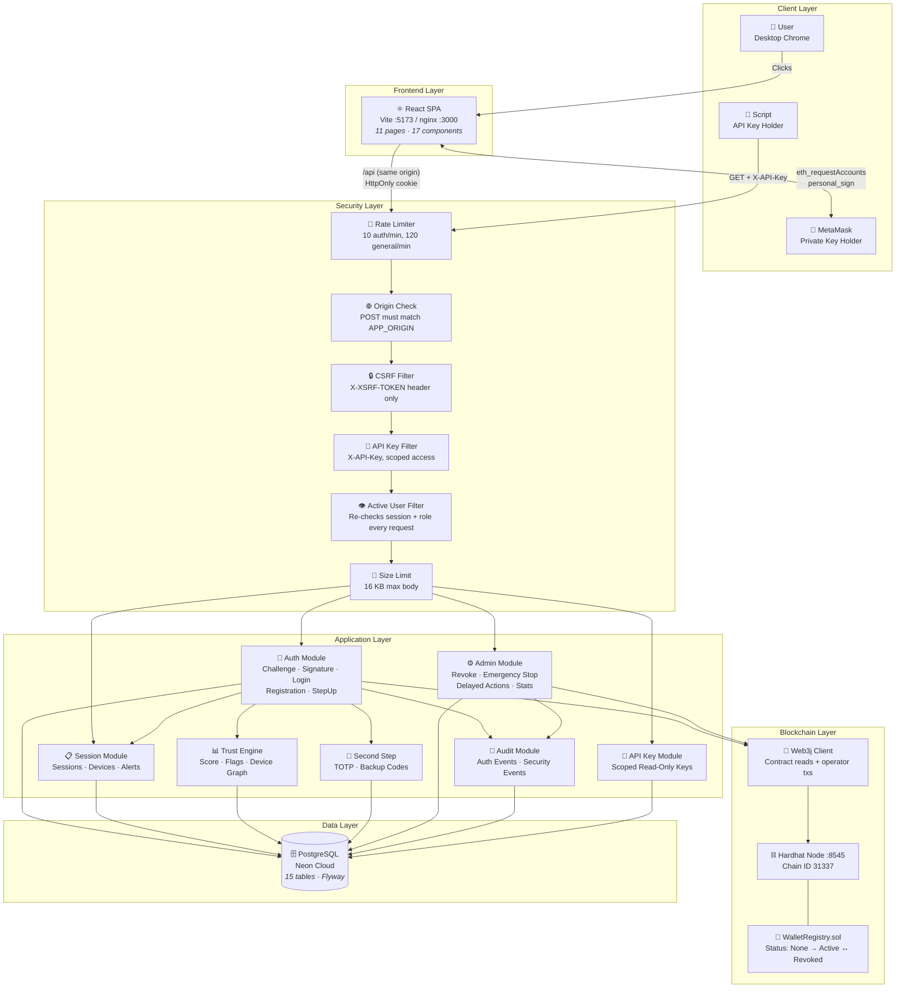

### Component Responsibility Matrix

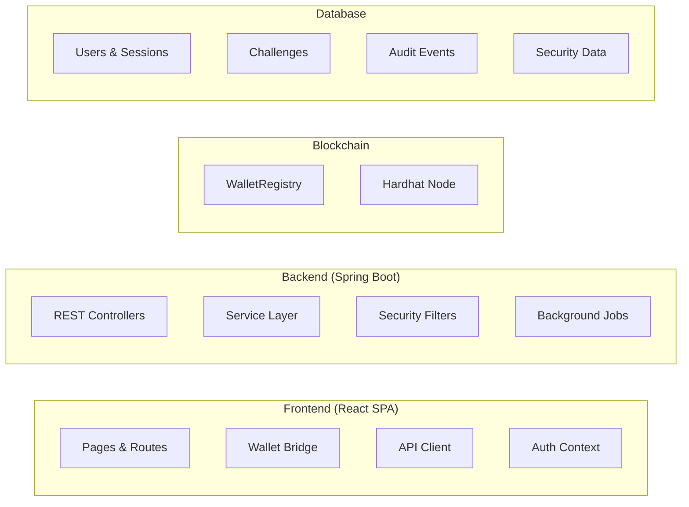

### Physical & Network Infrastructure Topology

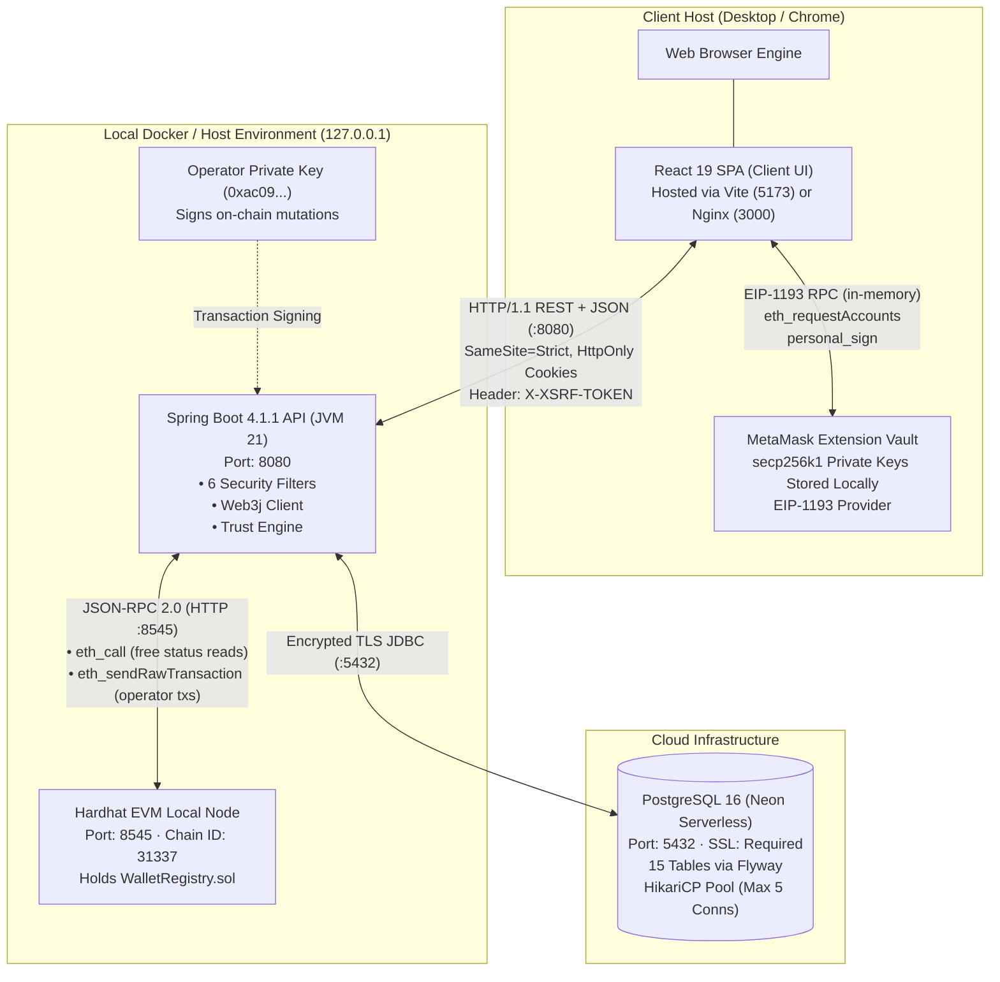

### Layered Communication Protocols Matrix

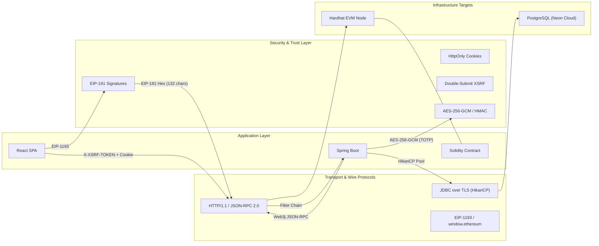

---

## Overall Data Flow

### Complete Request Lifecycle

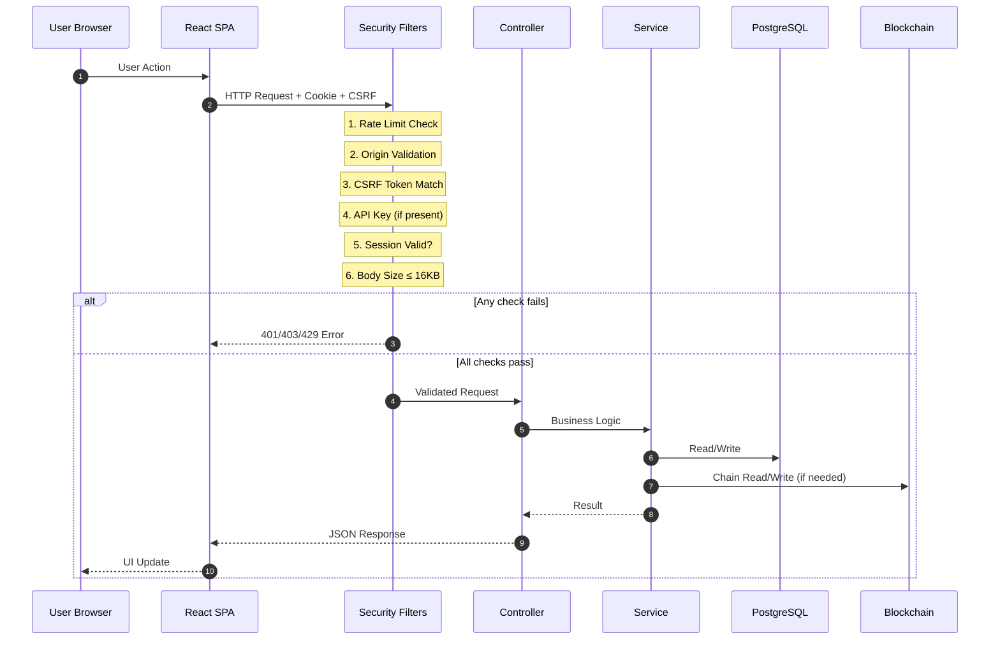

### Data Flow by Feature

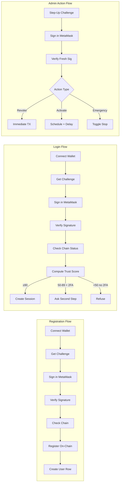

---

## Core Modules — Backend

### Module Architecture

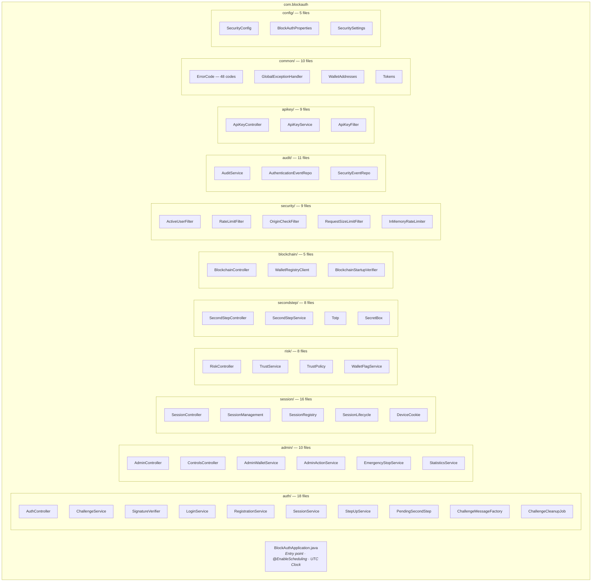

### Backend Module Details

| Module | Files | Key Classes | Responsibility |
|---|---|---|---|
| **`auth/`** | 18 | `AuthController`, `ChallengeService`, `SignatureVerifier`, `LoginService`, `RegistrationService`, `SessionService`, `StepUpService` | Challenge-response authentication, signature verification, session creation, fresh signatures for sensitive actions |
| **`admin/`** | 10 | `AdminController`, `ControlsController`, `AdminWalletService`, `AdminActionService`, `EmergencyStopService`, `StatisticsService` | Wallet revoke/activate, emergency stop toggle, delayed action scheduling, aggregate statistics |
| **`session/`** | 16 | `SessionManagement`, `SessionRegistry`, `SessionLifecycle`, `DeviceCookie`, `SignInAlert` | Server-side session tracking, device recognition via hashed tokens, new-device alerts, session end on various triggers |
| **`risk/`** | 8 | `TrustService`, `TrustPolicy`, `WalletFlagService`, `LoginAssessment` | Trust score computation (single SQL query with recursive CTE), policy decisions, wallet flagging |
| **`secondstep/`** | 8 | `SecondStepService`, `Totp`, `SecretBox`, `BackupCode` | TOTP setup/verify, AES-256-GCM encryption, backup code generation (keyed HMAC), rate-limited code attempts |
| **`blockchain/`** | 5 | `WalletRegistryClient`, `BlockchainStartupVerifier` | All contract interaction (reads via `eth_call`, writes via signed operator txs), startup chain/contract validation |
| **`security/`** | 9 | `ActiveUserFilter`, `RateLimitFilter`, `OriginCheckFilter`, `InMemoryRateLimiter` | 6-layer filter chain: rate limiting, origin checking, session re-validation, body size limits |
| **`audit/`** | 11 | `AuditService`, `AuthenticationEvent`, `SecurityEvent` | Records 21 auth event types + 15 attack types; writes never break the operation they record |
| **`apikey/`** | 9 | `ApiKeyService`, `ApiKeyFilter` | Read-only API keys with scoped access; SHA-256 hashed secrets, constant-time comparison |
| **`user/`** | 8 | `UserService`, `UserController`, `User` | User entity, profile, chain status mirror, role assignment at registration |
| **`common/`** | 10 | `ErrorCode` (48 codes), `GlobalExceptionHandler`, `WalletAddresses`, `Tokens` | Error catalog, exception handling, address validation (EIP-55), cryptographic utilities |
| **`config/`** | 5 | `SecurityConfig`, `BlockAuthProperties`, `SecuritySettings` | Spring Security filter chain, typed configuration binding with startup validation |

### Backend Key Functions

| Function | What It Does |
|---|---|
| `ChallengeService.consume()` | Atomic single-use challenge consumption in its own committed transaction |
| `SignatureVerifier.verify()` | EIP-191 signature recovery via Web3j; rejects high-s duplicates (EIP-2) |
| `LoginService.login()` | Full sign-in pipeline: challenge → signature → chain → trust → session or 2FA |
| `TrustPolicy.score()` | Pure function: 6 signals → score starting at 100 minus applicable penalties |
| `WalletRegistryClient.send()` | Synchronized operator transaction with gas estimation, receipt polling, 30s timeout |
| `AdminActionService.runDue()` | Scheduled every 15s; executes delayed actions, retries on temporary failure |
| `SecondStepService.verifyCode()` | Checks TOTP (current ±1 step, never reused) or backup code (keyed HMAC, one-time) |

---

## Core Modules — Frontend

### Frontend Architecture

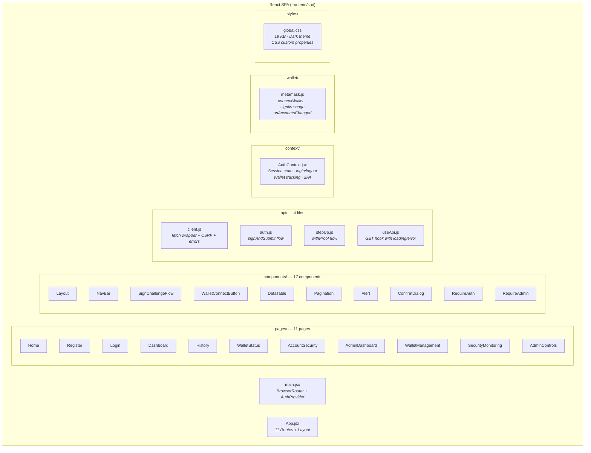

### Frontend Pages

| Page | Route | Role | Description |
|---|---|---|---|
| **Home** | `/` | Public | Landing page with wallet connection |
| **Register** | `/register` | Public | Challenge-response wallet registration |
| **Login** | `/login` | Public | Challenge-response sign-in with 2FA support |
| **Dashboard** | `/dashboard` | USER/ADMIN | Profile overview, session info, wallet status |
| **History** | `/history` | USER/ADMIN | Own authentication events (filterable, paginated) |
| **Wallet Status** | `/wallet-status` | USER/ADMIN | Live blockchain status of own wallet |
| **Account Security** | `/security` | USER/ADMIN | Sessions, devices, alerts, 2FA management |
| **Admin Dashboard** | `/admin` | ADMIN | Statistics, user list, quick actions |
| **Wallet Management** | `/admin/wallets` | ADMIN | Revoke/activate wallets, on-chain lookup |
| **Security Monitoring** | `/admin/security` | ADMIN | Security events, auth events, trust scores |
| **Admin Controls** | `/admin/controls` | ADMIN | Flags, emergency stop, delayed actions, API keys |

### Frontend Key Design Decisions

| Decision | Rationale |
|---|---|
| **No web storage** | Session state is HttpOnly cookie only; React context mirrors `/api/users/me` in memory |
| **No TypeScript** | Keeps the project accessible for study |
| **No CSS framework** | Plain CSS with custom properties — project specification forbids UI libraries |
| **No ethers.js/web3.js in frontend** | Only `window.ethereum.request` is used — minimal wallet surface |
| **Automatic session detection** | 401 responses trigger sign-out + redirect via API client hooks |
| **Wallet change auto-logout** | MetaMask `accountsChanged` event signs out stale sessions |
| **CSRF retry** | `CSRF_INVALID` error automatically fetches a new token and retries once |

---

## Smart Contract

### WalletRegistry State Machine

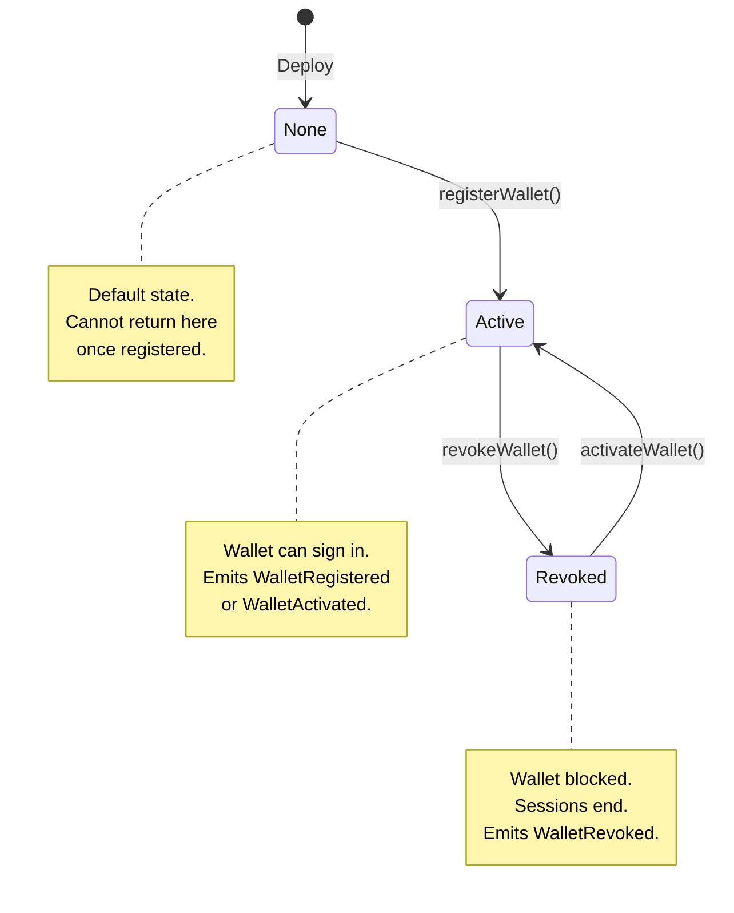

### Contract Interface

| Element | Description |
|---|---|
| `admin` | Immutable address set at deployment — the only account that can change state |
| `registerWallet(address)` | Admin only. Fails for zero address and any previously registered wallet |
| `revokeWallet(address)` | Admin only. Requires `Active` state |
| `activateWallet(address)` | Admin only. Requires `Revoked` state |
| `isRegistered(address)` | Free read — `true` if ever registered |
| `isActive(address)` | Free read — `true` only if currently `Active` |
| `getWalletStatus(address)` | Free read — returns `(registered, active, registeredAt)` |
| **Events** | `WalletRegistered`, `WalletRevoked`, `WalletActivated` — each with wallet + timestamp |
| **Errors** | `NotAdmin`, `ZeroAddress`, `AlreadyRegistered`, `NotRegistered`, `AlreadyRevoked`, `AlreadyActive` |
| **Safety** | No `payable` functions, no `receive()`/`fallback()`, no external calls, constant gas per operation |

---

## Database Schema

### Entity Relationship Diagram

```mermaid
erDiagram
    users {
        uuid id PK
        varchar wallet_address UK
        varchar role "USER | ADMIN"
        varchar status "ACTIVE | REVOKED"
        timestamptz created_at
        timestamptz updated_at
    }
    
    authentication_challenges {
        bigint id PK
        varchar wallet_address
        varchar purpose "REGISTRATION | LOGIN | ACTION"
        varchar nonce UK
        text challenge UK
        timestamptz expires_at
        boolean used
        varchar action "nullable"
        uuid session_id FK "nullable"
    }
    
    devices {
        uuid id PK
        varchar token_hash UK "SHA-256"
        varchar label
    }
    
    user_devices {
        uuid id PK
        uuid user_id FK
        uuid device_id FK
        timestamptz trusted_until "nullable"
        timestamptz removed_at "nullable"
    }
    
    user_sessions {
        uuid id PK
        uuid user_id FK
        uuid device_id FK
        varchar ip_address
        boolean second_step
        timestamptz ended_at "nullable"
        varchar end_reason "nullable"
    }
    
    sign_in_alerts {
        bigint id PK
        uuid user_id FK
        uuid session_id FK UK
        varchar resolution "nullable"
    }
    
    second_factors {
        uuid user_id PK
        varchar secret_ciphertext "AES-256-GCM"
        timestamptz enabled_at "nullable"
        bigint last_used_step
    }
    
    backup_codes {
        bigint id PK
        uuid user_id FK
        varchar code_hash "HMAC-SHA256"
        timestamptz used_at "nullable"
    }
    
    wallet_flags {
        varchar wallet_address PK
        varchar reason
        uuid flagged_by FK
    }
    
    login_assessments {
        bigint id PK
        varchar wallet_address
        uuid user_id FK
        integer score "0-100"
        varchar decision "ALLOW | SECOND_STEP | REFUSE"
    }
    
    emergency_stop {
        integer id PK "always 1"
        boolean active
        boolean block_logins
    }
    
    admin_actions {
        bigint id PK
        varchar action
        varchar target_wallet
        varchar status "PENDING → EXECUTED"
        timestamptz execute_after
    }
    
    api_keys {
        uuid id PK
        uuid owner_id FK
        varchar secret_hash UK "SHA-256"
        varchar scopes
        timestamptz expires_at
    }
    
    authentication_events {
        bigint id PK
        uuid user_id FK
        varchar event_type "21 types"
        varchar event_status
    }
    
    security_events {
        bigint id PK
        varchar attack_type "15 types"
        varchar result "BLOCKED | DETECTED"
    }
    
    users ||--o{ user_devices : has
    users ||--o{ user_sessions : has
    users ||--o{ authentication_events : logged
    users ||--o{ security_events : logged
    users ||--o| second_factors : may_have
    users ||--o{ backup_codes : may_have
    users ||--o{ api_keys : owns
    users ||--o{ admin_actions : requests
    devices ||--o{ user_devices : linked
    devices ||--o{ user_sessions : used_in
    user_sessions ||--o| sign_in_alerts : triggers
```

### Data Security

| Data Type | Storage Method |
|---|---|
| Device tokens | SHA-256 hash only |
| API key secrets | SHA-256 hash only |
| Backup codes | Keyed HMAC-SHA256 (low-entropy codes need a keyed hash) |
| TOTP secrets | AES-256-GCM encrypted |
| Wallet addresses | Lowercase, CHECK constraint enforced |
| Timestamps | `TIMESTAMPTZ` in UTC |
| Enum values | Database `CHECK` constraints (not just app-level) |

---

## Complete System Workflows & Authentication Flows

This section documents every operational and security workflow within BlockAuth with end-to-end architectural sequence diagrams, state machines, and decision logic trees.

---

### Workflow 1: Web3 Wallet Connection & Account Change Detection

Handles browser wallet discovery, EIP-1193 provider binding, account change detection, and automatic session revocation upon wallet switching.

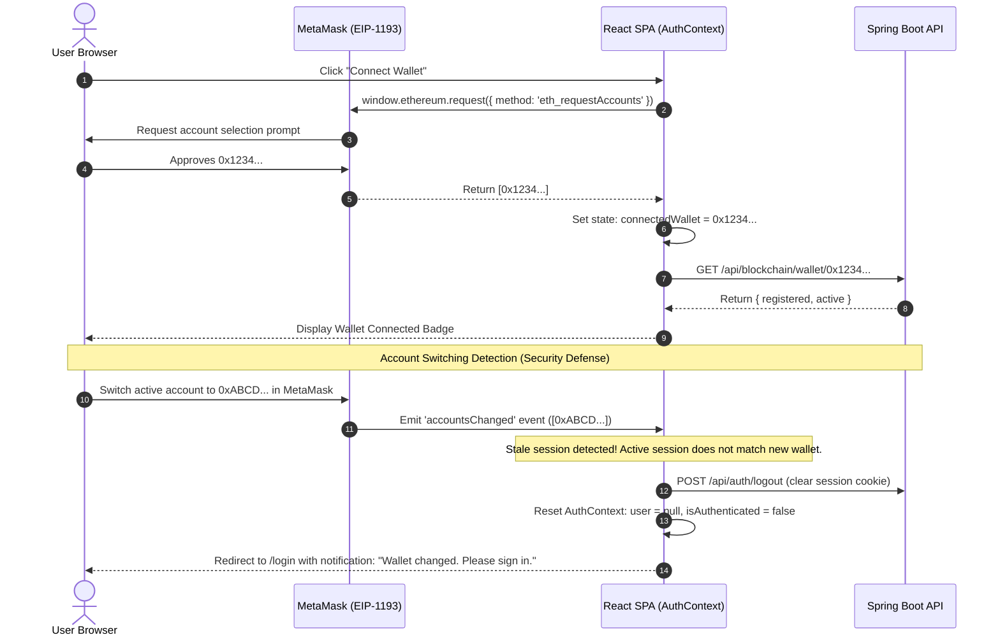

---

### Workflow 2: Challenge-Response User Registration

Registers a new wallet address cryptographically, submits an on-chain registration transaction via the backend operator key, and creates the user identity record.

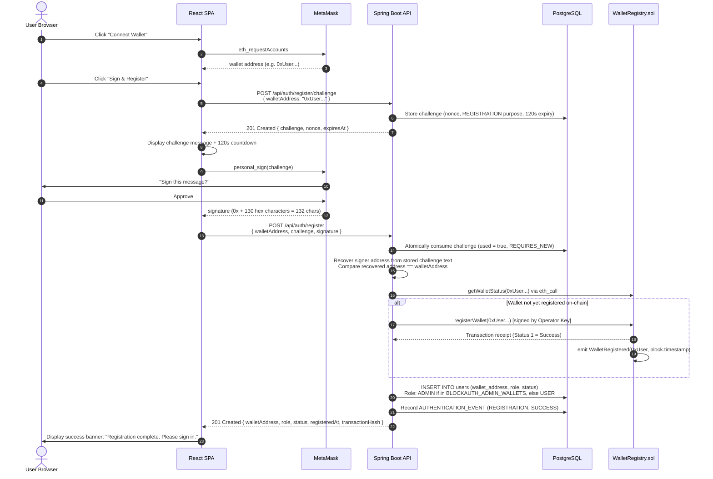

---

### Workflow 3: Authentication & Adaptive Risk Evaluation (Login)

The primary sign-in pipeline integrating EIP-191 signature recovery, low-$s$ canonical validation, on-chain status verification, single-query trust scoring, and session issuance.

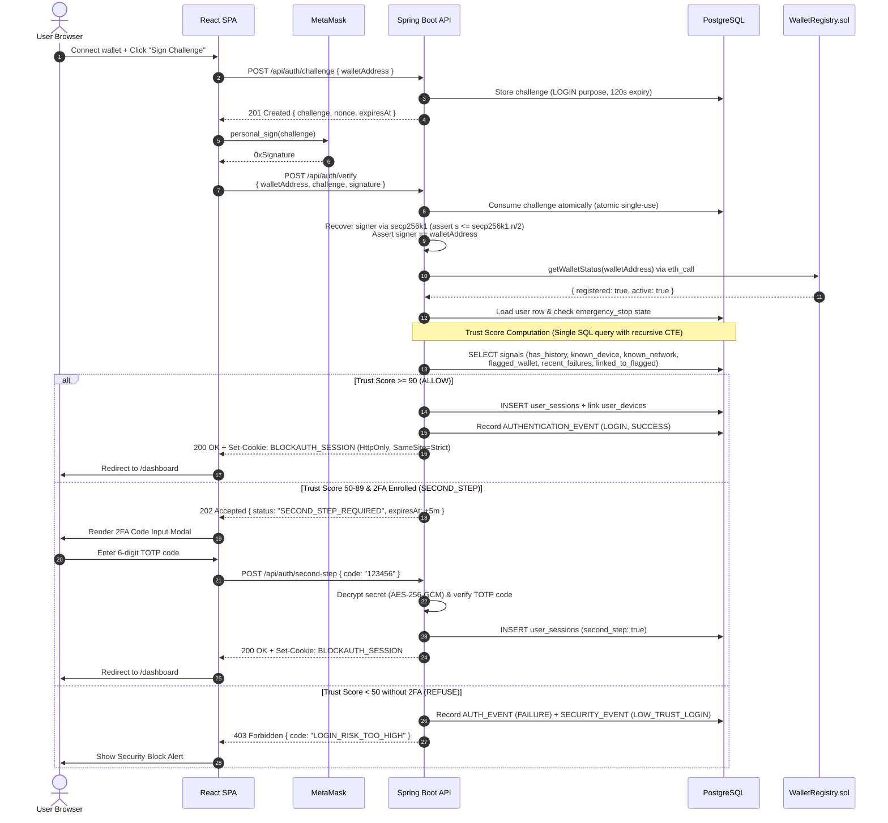

---

### Workflow 4: Adaptive Trust Score Decision Tree & Penalty Engine

Computes risk penalties starting from a baseline score of 100 using relational contextual signals and device-graph traversals.

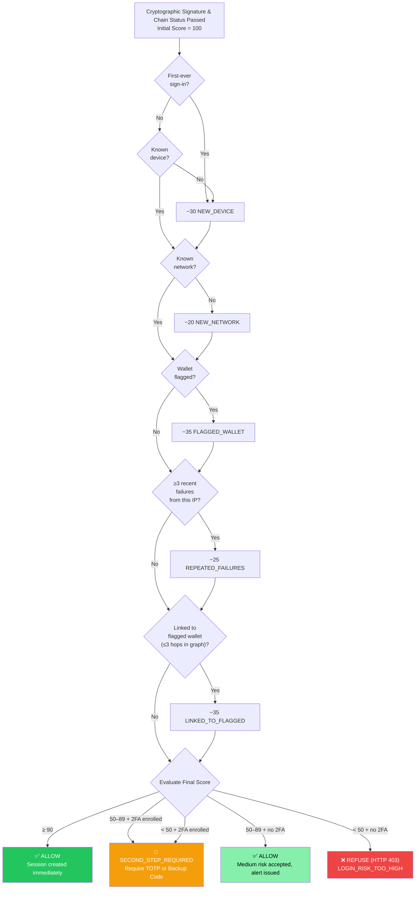

---

### Workflow 5: Two-Factor Authentication (TOTP 2FA) Setup & Activation

Enables RFC 6238 time-based authenticator codes with encrypted secret seeds (AES-256-GCM), HMAC-SHA256 backup codes, and required fresh wallet signature verification.

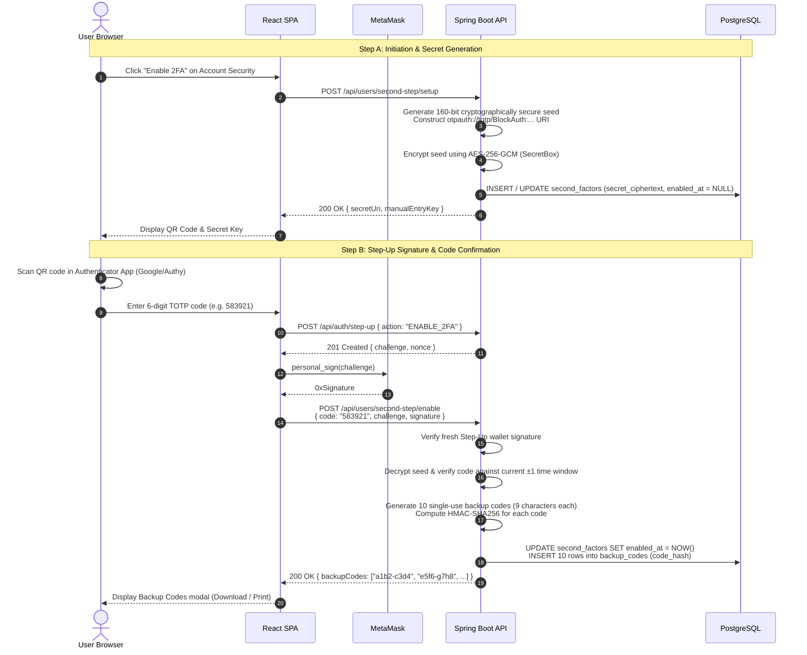

---

### Workflow 6: Multi-Factor Authentication (2FA) Code Verification Flow

Processes second-step authentication attempts during login using TOTP anti-replay tracking or backup code burn.

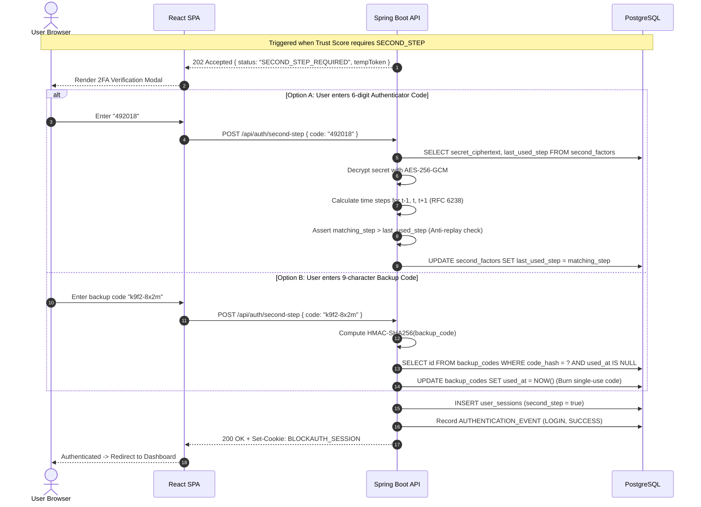

---

### Workflow 7: Step-Up Authentication for Sensitive Operations

Enforces that high-impact actions (wallet revocation, emergency stop, 2FA modifications, API key issuance) require a fresh cryptographic signature, preventing session-hijacking escalation.

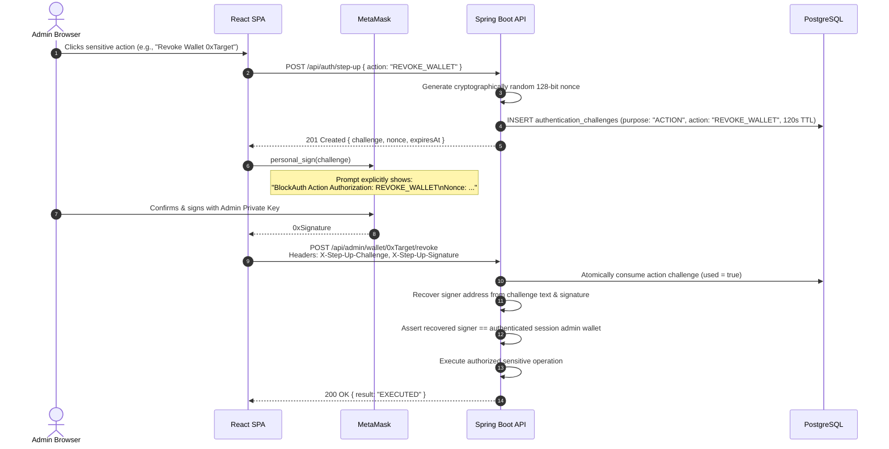

---

### Workflow 8: Session Governance & Device Fingerprinting

Manages device cookies, new device detection, and user resolution of unauthorized sign-in alerts.

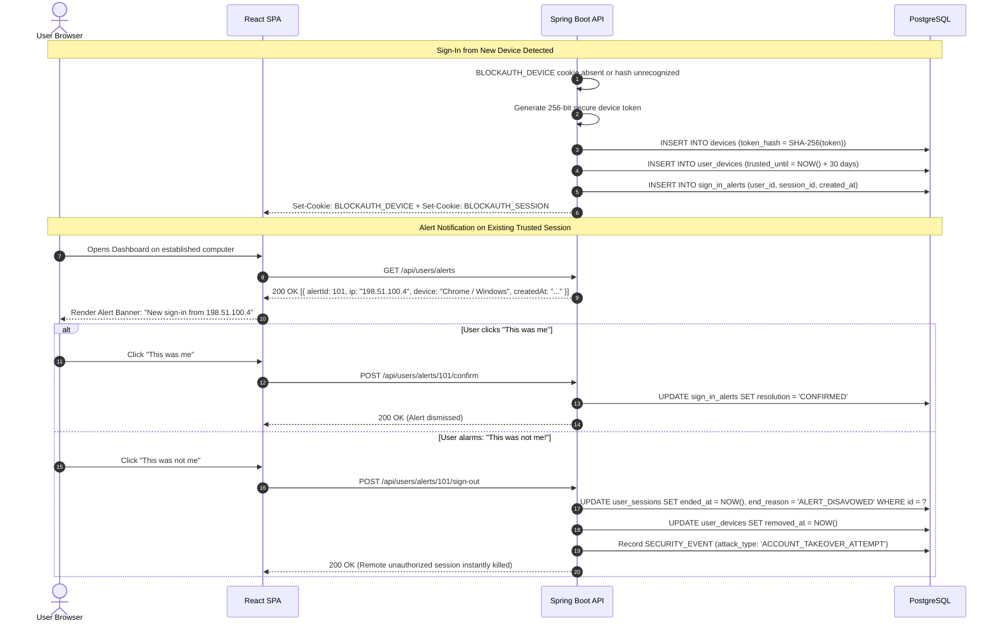

---

### Workflow 9: On-Chain Wallet Revocation & Instant Session Eviction

Demonstrates instantaneous account revocation: the admin signs a step-up challenge, the backend operator key executes an on-chain revocation transaction, and the target's sessions are terminated immediately.

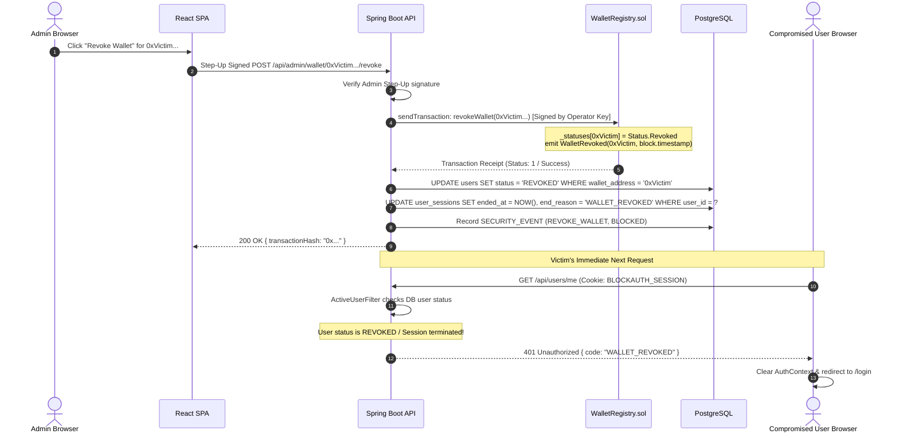

---

### Workflow 10: Delayed Action & Reactivation Workflow

Provides multi-admin governance: wallet reactivation requests are held in a scheduled delay queue (default: 10 minutes), giving peer administrators a window to cancel suspect actions before on-chain execution.

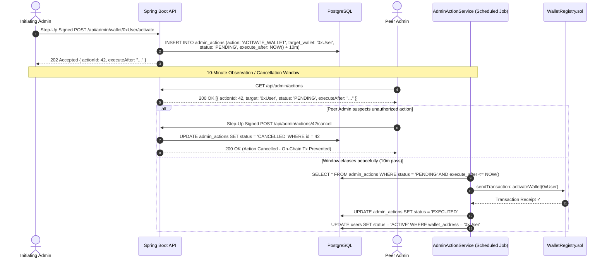

---

### Workflow 11: Emergency Stop Master Control Workflow

System-wide circuit breaker: freezes registrations, delayed executions, and optionally user sign-ins during security incidents.

```mermaid
sequenceDiagram
    autonumber
    actor Admin as Admin Browser
    participant BE as Spring Boot API
    participant DB as PostgreSQL
    actor Public as Incoming User

    Admin->>BE: Step-Up Signed POST /api/admin/emergency-stop/activate<br/>{ blockLogins: true }
    BE->>DB: UPDATE emergency_stop SET active = true, block_logins = true, activated_at = NOW()
    BE->>DB: Record SECURITY_EVENT (EMERGENCY_STOP_ACTIVATED)
    BE-->>Admin: 200 OK { active: true, blockLogins: true }

    Note over Public,BE: Inbound Traffic during Emergency Freeze
    Public->>BE: POST /api/auth/register/challenge
    BE->>DB: Check emergency_stop state
    Note over BE: Emergency stop is ACTIVE!
    BE-->>Public: 503 Service Unavailable { code: "EMERGENCY_STOP_ACTIVE" }

    Public->>BE: POST /api/auth/challenge (Sign-in)
    BE-->>Public: 503 Service Unavailable { code: "LOGINS_BLOCKED" }

    Note over Admin,BE: Lifting Emergency Stop (Requires Delay Window)
    Admin->>BE: Step-Up Signed POST /api/admin/emergency-stop/lift
    BE->>DB: INSERT INTO admin_actions (action: 'LIFT_EMERGENCY_STOP', execute_after: NOW() + 10m)
    BE-->>Admin: 202 Accepted { status: "SCHEDULED_DELAYED" }
```

---

### Workflow 12: Scoped API Key Authentication Workflow

Provisioning and invocation of time-bound, read-only API keys for automated monitoring scripts.

```mermaid
sequenceDiagram
    autonumber
    actor Admin as Admin Browser
    participant BE as Spring Boot API
    participant DB as PostgreSQL
    actor Script as Monitoring Agent

    Admin->>BE: Step-Up Signed POST /api/admin/api-keys<br/>{ label: "Prometheus Collector", scopes: ["audit:read", "statistics:read"], ttlDays: 30 }
    BE->>BE: Generate 256-bit Secure Token: bk_live_9f82...<br/>Compute SHA-256(bk_live_9f82...)
    BE->>DB: INSERT INTO api_keys (secret_hash, scopes, expires_at)
    BE-->>Admin: 201 Created { id, keySecret: "bk_live_9f82..." }
    Note over Admin: Key secret shown ONCE; never stored in plaintext on server

    Note over Script,BE: Script Queries Metrics
    Script->>BE: GET /api/admin/statistics<br/>Headers: X-API-Key: bk_live_9f82...
    BE->>BE: ApiKeyFilter intercepts request
    BE->>BE: Compute SHA-256(header_key)
    BE->>DB: SELECT * FROM api_keys WHERE secret_hash = ? AND expires_at > NOW()
    BE->>BE: Assert scopes contain 'statistics:read'
    BE->>BE: Route to StatisticsService
    BE-->>Script: 200 OK { totalUsers: 48, activeSessions: 12, ... }
```

---

### Workflow 13: 6-Layer Security Filter Execution Pipeline

Detailed chronological filter evaluation demonstrating multi-layered defense on every inbound request.

```mermaid
sequenceDiagram
    autonumber
    actor Client as Inbound HTTP Request
    participant RL as 1. RateLimitFilter
    participant OC as 2. OriginCheckFilter
    participant CSRF as 3. CsrfFilter
    participant AK as 4. ApiKeyFilter
    participant AU as 5. ActiveUserFilter
    participant SZ as 6. RequestSizeLimitFilter
    participant CTRL as Controller & Service

    Client->>RL: HTTP Request (Method, Path, IP, Headers, Body)
    alt IP exceeded 10 auth/min or 120 gen/min
        RL-->>Client: 429 Too Many Requests { code: "RATE_LIMIT_EXCEEDED" }
    else Within quota
        RL->>OC: Forward request
    end

    alt POST/PUT/DELETE and Origin != APP_ORIGIN
        OC-->>Client: 403 Forbidden { code: "ORIGIN_MISMATCH" }
    else Origin valid or GET/HEAD
        OC->>CSRF: Forward request
    end

    alt POST/PUT/DELETE and Cookie(XSRF) != Header(X-XSRF-TOKEN)
        CSRF-->>Client: 403 Forbidden { code: "CSRF_TOKEN_INVALID" }
    else CSRF valid or GET/HEAD
        CSRF->>AK: Forward request
    end

    alt Has X-API-Key header
        AK->>AK: Validate hash & scope
        alt Invalid key or missing scope
            AK-->>Client: 401/403 { code: "INVALID_API_KEY" }
        else Valid key
            AK->>CTRL: Dispatched as API client
        end
    else Normal session traffic
        AK->>AU: Forward request
    end

    alt Active session cookie present
        AU->>AU: Validate user row in DB & status == ACTIVE
        alt Wallet revoked or session invalidated
            AU-->>Client: 401 Unauthorized { code: "SESSION_EXPIRED" }
        else Session active
            AU->>SZ: Forward request
        end
    else Unauthenticated request
        AU->>SZ: Forward request
    end

    alt Content-Length > 16,384 bytes (16 KB)
        SZ-->>Client: 413 Payload Too Large { code: "PAYLOAD_TOO_LARGE" }
    else Body within limit
        SZ->>CTRL: Execute Spring Controller Endpoint
        CTRL-->>Client: Standardized JSON Response
    end
```

---

### Workflow 14: Comprehensive Session Lifecycle State Machine

Illustrates all session state transitions and termination vectors across the application lifecycle.

```mermaid
stateDiagram-v2
    [*] --> Active: Login Success<br/>New session ID + HttpOnly cookie
    
    Active --> Active: User Request<br/>ActiveUserFilter validates status<br/>Update last_seen_at (max 1/min)
    
    Active --> Ended_LOGOUT: User clicks Logout
    Active --> Ended_REMOTE: Admin / User terminates via Session Management
    Active --> Ended_EXPIRED: 30-minute idle timeout elapses
    Active --> Ended_REVOKED: Wallet revoked on-chain
    Active --> Ended_RESTART: Server restart (in-memory state cleared)
    Active --> Ended_EMERGENCY: Emergency Stop triggered with blockLogins
    Active --> Ended_DEVICE: User removes device trust
    Active --> Ended_RELOGIN: Same wallet re-authenticates on same device
    Active --> Ended_DISAVOWED: User clicks "This was not me" on alert
    
    Ended_LOGOUT --> [*]
    Ended_REMOTE --> [*]
    Ended_EXPIRED --> [*]
    Ended_REVOKED --> [*]
    Ended_RESTART --> [*]
    Ended_EMERGENCY --> [*]
    Ended_DEVICE --> [*]
    Ended_RELOGIN --> [*]
    Ended_DISAVOWED --> [*]
```

---

## API Reference

All endpoints are under `/api` on the same origin. Requests and responses are JSON. Every `POST` needs `X-XSRF-TOKEN` header. Errors use one standard body: `{ status, code, message, timestamp, path, errorId, fieldErrors }`.

### Authentication (Public)

| Method | Endpoint | Description | Success |
|---|---|---|---|
| GET | `/api/auth/csrf` | Issue CSRF token | `200` |
| POST | `/api/auth/register/challenge` | Challenge for registration | `201` |
| POST | `/api/auth/register` | Verify signature + register on-chain | `201` |
| POST | `/api/auth/challenge` | Challenge for sign-in | `201` |
| POST | `/api/auth/verify` | Verify signature + sign in | `200` or `202` |
| POST | `/api/auth/second-step` | Complete 2FA | `200` |
| POST | `/api/auth/step-up` | Challenge for sensitive action (USER/ADMIN) | `201` |
| POST | `/api/auth/logout` | End session | `204` |

### Signed-In User (USER or ADMIN)

| Method | Endpoint | Description |
|---|---|---|
| GET | `/api/users/me` | Own profile |
| GET | `/api/users/authentication-history` | Own auth events (paginated) |
| GET | `/api/users/wallet-status` | Own wallet blockchain status |
| GET | `/api/users/sessions` | Active sessions |
| POST | `/api/users/sessions/{id}/end` | End one session |
| POST | `/api/users/sessions/end-others` | End all other sessions |
| GET | `/api/users/devices` | Recognized devices |
| POST | `/api/users/devices/{id}/remove` | Forget a device |
| GET | `/api/users/alerts` | New sign-in alerts |
| POST | `/api/users/alerts/{id}/confirm` | "This was me" |
| POST | `/api/users/alerts/{id}/sign-out` | "This was not me" |
| GET | `/api/users/second-step` | 2FA status |
| POST | `/api/users/second-step/setup` | Begin 2FA setup |
| POST | `/api/users/second-step/enable` | Confirm with code + proof |
| POST | `/api/users/second-step/disable` | Disable with code + proof |
| POST | `/api/users/second-step/backup-codes` | Renew backup codes |

### Administration (ADMIN; * also accepts API key)

| Method | Endpoint | Description |
|---|---|---|
| GET | `/api/admin/users` * | Users + wallets (filterable) |
| GET | `/api/admin/authentication-events` * | Auth audit logs |
| GET | `/api/admin/security-events` * | Security audit logs |
| GET | `/api/admin/statistics` * | Aggregate counts |
| GET | `/api/admin/login-assessments` * | Trust score history |
| GET | `/api/blockchain/wallet/{address}` * | On-chain wallet status |
| GET | `/api/blockchain/verify/{address}` * | Wallet validity check |
| POST | `/api/admin/wallet/{address}/revoke` | Revoke on-chain (immediate) |
| POST | `/api/admin/wallet/{address}/activate` | Request reactivation (delayed) |
| POST | `/api/admin/wallet/{address}/second-step/reset` | Request 2FA reset (delayed) |
| GET | `/api/admin/wallet-flags` | List flagged wallets |
| POST | `/api/admin/wallet-flags` | Flag a wallet |
| POST | `/api/admin/wallet-flags/{address}/remove` | Remove flag |
| GET | `/api/admin/emergency-stop` | Emergency stop state |
| POST | `/api/admin/emergency-stop/activate` | Switch on (immediate) |
| POST | `/api/admin/emergency-stop/lift` | Request lifting (delayed) |
| GET | `/api/admin/actions` | Delayed actions |
| POST | `/api/admin/actions/{id}/cancel` | Cancel pending action |
| GET | `/api/admin/api-keys` | List API keys |
| POST | `/api/admin/api-keys` | Create API key |
| POST | `/api/admin/api-keys/{id}/revoke` | Revoke API key |

---

## Project Structure

```text
.
├── README.md                          This document
├── .env.example                       Configuration template (placeholders only)
├── docker-compose.yml                 Optional local stack (3 services)
│
├── backend/                           Spring Boot API (Maven)
│   ├── pom.xml                        Dependencies + "blockchain-it" test profile
│   ├── mvnw, mvnw.cmd                Maven Wrapper (no separate install needed)
│   ├── Dockerfile                     Two-stage build, non-root user
│   └── src/
│       ├── main/java/com/blockauth/
│       │   ├── BlockAuthApplication.java     Entry point · @EnableScheduling · UTC Clock
│       │   ├── auth/                  18 files — challenges, signatures, registration,
│       │   │                          login, sessions, step-up, cleanup job
│       │   ├── admin/                 10 files — wallet management, statistics,
│       │   │                          emergency stop, delayed actions
│       │   ├── blockchain/             5 files — Web3j contract client, startup verifier
│       │   ├── session/               16 files — session records, devices, cookies, alerts
│       │   ├── secondstep/             8 files — TOTP, AES-GCM secret box, backup codes
│       │   ├── risk/                   8 files — trust score, device graph, wallet flags
│       │   ├── apikey/                 9 files — read-only API keys, X-API-Key filter
│       │   ├── audit/                 11 files — authentication + security events
│       │   ├── security/               9 files — rate limit, origin, active user, size filters
│       │   ├── user/                   8 files — entity, profile, repository
│       │   ├── common/                10 files — 48 error codes, exception handler, tokens
│       │   └── config/                 5 files — Spring Security, properties, Web3j config
│       ├── main/resources/
│       │   ├── application.yml                    Base configuration
│       │   ├── application-{dev,test,prod}.yml    Profile overrides
│       │   └── db/migration/
│       │       ├── V1__init_schema.sql            4 tables (users, challenges, events)
│       │       └── V2__security_features.sql      11 tables + ALTER (security features)
│       └── test/java/com/blockauth/               49 test files
│           ├── IntegrationTest.java               Base: real HTTP, real sigs, real DB
│           ├── TestWallet.java                    Generates real Ethereum wallets
│           ├── MutableClock.java                  Time control for expiry tests
│           ├── auth/                              9 tests (login, registration, challenge, sig)
│           ├── admin/                             5 tests (revocation, actions, emergency, stats)
│           ├── security/                          5 tests (auth matrix, CSRF, rate limit, fail-closed)
│           ├── secondstep/                        4 tests (TOTP, encryption, integration)
│           ├── risk/                              3 tests (trust policy, score, service)
│           ├── session/                           2 tests (management, alerts)
│           ├── blockchain/                        1 test (real chain, tagged "blockchain")
│           └── ...                                remaining package tests
│
├── frontend/                          React SPA (Vite)
│   ├── package.json                   React 19, React Router 7, Vite 8
│   ├── vite.config.js                 Dev server + /api proxy to :8080
│   ├── nginx.conf                     Production serving + security headers
│   ├── Dockerfile                     Node build → nginx serve
│   ├── index.html                     SPA entry point
│   └── src/
│       ├── main.jsx                   React root + BrowserRouter + AuthProvider
│       ├── App.jsx                    11 routes + Layout + guards
│       ├── api/                        4 files — HTTP client, auth, step-up, hooks
│       ├── context/AuthContext.jsx     Session state, wallet tracking, login/logout
│       ├── wallet/metamask.js         MetaMask bridge (only MetaMask code)
│       ├── components/                17 components — Layout, NavBar, tables, dialogs
│       ├── pages/                     11 pages — user + admin views
│       ├── utils/                      3 files — formatting, messages, event helpers
│       └── styles/global.css          19 KB — dark theme, CSS custom properties
│
├── contracts/                         Hardhat project
│   ├── contracts/WalletRegistry.sol   81 lines — the on-chain identity registry
│   ├── scripts/deploy.js             Deployment script (prints address)
│   ├── test/WalletRegistry.test.js   15 test cases
│   ├── hardhat.config.js             Solidity 0.8.24, localhost network
│   └── Dockerfile                    Image for the Hardhat node
│
├── postman/
│   └── BlockAuth.postman_collection.json   84 API requests in 6 folders
│
└── security-tests/zap/               OWASP ZAP scan notes and API description
```

---

## Setup and Installation

### Prerequisites

| Tool | Version | Notes |
|---|---|---|
| Git | Any recent | |
| JDK | **21** | Required for Spring Boot 4.1 |
| Node.js + npm | **22 LTS** | For frontend and contracts |
| MetaMask | Latest | Desktop Chrome extension |
| Neon account | Free tier | PostgreSQL cloud database |
| Docker Desktop | Optional | For containerized local stack |

Maven is **not** needed separately — use the wrapper (`mvnw.cmd` on Windows, `./mvnw` elsewhere).

### Step 1 — Clone and Configure

```powershell
git clone https://github.com/abhinandbs12/ai-augmented-decentralized-authentication-system.git blockauth
cd blockauth
Copy-Item .env.example .env.local    # cp .env.example .env.local on macOS/Linux
```

### Step 2 — Database (Neon PostgreSQL)

1. Create a Neon project → get `DB_URL`, `DB_USERNAME`, `DB_PASSWORD`
2. Create a `test` branch → get `TEST_DB_*` values (integration tests empty its tables)
3. Fill both sets of values in `.env.local`

```text
DB_URL=jdbc:postgresql://<host>/<database>?sslmode=require
DB_USERNAME=<role>
DB_PASSWORD=<password>
```

### Step 3 — Smart Contract

```powershell
cd contracts
npm install
npx hardhat test                      # Run 15 contract tests
npx hardhat node                      # Terminal A — keep running
```

In a second terminal:
```powershell
cd contracts
npx hardhat run scripts/deploy.js --network localhost
```

Copy **Account #0's private key** → `BLOCKCHAIN_OPERATOR_PRIVATE_KEY`
Copy **printed contract address** → `CONTRACT_ADDRESS`

### Step 4 — Admin Wallet + Encryption Key

```powershell
# Put your MetaMask admin wallet address in .env.local:
BLOCKAUTH_ADMIN_WALLETS=0x<your-admin-address>

# Generate the encryption key (PowerShell):
$b = New-Object byte[] 32; [Security.Cryptography.RandomNumberGenerator]::Create().GetBytes($b); [Convert]::ToBase64String($b)
# or: openssl rand -base64 32

# Put the result in .env.local:
SECOND_STEP_ENCRYPTION_KEY=<base64-key>
```

### Step 5 — Backend

```powershell
cd backend
.\mvnw.cmd spring-boot:run           # ./mvnw spring-boot:run on macOS/Linux
```

At startup: Flyway applies migrations → startup verifier checks chain ID, contract code, and operator key.

### Step 6 — Frontend

```powershell
cd frontend
npm install
npm run dev
```

### Step 7 — Verify

Open `http://localhost:5173`

```powershell
# Health check:
curl.exe http://localhost:8080/actuator/health
# Should return: {"status":"UP"}
```

1. Register the admin wallet → admin dashboard appears
2. Register a second wallet → user dashboard, no admin access
3. As admin, revoke the second wallet → its next request signs out

---

## Running with Docker

Docker Compose runs Hardhat, backend, and frontend on ports 8545, 8080, and 3000 (bound to `127.0.0.1` only).

```powershell
docker compose up -d --build hardhat
docker compose logs hardhat                              # Copy Account #0's key
docker compose exec hardhat npx hardhat run scripts/deploy.js --network localhost
# Set CONTRACT_ADDRESS and BLOCKCHAIN_OPERATOR_PRIVATE_KEY in .env.local
docker compose up -d --build backend frontend
```

Open `http://localhost:3000`. `docker compose down` erases the chain — deploy again afterwards.

---

## Testing

### Test Summary

| What | Count | Command |
|---|---|---|
| Contract tests | **15 passing** | `cd contracts; npx hardhat test` |
| Backend unit tests | **184 passing** | `cd backend; .\mvnw.cmd test` |
| Backend integration tests | **172 passing** | `cd backend; .\mvnw.cmd verify` |
| Chain integration tests | Tagged `blockchain` | `cd backend; .\mvnw.cmd verify -Pblockchain-it` |
| Frontend build | Compiles (326 KB JS) | `cd frontend; npm run build` |
| Postman collection | 84 requests | Import + run against local stack |
| OWASP ZAP scans | 0 High/Medium alerts | See `security-tests/zap/README.md` |

### Test Coverage by Module

| Module | Unit Tests | Integration Tests |
|---|---|---|
| auth | `ChallengeServiceTest`, `ChallengeMessageFactoryTest`, `SignatureVerifierTest`, `LoginServiceTest`, `RegistrationServiceTest`, `Eip4361FormatTest` | `LoginFlowIT`, `RegistrationFlowIT`, `LogoutIT`, `StepUpIT`, `ChallengeCleanupIT`, `ChallengeConcurrencyIT` |
| admin | `AdminWalletServiceTest` | `RevocationFlowIT`, `AdminActionIT`, `EmergencyStopIT`, `StatisticsIT` |
| security | `InMemoryRateLimiterTest`, `FailClosedFiltersTest` | `AuthorizationMatrixIT`, `CsrfIT`, `RateLimitIT` |
| secondstep | `TotpTest`, `SecretBoxTest` | `SecondStepIT` |
| risk | `TrustPolicyTest`, `TrustServiceTest` | `TrustScoreIT` |
| session | — | `SessionManagementIT`, `SignInAlertIT` |
| blockchain | — | `WalletRegistryClientIT` (real chain) |
| config | `BlockAuthPropertiesTest`, `SecuritySettingsTest`, `AdminWalletsBindingTest` | `ConfiguredAdminWalletsIT` |
| common | `WalletAddressesTest`, `TokensTest`, `GlobalExceptionHandlerTest` | `ErrorFormatIT`, `SchemaIT` |
| user | `UserServiceTest` | `HistoryScopeIT` |
| apikey | — | `ApiKeyIT` |

---

## Security Architecture

### 6-Layer Filter Chain

```mermaid
flowchart LR
    REQ["Incoming<br/>Request"] --> RL["🚦 Rate Limit<br/>10 auth | 120 general<br/>per min per IP"]
    RL --> OC["🌐 Origin Check<br/>POST Origin ≡<br/>APP_ORIGIN"]
    OC --> CSRF["🔒 CSRF<br/>X-XSRF-TOKEN<br/>header only"]
    CSRF --> AK["🔑 API Key<br/>X-API-Key<br/>scoped access"]
    AK --> AU["👁️ Active User<br/>Re-check session<br/>+ role + status"]
    AU --> SZ["📏 Size Limit<br/>≤ 16 KB body"]
    SZ --> APP["✅ Application<br/>Controller"]
```

### Security Measures

| Layer | Mechanism | Details |
|---|---|---|
| **Session** | HttpOnly, SameSite=Strict cookie | Server-side, regenerated at login, 30min idle timeout, re-checked every request |
| **CSRF** | Cookie-to-header token | `XSRF-TOKEN` → `X-XSRF-TOKEN` (header only, no form parameter) |
| **Origin** | Custom filter | POST `Origin` header must match `APP_ORIGIN` |
| **Rate Limit** | In-memory sliding window | 10 auth/min/IP, 120 general/min/IP, 10 failures → 15min IP block |
| **Validation** | Bean Validation + CHECK | EIP-55 checksums, signature format, enums, unknown JSON rejected, 16KB limit |
| **Authorization** | Deny-by-default | User endpoints never take a user ID; roles from DB only |
| **Secrets** | Never logged, never in errors | Config validators use constructors (not annotations) to avoid printing values |
| **Crypto** | AES-256-GCM, HMAC-SHA256, SHA-256 | Authenticator secrets encrypted; backup codes keyed-hashed; tokens hashed |
| **Headers** | CSP, X-Frame-Options, nosniff | `default-src 'none'`, `DENY`, `no-referrer`; nginx adds its own CSP |
| **Contract** | Admin-only mutations | No payable functions, no external calls, immutable admin |
| **Fail-Closed** | Always | Chain/DB unavailable → sign-in fails; trust check fails → never silently allowed |

---

## Environment Variables

Defined in `.env.local` (from `.env.example`). Real environment variables override the file.

| Variable | Purpose | Required |
|---|---|---|
| `DB_URL`, `DB_USERNAME`, `DB_PASSWORD` | Application database (Neon) | Yes |
| `TEST_DB_URL`, `TEST_DB_USERNAME`, `TEST_DB_PASSWORD` | Test database branch | For tests |
| `BLOCKCHAIN_RPC_URL` | JSON-RPC endpoint (`http://127.0.0.1:8545`) | Yes |
| `BLOCKCHAIN_CHAIN_ID` | Expected chain ID (`31337`) | Yes |
| `CONTRACT_ADDRESS` | Deployed WalletRegistry address | Yes |
| `BLOCKCHAIN_OPERATOR_PRIVATE_KEY` | Contract admin key (signs register/revoke/activate) | Yes |
| `BLOCKAUTH_ADMIN_WALLETS` | Comma-separated admin wallet addresses | Recommended |
| `APP_ORIGIN` | Web app origin (`http://localhost:5173`) | Yes |
| `SECOND_STEP_ENCRYPTION_KEY` | 32 random bytes, Base64 (encrypts 2FA secrets) | Yes |
| `CHALLENGE_TTL_SECONDS` | Challenge lifetime (default `120`, range 60–600) | No |
| `SESSION_TIMEOUT` | Idle timeout (default `30m`) | No |
| `SESSION_COOKIE_SECURE` | Cookie Secure flag (default `true`) | No |
| `TRUSTED_DEVICE_DAYS` | Days device stays trusted after 2FA (default `30`) | No |
| `ADMIN_ACTION_DELAY` | Waiting period for delayed actions (default `10m`, range 1s–7d) | No |

> ⚠️ `DB_PASSWORD`, `TEST_DB_PASSWORD`, `BLOCKCHAIN_OPERATOR_PRIVATE_KEY`, and `SECOND_STEP_ENCRYPTION_KEY` are secrets — never commit them.

---

## Deployment

No hosted deployment is configured. The repository provides:

- **Docker Compose** for a complete local stack
- A **`prod` Spring profile** for HTTPS reverse proxy: honours `X-Forwarded-*` headers and forces `Secure` cookies

Any deployment outside `localhost` **must** use HTTPS.

---

## Troubleshooting

| Symptom | Cause and Fix |
|---|---|
| Backend stops with blockchain error | Wrong chain ID, no code at `CONTRACT_ADDRESS`, or wrong operator key. Redeploy after chain restart. |
| Backend names `SECOND_STEP_ENCRYPTION_KEY` | Missing or not 32 bytes in Base64. Generate as shown above. |
| Login says wallet not registered | Chain was reset. Redeploy, truncate dev data, restart, re-register. |
| `429` "Too many failed attempts" | 10 failures in 15 min block the IP for 15 min. Restart backend clears in-memory limits. |
| MetaMask shows nothing after click | A request is waiting in the extension. Open MetaMask and answer it. |
| "Registration is incomplete" | Wallet registered on-chain but user row not saved. Run registration again. |
| Admin address logs in as normal user | Role is set at registration. List the address in config and register after restart. |
| Reactivation didn't happen yet | Waits for `ADMIN_ACTION_DELAY`. Check Admin → Controls. |
| First request slow after break | Neon suspends idle databases; first connection wakes it. |

**To reset development data after a chain restart:**

```sql
TRUNCATE users, authentication_challenges, authentication_events, security_events RESTART IDENTITY CASCADE;
```

---

## Known Limitations

| # | Limitation | Impact |
|---|---|---|
| 1 | **Single backend instance** — sessions, rate limits, pending 2FA in memory | Cannot scale horizontally; restart signs everyone out |
| 2 | **Local Hardhat chain only** — chain ID 31337, no public network | Chain data lost on node restart |
| 3 | **One operator key** — immutable contract admin | Single point of compromise; no multi-sig or rotation |
| 4 | **No wallet key recovery** | Lost key = lost access, new wallet = new account |
| 5 | **Desktop Chrome + MetaMask only** | No mobile, no WalletConnect |
| 6 | **In-app alerts only** | No email/push notifications for suspicious sign-ins |
| 7 | **Untuned trust score** | Default penalties are starting values, not calibrated |
| 8 | **No data retention policy** | Events and IP addresses stored indefinitely |
| 9 | **No frontend tests** | UI regressions caught only by manual testing |
| 10 | **No CI/CD pipeline** | Tests run only when manually invoked |

---

## Ablation Flow

This section documents what happens when individual components are removed or disabled, demonstrating each module's contribution to the system.

### Component Ablation Matrix

```mermaid
flowchart TD
    subgraph "Full System"
        FULL["All Components Active<br/>✅ Maximum Security"]
    end

    subgraph "Remove Trust Score"
        NT["No TrustService<br/>⚠️ Every valid signature<br/>gets immediate access<br/>No risk-based 2FA prompts"]
    end

    subgraph "Remove Second Step"
        N2FA["No SecondStepService<br/>⚠️ Stolen session +<br/>signature = full access<br/>No backup recovery"]
    end

    subgraph "Remove Fresh Signatures"
        NSU["No StepUpService<br/>⚠️ Stolen session can<br/>revoke wallets, create keys<br/>toggle emergency stop"]
    end

    subgraph "Remove Rate Limiting"
        NRL["No RateLimitFilter<br/>⚠️ Unlimited brute force<br/>on challenges + signatures<br/>No IP blocking"]
    end

    subgraph "Remove Blockchain"
        NBC["No WalletRegistry<br/>⚠️ Status in DB only<br/>DB admin can change silently<br/>No on-chain audit trail"]
    end

    subgraph "Remove Emergency Stop"
        NES["No EmergencyStopService<br/>⚠️ Cannot pause system<br/>during active compromise"]
    end

    subgraph "Remove Delayed Actions"
        NDA["No AdminActionService<br/>⚠️ Reactivation is instant<br/>Stolen admin = immediate<br/>access restoration"]
    end

    FULL --> NT
    FULL --> N2FA
    FULL --> NSU
    FULL --> NRL
    FULL --> NBC
    FULL --> NES
    FULL --> NDA
```

### Detailed Ablation Analysis

| Component Removed | Security Impact | Functional Impact | What Breaks |
|---|---|---|---|
| **Trust Score Engine** | 🔴 Critical — no risk assessment | Every valid signature gets session immediately | Unknown devices, flagged wallets, repeated failures all bypass checks |
| **Second Step (TOTP)** | 🟡 Moderate — no 2FA layer | Trust score can only ALLOW or REFUSE (no SECOND_STEP option) | Users cannot add extra protection; no backup code recovery |
| **Fresh Signatures (Step-Up)** | 🔴 Critical — session = full admin power | Stolen session cookie can revoke wallets, toggle emergency stop | All sensitive actions become one-click with no re-authentication |
| **Rate Limiting** | 🔴 Critical — unlimited attempts | Brute-force challenge guessing, signature replay attempts | No IP blocking after failures; DoS vulnerability |
| **CSRF Protection** | 🔴 Critical — cross-site attacks | Other sites can trigger wallet revocations, session termination | Any logged-in admin's browser becomes an attack vector |
| **Device Recognition** | 🟡 Moderate — trust score degraded | Trust score loses NEW_DEVICE signal (30-point penalty) | No sign-in alerts; no device management; no device trust |
| **Blockchain (WalletRegistry)** | 🟡 Moderate — centralized status | Wallet status moves entirely to PostgreSQL | No on-chain audit trail; DB admin can change status silently |
| **Emergency Stop** | 🟡 Moderate — no panic button | Cannot freeze system during active attack | Ongoing compromise continues until manual intervention |
| **Delayed Actions** | 🟡 Moderate — instant access grant | Stolen admin session can reactivate wallets immediately | No cancellation window for other admins |
| **Audit Logging** | 🟡 Moderate — no traceability | Authentication events not recorded | Cannot investigate incidents or detect patterns |
| **API Keys** | 🟢 Low — scripts lose access | Monitoring scripts cannot query the API | Manual admin dashboard checks only |
| **Origin Check** | 🟡 Moderate — weakened CSRF | Cross-origin POSTs could bypass CSRF in some browsers | CSRF token + SameSite cookie still provide base protection |

### Defense-in-Depth Layers

```mermaid
flowchart TB
    subgraph Layer1["Layer 1: Network"]
        RL[Rate Limiting]
        IB[IP Blocking]
        OC[Origin Check]
        SZ[Size Limit]
    end

    subgraph Layer2["Layer 2: Authentication"]
        CR[Challenge-Response]
        SIG[Signature Verification]
        CHAIN[Chain Status Check]
    end

    subgraph Layer3["Layer 3: Risk Assessment"]
        TS2[Trust Score]
        FA[2FA / Second Step]
        DEV[Device Recognition]
    end

    subgraph Layer4["Layer 4: Session Security"]
        SESS[Server-Side Sessions]
        CSRF2[CSRF Protection]
        AUF2[Active User Filter]
    end

    subgraph Layer5["Layer 5: Action Security"]
        STEPUP[Fresh Signatures]
        DELAY[Delayed Actions]
        ESTOP[Emergency Stop]
    end

    subgraph Layer6["Layer 6: Monitoring"]
        AUDIT2[Audit Logging]
        SECEVT[Security Events]
        FLAGS[Wallet Flags]
    end

    Layer1 --> Layer2 --> Layer3 --> Layer4 --> Layer5 --> Layer6
```

> Removing any single layer degrades security but does not completely compromise the system (except rate limiting, which enables brute force). This defense-in-depth approach means an attacker must defeat multiple independent layers.

---

## Team

| Name |
|---|
| **Karthik R Nair** |
| **Sunny Singh** |
| **Abhinand Biju Smitha** |

---

*BlockAuth is a working reference implementation for local and Docker use. It is suitable for study, demonstration, and further development.*
