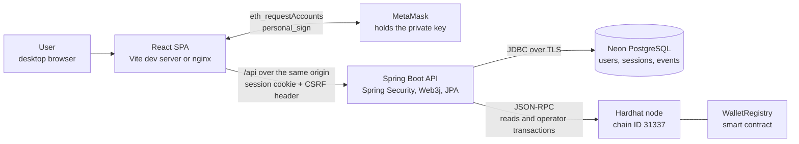
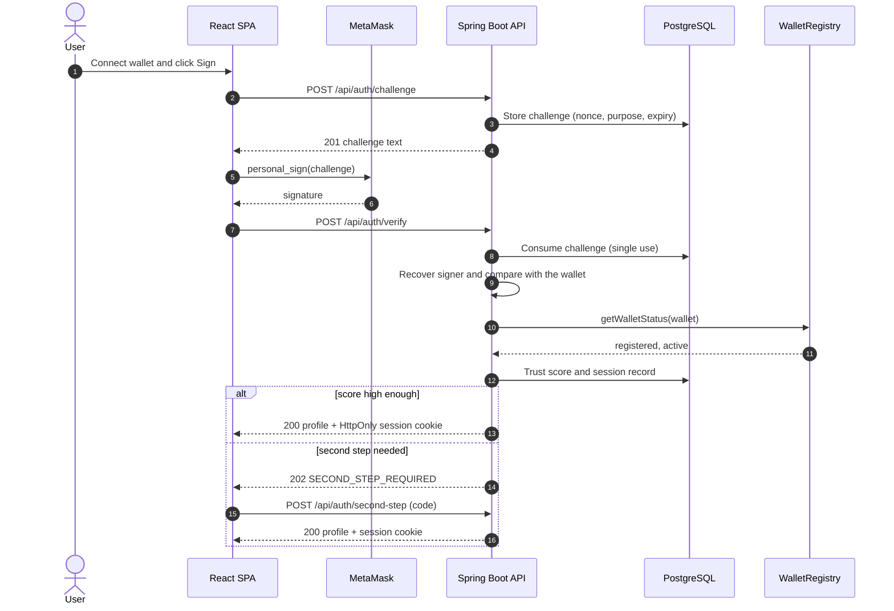

# BlockAuth

**Blockchain-based wallet authentication and identity verification.**

BlockAuth replaces passwords with proof of wallet ownership. A user signs a one-time message in
MetaMask; the backend verifies the signature, checks the wallet's status in an on-chain identity
registry (`WalletRegistry`), and only then opens a server-side session. Administrators can revoke a
wallet on the blockchain, which ends its sessions and blocks further sign-ins until it is reactivated.

It is intended for developers and evaluators who want a working reference of challenge-response wallet
login with an on-chain identity registry and a hardened, session-based web backend.

- No passwords anywhere: there is no password field, column or endpoint.
- The user's private key never leaves MetaMask; users only sign messages and never pay gas.
- The blockchain is the authority on whether a wallet is registered and active; the database mirrors it.

## Contents

- [Key features](#key-features)
- [System architecture](#system-architecture)
- [Sign-in workflow](#sign-in-workflow)
- [Tech stack](#tech-stack)
- [Project structure](#project-structure)
- [Getting started](#getting-started)
- [Environment variables](#environment-variables)
- [Running with Docker](#running-with-docker)
- [Testing](#testing)
- [API reference](#api-reference)
- [Database](#database)
- [Security](#security)
- [Deployment](#deployment)
- [Troubleshooting](#troubleshooting)
- [Known limitations](#known-limitations)
- [License](#license)

## Key features

**Wallet authentication**

- Registration and login by signing a one-time challenge with MetaMask (EIP-191 `personal_sign`).
- Challenges are random (128-bit nonce), bound to one wallet and one purpose, valid for 120 seconds and
  usable once; the signed text follows the Sign-In with Ethereum (EIP-4361) message format.
- Login succeeds only if the `WalletRegistry` contract reports the wallet as registered and active.
- Role-based access: `USER` and `ADMIN`. Administrators are bootstrapped from a configured wallet list.

**Administration and monitoring**

- Revoke and reactivate wallets on-chain; a revoked wallet's open sessions end on their next request.
- Admin dashboard with statistics, a user and wallet list, an on-chain status lookup, and logs of
  authentication events, security events (detected attacks) and sign-in risk scores.
- Every authentication outcome and every detected attack is recorded in the database.

**Account security**

| Feature | What it does |
|---|---|
| Sessions and devices | Users see every signed-in session and device and can sign any of them out, or sign out everywhere else. The server checks the session record on every request, so a signed-out session is refused on its next request. |
| New sign-in alerts | A sign-in on a new device is shown on the wallet's other sessions with "This was me" and "This was not me". Alerts are shown in the app only. |
| Second step | Optional authenticator-app codes (TOTP, RFC 6238) and ten one-time backup codes, asked for when a sign-in does not look like the wallet's usual one. |
| Trust score | Each verified sign-in is scored from 100 down (new device, new network, flagged wallet, repeated failures from the same address, device shared with a flagged wallet). Low scores require the second step, or are refused when the wallet has none. |
| Fresh signature for sensitive actions | Revoking or reactivating a wallet, the emergency stop, flags, second-step changes and API keys need a new wallet signature over a one-time message naming the action and its parameters. |
| Emergency stop | Pauses registrations, reactivations, second-step resets, flag removal and API-key creation, and optionally user sign-ins. Administrators can always sign in; revoking stays possible. |
| Waiting period for admin actions | Reactivating a wallet, resetting a second step and lifting the emergency stop take effect only after a configurable delay, during which any administrator can cancel them. |
| Read-only API keys | Administrator-owned keys for scripts, sent as `X-API-Key`, with scopes `users:read`, `audit:read` and `wallet-status:read`, valid for at most 90 days. |

## System architecture

One React single-page app, one Spring Boot backend, one smart contract and one PostgreSQL database.



| Component | Responsibility |
|---|---|
| Frontend (`frontend/`) | Pages, wallet connection, asking MetaMask for signatures, showing results. It never stores authentication state in web storage. |
| Backend (`backend/`) | Challenges, signature verification, contract reads and writes, sessions, authorization, validation, rate limiting and auditing. |
| Smart contract (`contracts/`) | The authoritative registered / active / revoked status per wallet. Only its admin account (the backend's operator key) can change it. |
| Database | Users and roles, the status mirror, challenges, sessions and devices, second-step data, audit events. |

Users never send blockchain transactions: the backend's operator account sends `registerWallet`,
`revokeWallet` and `activateWallet`, so MetaMask needs no ETH and no network switch.

## Sign-in workflow



Registration follows the same challenge-and-signature steps (`/api/auth/register/challenge`, then
`/api/auth/register`); after the signature checks out, the backend registers the wallet on-chain. It does
not create a session: the user logs in afterwards.

## Tech stack

| Layer | Technology |
|---|---|
| Frontend | React 19, React Router 7, JavaScript, plain CSS, Vite 8 |
| Wallet | MetaMask browser extension (EIP-1193 provider, `personal_sign`) |
| Backend | Java 21, Spring Boot 4.1, Spring Security, Spring Data JPA, Jakarta Bean Validation, Spring Boot Actuator (health only) |
| Blockchain client | Web3j 5 (contract calls, transaction signing, EIP-191 signature recovery) |
| Smart contract | Solidity 0.8.24, Hardhat 2 with `@nomicfoundation/hardhat-toolbox` |
| Database | Neon PostgreSQL, Flyway migrations |
| Build | Maven (wrapper included), npm |
| Testing | JUnit 5, Spring Boot Test, Mockito, Hardhat tests (Mocha/Chai), Postman collection, OWASP ZAP |
| Containers (optional) | Docker Compose: Hardhat node, backend (Eclipse Temurin 21), frontend (nginx) |

## Project structure

```text
.
├── backend/                     Spring Boot API (Maven)
│   ├── src/main/java/com/blockauth/
│   │   ├── auth/                challenges, signatures, registration, login, sessions, fresh signatures
│   │   ├── user/                own profile, history and wallet status
│   │   ├── admin/               wallet management, statistics, emergency stop, delayed actions
│   │   ├── blockchain/          Web3j client for WalletRegistry and startup checks
│   │   ├── session/             session records, devices, sign-in alerts
│   │   ├── secondstep/          authenticator codes and backup codes
│   │   ├── risk/                trust score and flagged wallets
│   │   ├── apikey/              read-only API keys
│   │   ├── audit/               authentication and security events
│   │   ├── security/            filters, rate limiting, access handling
│   │   ├── common/, config/     errors, validation helpers, configuration
│   ├── src/main/resources/      application*.yml, db/migration (Flyway)
│   └── src/test/java/           unit tests (*Test) and integration tests (*IT)
├── frontend/                    React SPA (Vite)
│   └── src/                     pages, components, API client, MetaMask wrapper, styles
├── contracts/                   Hardhat project: WalletRegistry.sol, deploy script, tests
├── postman/                     API regression collection
├── security-tests/zap/          OWASP ZAP notes and an API description for scans
├── docker-compose.yml           optional local stack
└── .env.example                 configuration template (placeholders only)
```

## Getting started

### Prerequisites

| Tool | Version |
|---|---|
| Git | any recent |
| JDK | 21 |
| Node.js and npm | 22 LTS |
| MetaMask | latest, in desktop Chrome |
| Neon account | free tier is enough |
| Docker Desktop | optional |

Maven is not needed separately: use the wrapper in `backend/` (`mvnw.cmd` on Windows, `./mvnw` elsewhere).
Commands below are for PowerShell; macOS/Linux equivalents follow `#` where they differ.

### 1. Clone and configure

```powershell
git clone https://github.com/abhinandbs12/ai-augmented-decentralized-authentication-system.git blockauth
cd blockauth
Copy-Item .env.example .env.local    # cp .env.example .env.local
```

All settings live in `.env.local` in the repository root (git-ignored). See
[Environment variables](#environment-variables).

### 2. Database

In the Neon console create a project and add a second branch, `test`, for the integration tests. For
each branch open *Connection details*, choose the direct (non-pooled) host, and fill `DB_*` (the
application's branch) and `TEST_DB_*` (`test`) in `.env.local`:

```text
DB_URL=jdbc:postgresql://<host>/<database>?sslmode=require
DB_USERNAME=<role>
DB_PASSWORD=<password>
```

Flyway creates the tables when the backend starts.

### 3. Smart contract

```powershell
cd contracts
npm install
npx hardhat test
npx hardhat node                                         # terminal A, keep it running
```

Copy the private key of **Account #0** from the node's output into `BLOCKCHAIN_OPERATOR_PRIVATE_KEY`,
then deploy from a second terminal in `contracts/`:

```powershell
npx hardhat run scripts/deploy.js --network localhost
```

Copy the printed address into `CONTRACT_ADDRESS`. The keys printed by `hardhat node` are public test
keys: use them only on the local chain.

### 4. Administrator wallet and second-step key

- Put the address of the MetaMask account that should be administrator into `BLOCKAUTH_ADMIN_WALLETS`.
  Use a different account to test as a normal user.
- Generate `SECOND_STEP_ENCRYPTION_KEY` (32 random bytes, Base64), for example:

  ```powershell
  $b = New-Object byte[] 32; [Security.Cryptography.RandomNumberGenerator]::Create().GetBytes($b); [Convert]::ToBase64String($b)
  ```

  or `openssl rand -base64 32`.

### 5. Backend

```powershell
cd backend
.\mvnw.cmd spring-boot:run                               # ./mvnw spring-boot:run
```

At startup the backend applies the migrations and checks the chain: the chain ID, that the contract
address has code, and that the operator key is the contract's admin. It refuses to start on a mismatch.

### 6. Frontend

```powershell
cd frontend
npm install
npm run dev
```

Open `http://localhost:5173`. The Vite dev server proxies `/api` to `http://localhost:8080`, so the app
and the API share one origin.

### 7. Check that it works

- `curl.exe http://localhost:8080/actuator/health` returns `{"status":"UP"}`.
- Register the administrator wallet and log in: the admin dashboard appears.
- Register and log in with a second wallet: the user dashboard appears, and `/admin` shows a
  "no permission" page.
- As administrator, revoke the second wallet: its next request is signed out and its next login is
  refused.

## Environment variables

Defined in `.env.local` (copied from `.env.example`). Real environment variables override the file. The
frontend and the contracts project need none.

| Variable | Purpose | Required |
|---|---|---|
| `DB_URL`, `DB_USERNAME`, `DB_PASSWORD` | JDBC URL, role and password of the application's Neon branch | Yes |
| `TEST_DB_URL`, `TEST_DB_USERNAME`, `TEST_DB_PASSWORD` | Neon `test` branch used by the integration tests | For tests |
| `BLOCKCHAIN_RPC_URL` | JSON-RPC endpoint (`http://127.0.0.1:8545` locally) | Yes |
| `BLOCKCHAIN_CHAIN_ID` | Expected chain ID (`31337` locally) | Yes |
| `CONTRACT_ADDRESS` | Deployed `WalletRegistry` address | Yes |
| `BLOCKCHAIN_OPERATOR_PRIVATE_KEY` | Key of the contract's admin account; signs register, revoke and activate transactions | Yes |
| `BLOCKAUTH_ADMIN_WALLETS` | Comma-separated wallet addresses that receive the `ADMIN` role when they register | To have an administrator |
| `APP_ORIGIN` | Exact origin of the web app (`http://localhost:5173` locally) | Yes |
| `CHALLENGE_TTL_SECONDS` | Challenge lifetime, default `120` | No |
| `SESSION_TIMEOUT` | Idle session timeout, default `30m` | No |
| `SESSION_COOKIE_SECURE` | `Secure` cookie flag: `false` on `http://localhost`, `true` when deployed | No |
| `SPRING_PROFILES_ACTIVE` | `dev`, `test` or `prod` (as a real environment variable) | No |
| `SECOND_STEP_ENCRYPTION_KEY` | 32 random bytes, Base64; encrypts authenticator secrets and keys the backup-code hashes | Yes |
| `TRUSTED_DEVICE_DAYS` | Days a device stays trusted after passing the second step, default `30` | No |
| `ADMIN_ACTION_DELAY` | Waiting period for delayed admin actions, default `10m` (between `1s` and `7d`) | No |

`DB_PASSWORD`, `TEST_DB_PASSWORD`, `BLOCKCHAIN_OPERATOR_PRIVATE_KEY` and `SECOND_STEP_ENCRYPTION_KEY` are
secrets: never commit them. Changing `SECOND_STEP_ENCRYPTION_KEY` makes every enrolled second step and
backup code unusable.

## Running with Docker

Docker Compose runs the Hardhat node, the backend and the frontend (nginx with the production security
headers) on ports 8545, 8080 and 3000, published on `127.0.0.1` only. The database stays on Neon, so
`.env.local` must hold the `DB_*` values. Stop any local `hardhat node` and backend first.

```powershell
docker compose up -d --build hardhat
docker compose logs hardhat                              # copy Account #0's key into BLOCKCHAIN_OPERATOR_PRIVATE_KEY
docker compose exec hardhat npx hardhat run scripts/deploy.js --network localhost
docker compose up -d --build backend frontend            # after setting CONTRACT_ADDRESS
```

Open `http://localhost:3000`. `docker compose down` discards the chain: deploy again and reset the
development data (see [Troubleshooting](#troubleshooting)).

## Testing

| What | Needs | Command |
|---|---|---|
| Contract tests | nothing running | `cd contracts; npx hardhat test` |
| Backend unit tests | nothing running | `cd backend; .\mvnw.cmd test` |
| Backend unit and integration tests | `TEST_DB_*` in `.env.local` | `cd backend; .\mvnw.cmd verify` |
| Same, plus tests against the real chain | `hardhat node` running with the contract deployed | `cd backend; .\mvnw.cmd verify -Pblockchain-it` |
| Frontend production build | nothing running | `cd frontend; npm run build` |

The integration tests run the real application over HTTP with real signatures against the Neon `test`
branch, and empty its tables before every test: never point `TEST_DB_*` at the application's branch.

- **Postman:** import `postman/BlockAuth.postman_collection.json` and run it against the local stack. It
  covers unsigned authentication checks, authorization, validation and injection, CSRF, rate limiting and
  the admin endpoints. For requests marked USER or ADMIN, copy the `BLOCKAUTH_SESSION` cookie from the
  browser into the `userSession` or `adminSession` variable. Postman cannot produce wallet signatures, so
  it checks that signed actions are refused without one.
- **OWASP ZAP:** `security-tests/zap/README.md` describes baseline, full and API scans of a local stack.

## API reference

All endpoints are under `/api` on the same origin as the app. Requests and responses are JSON; every
`POST` needs the `X-XSRF-TOKEN` header (the token comes from `GET /api/auth/csrf`). Errors use one
standard body: `status`, `code`, `message`, `timestamp`, `path`, `errorId`, `fieldErrors`.

**Authentication** (public unless noted)

| Method | Endpoint | Description |
|---|---|---|
| GET | `/api/auth/csrf` | Issue the CSRF token |
| POST | `/api/auth/register/challenge` | Challenge for registering a wallet |
| POST | `/api/auth/register` | Verify the signature and register the wallet on-chain |
| POST | `/api/auth/challenge` | Challenge for signing in |
| POST | `/api/auth/verify` | Verify the signature and sign in (`200`), or ask for the second step (`202`) |
| POST | `/api/auth/second-step` | Finish a sign-in with an authenticator or backup code |
| POST | `/api/auth/step-up` | Challenge for confirming a sensitive action (signed-in users) |
| POST | `/api/auth/logout` | End the session |

**Signed-in user** (`USER` or `ADMIN`; always the caller's own data)

| Method | Endpoint | Description |
|---|---|---|
| GET | `/api/users/me` | Own profile |
| GET | `/api/users/authentication-history` | Own authentication events, paginated |
| GET | `/api/users/wallet-status` | Own wallet's status read from the blockchain |
| GET | `/api/users/sessions` | Signed-in sessions |
| POST | `/api/users/sessions/{id}/end`, `/api/users/sessions/end-others` | Sign out one session, or all others |
| GET | `/api/users/devices` | Devices used to sign in |
| POST | `/api/users/devices/{id}/remove` | Forget a device and sign it out |
| GET | `/api/users/alerts` | New sign-in alerts |
| POST | `/api/users/alerts/{id}/confirm`, `/api/users/alerts/{id}/sign-out` | "This was me" / "This was not me" |
| GET | `/api/users/second-step` | Second-step status |
| POST | `/api/users/second-step/setup`, `/enable`, `/disable`, `/backup-codes` | Set up, turn on or off, renew backup codes |

**Administration** (`ADMIN`; the read endpoints marked * also accept a read-only API key with the matching scope)

| Method | Endpoint | Description |
|---|---|---|
| GET | `/api/admin/users` * | Users and wallets, filterable |
| GET | `/api/admin/authentication-events` *, `/api/admin/security-events` * | Audit logs, filterable |
| GET | `/api/admin/statistics` * | Aggregate counts |
| GET | `/api/admin/login-assessments` * | Sign-in trust scores |
| GET | `/api/blockchain/wallet/{address}` *, `/api/blockchain/verify/{address}` * | Any wallet's on-chain status / validity |
| POST | `/api/admin/wallet/{address}/revoke` | Revoke a wallet on-chain (immediate) |
| POST | `/api/admin/wallet/{address}/activate` | Request reactivation (`202`, carried out after the waiting period) |
| POST | `/api/admin/wallet/{address}/second-step/reset` | Request a user's second-step reset (`202`) |
| GET, POST | `/api/admin/wallet-flags` | List or flag suspicious wallets |
| POST | `/api/admin/wallet-flags/{address}/remove` | Remove a flag |
| GET | `/api/admin/emergency-stop` | Emergency stop state |
| POST | `/api/admin/emergency-stop/activate`, `/api/admin/emergency-stop/lift` | Switch on (immediate) / request lifting (`202`) |
| GET | `/api/admin/actions` | Delayed actions and their status |
| POST | `/api/admin/actions/{id}/cancel` | Cancel a waiting action |
| GET, POST | `/api/admin/api-keys` | List or create read-only API keys |
| POST | `/api/admin/api-keys/{id}/revoke` | Revoke an API key |

Revoke, activate, second-step reset, flags, the emergency stop, API-key creation and the user's own
second-step changes require a `proof` (a fresh signature obtained through `/api/auth/step-up`).
`GET /actuator/health` reports liveness without details.

## Database

PostgreSQL on Neon, with the schema owned by Flyway (`backend/src/main/resources/db/migration`) and
Hibernate validating the entities against it at startup. Wallet addresses are stored lowercase, times as
`TIMESTAMPTZ` in UTC, and enumerated values are enforced with `CHECK` constraints.

| Migration | Tables |
|---|---|
| `V1__init_schema.sql` | `users`, `authentication_challenges`, `authentication_events`, `security_events` |
| `V2__security_features.sql` | `devices`, `user_devices`, `user_sessions`, `sign_in_alerts`, `second_factors`, `backup_codes`, `wallet_flags`, `login_assessments`, `emergency_stop`, `admin_actions`, `api_keys` |

The contract stores only each wallet's status and registration time. Personal data (IP addresses, user
agents) and all secrets stay off-chain. No secret is stored in plain form: device tokens and API keys are
stored as SHA-256 hashes, backup codes as keyed HMACs, and authenticator secrets encrypted with AES-256-GCM.

## Security

- **Sessions:** server-side sessions in an `HttpOnly`, `SameSite=Strict` cookie (`BLOCKAUTH_SESSION`),
  regenerated at login, with an idle timeout; every request re-checks the session record and the user's
  current role and status.
- **CSRF:** a token on every `POST` and an `Origin` check against `APP_ORIGIN`.
- **Authorization:** deny by default; roles come only from the database; user endpoints never take a user
  ID.
- **Input:** strict validation (addresses with EIP-55 checksum, signature format, enum filters), unknown
  JSON fields rejected, 16 KB body limit.
- **Abuse:** rate limits of 10 challenge and 10 verification requests per minute per address and 120 other
  API requests per minute; 10 failed sign-ins in 15 minutes block the address for 15 minutes.
- **Fail closed:** if the blockchain or the database cannot answer, sign-in fails; if the trust check
  fails, the sign-in is never let through on the signature alone (it asks for the second step, or is
  refused when the wallet has none).
- **Headers:** the API sends a restrictive Content-Security-Policy, `X-Frame-Options: DENY`, `nosniff`
  and `no-referrer`; the nginx frontend sends its own CSP.
- **Contract:** only the admin account can change state; no payable functions, no external calls.

## Deployment

No hosted deployment is configured. The repository provides:

- **Docker Compose** for a complete local stack (see [Running with Docker](#running-with-docker)).
- A **`prod` Spring profile** for running behind an HTTPS reverse proxy: it honours `X-Forwarded-*`
  headers (so rate limits use the real client address and HSTS is sent) and forces `Secure` cookies.

Any deployment outside `localhost` must use HTTPS. Take a database snapshot before applying new migrations
to an existing database.

## Troubleshooting

| Symptom | Cause and fix |
|---|---|
| Backend stops at startup with a blockchain error | Wrong chain ID, no contract code at `CONTRACT_ADDRESS`, or the operator key is not the contract admin. Usually the chain was restarted: deploy again and update `CONTRACT_ADDRESS`. If the node is simply down, the backend starts and answers 503 on chain-backed requests. |
| Backend stops naming `SECOND_STEP_ENCRYPTION_KEY` | The value is missing or not 32 bytes in Base64. Generate one as shown above. |
| Login says the wallet is not registered although it was | The local chain was reset. Deploy again, empty the application tables on your development branch, restart the backend and register again. |
| `Port 8080 was already in use` | Another program holds the port; the ports (5173, 8080, 8545, and 3000 with Docker) are fixed. |
| `429` "Too many failed attempts" | Ten failed sign-ins from one address block it for 15 minutes. Limits are in memory; restarting the backend clears them. |
| MetaMask shows nothing after a click | A request is already waiting in the extension. Open MetaMask and answer it. |
| "Registration is incomplete" at login | The wallet was registered on-chain but the user row was not saved. Run registration again; no second transaction is sent. |
| An address in `BLOCKAUTH_ADMIN_WALLETS` logs in as a normal user | The role is given once, at registration, and the list is read at startup. Register after listing the address and restarting the backend. |
| Login asks for a verification code | The wallet has the second step on and the sign-in scored below the "allow" threshold (for example a new device). Enter the authenticator or a backup code in the same browser within five minutes. |
| Login refused as not looking like usual sign-ins | The trust score was too low and the wallet has no second step. Sign in from a known device or turn on the second step. |
| A reactivation did not happen yet | It waits for `ADMIN_ACTION_DELAY` (and for the emergency stop to be lifted). Admin → Controls shows its status. |
| First request after a break is slow | Neon suspends idle databases; the first connection wakes it. |

To empty the development data after a chain reset, run this in the Neon SQL editor on the application's
branch (it deletes every user and event there):

```sql
TRUNCATE users, authentication_challenges, authentication_events, security_events RESTART IDENTITY CASCADE;
```

## Known limitations

- Single backend instance: sessions, rate-limit counters and pending second-step attempts live in memory
  and are lost on restart.
- Sign-in alerts are shown in the app only; no e-mail or push notifications exist.
- The emergency stop and the waiting period are enforced by the backend; whoever holds the operator key
  can still call the contract directly.
- Trust-score thresholds and penalties, and the default `ADMIN_ACTION_DELAY`, are starting values rather
  than tuned figures.
- Supported browser: desktop Chrome with the MetaMask extension. Mobile is not supported.
- Only one local chain (Hardhat, chain ID 31337) is configured; no public network is set up.

## License

No license file is included in this repository.
